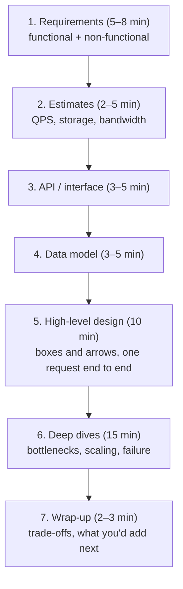
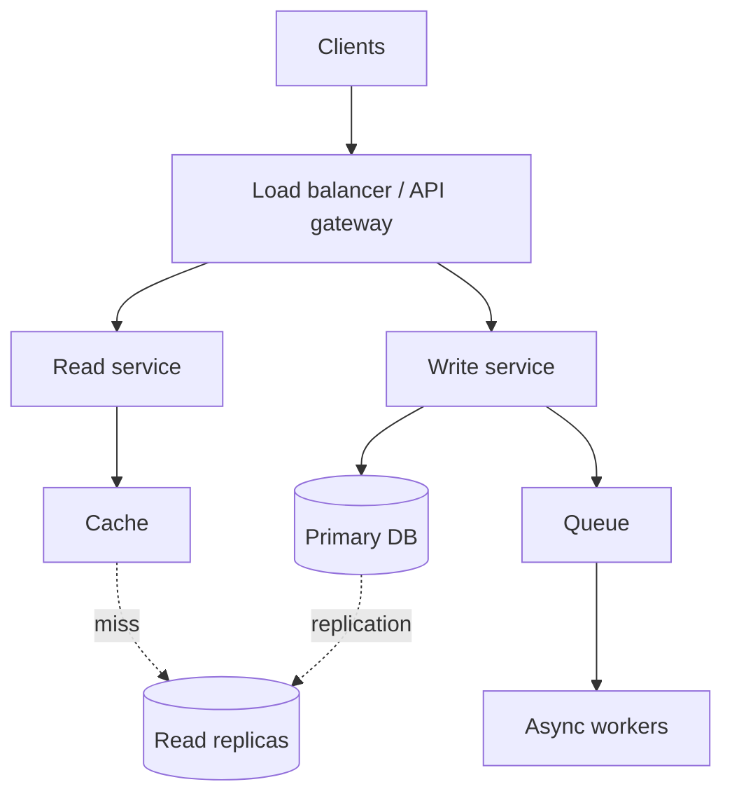

# The System Design Interview Framework

[⬅ Back to index](../README.md)

Covers: how the round is scored, a step-by-step 45-minute framework, requirements, API and data model, high-level design, deep dives, trade-offs, what changes by level, common mistakes and how to practise.

---

### 1. What is a system design interview actually testing?

<details>
<summary>Answer</summary>

It's not testing whether you know the "correct" architecture; there isn't one. Interviewers score you on roughly four things:

- **Problem navigation** – do you clarify an ambiguous prompt, scope it, and focus on what matters most?
- **Solution design** – can you produce a working high-level design whose parts fit together and meet the requirements?
- **Technical depth** – can you go deep on one or two hard parts (data model, scaling a hot path, consistency) and justify choices with numbers?
- **Communication and trade-offs** – do you explain *why*, compare options, accept hints, and adjust when the interviewer pushes?

A candidate who draws a simpler design but explains every trade-off clearly usually beats one who drops buzzwords (Kafka, Cassandra, Kubernetes) without reasons.

</details>

### 2. What's a good step-by-step framework for a 45–60 minute round?

<details>
<summary>Answer</summary>



1. **Requirements** – list 3–5 core features and agree on scope. List non-functional needs: scale, latency, availability vs consistency, durability.
2. **Estimates** – only the numbers that drive decisions (read/write QPS, storage per year, peak bandwidth).
3. **API** – the main endpoints or RPCs with request and response shapes.
4. **Data model** – entities, key fields, access patterns, and which store fits.
5. **High-level design** – clients, load balancer, services, databases, caches, queues. Walk one read and one write through it.
6. **Deep dives** – pick the 2–3 hardest parts (or let the interviewer choose): hot keys, fan-out, consistency, sharding, failure handling.
7. **Wrap-up** – summarise, call out bottlenecks and what you'd improve with more time (monitoring, security, cost).

Keep talking throughout, and check in: "Does this scope work for you?" "Should I go deeper on the feed or on storage?"

</details>

### 3. How do you gather requirements well?

<details>
<summary>Answer</summary>

Split them and write them on the board:

**Functional (what the system does)** – ask "who are the users and what are the top 3 things they do?" Then explicitly mark out-of-scope items ("no DMs, no ads ranking").

**Non-functional (how well it does it)** – the ones that change the architecture:
- **Scale** – DAU/MAU, requests per second, data size, growth.
- **Read/write ratio** – read-heavy systems want caches and replicas; write-heavy want partitioning, queues and LSM stores.
- **Latency** – p99 targets for the hot path (e.g. feed load < 200 ms).
- **Availability vs consistency** – can users see stale data briefly (feed likes) or never (bank balance, seat booking)?
- **Durability** – can we ever lose data?
- **Geography** – single region or global? Data-residency rules?
- **Special constraints** – real-time, offline, cost, privacy.

Good clarifying questions show seniority. Don't spend more than ~8 minutes, though: make reasonable assumptions and state them.

</details>

### 4. How should you design the API in the interview?

<details>
<summary>Answer</summary>

Write the 3–6 endpoints that cover the functional requirements, with key parameters:

```
POST /v1/urls            { longUrl, customAlias?, expiresAt? } → { shortUrl }
GET  /{code}             → 301/302 redirect
GET  /v1/feed?cursor=…&limit=20 → { items[], nextCursor }
```

Points that score well:
- Pick the style and say why: **REST** (simple, cacheable), **gRPC** (internal service-to-service, low latency, streaming), **GraphQL** (many clients needing different shapes), **WebSocket/SSE** (server push).
- **Cursor pagination** for feeds and lists, not offset.
- **Idempotency keys** on writes that must not double-apply (payments, orders).
- Auth (the user comes from the token, not a parameter), rate limits and versioning (`/v1`).

</details>

### 5. How do you choose a data model and database in the interview?

<details>
<summary>Answer</summary>

Start from **entities and access patterns**, not from a favourite database:

1. List the entities (User, Tweet, Follow…) and the key fields.
2. List the queries: "get a user's timeline sorted by time", "get a URL by code", "count likes".
3. Choose the store that serves those queries efficiently:
   - **Relational (Postgres/MySQL)** – relationships, transactions, flexible queries, moderate scale. A good default.
   - **Key-value / wide-column (DynamoDB, Cassandra)** – huge scale, simple lookups by key, high write throughput.
   - **Document (MongoDB)** – flexible nested records.
   - **Search (Elasticsearch)** – full-text and faceted search.
   - **Blob storage (S3)** – images, video, files; keep only metadata in the DB.
   - **Graph DB** – deep relationship traversals.
4. Say how it scales: indexes, replicas, the **partition key**.

Saying "Postgres, sharded by user_id, with read replicas" plus why is better than naming five databases.

</details>

### 6. How do you present the high-level design?

<details>
<summary>Answer</summary>

Draw the minimum set of boxes that serve the requirements, then **walk a request through it**:



- Start simple (one service + one DB) and evolve it as you hit requirements ("this won't handle 50K writes/s, so…"). This shows reasoning, not memorisation.
- Separate read and write paths when the ratio is skewed.
- Name what each arrow carries (sync HTTP, async event).
- Keep it legible; you'll add detail in deep dives.

</details>

### 7. What should you cover in deep dives?

<details>
<summary>Answer</summary>

Pick the parts where the system would actually break:
- **Scaling the hot path** – caching, sharding strategy, hot keys and celebrities, fan-out.
- **Data consistency** – what happens on concurrent writes, double submits, partial failures (transactions, idempotency, sagas).
- **Failure handling** – a node, DB or region goes down: replication, failover, retries with backoff, graceful degradation.
- **Bottleneck numbers** – "one Postgres primary handles ~5–10K writes/s; we need 50K, so we partition by…"
- **Special features** – ranking, search, real-time delivery, geo queries.

Often the interviewer steers you ("what if a celebrity with 100M followers posts?"). Treat that as the point of the round, not an interruption.

</details>

### 8. How do you discuss trade-offs convincingly?

<details>
<summary>Answer</summary>

Use the pattern **"Option A vs B → what we gain → what we pay → why it fits our requirements"**:

> "We could fan out on write so feeds are precomputed: reads become one cache lookup, but a celebrity post means 100M writes. Fan-out on read avoids that but makes every feed load expensive. Since reads are 100× writes, I'll fan out on write for normal users and merge celebrity posts at read time."

Common axes: consistency vs availability, latency vs throughput, read cost vs write cost, simplicity vs flexibility, cost vs performance, build vs buy. Always tie the decision back to a stated requirement.

</details>

### 9. How does the expectation change from mid-level to senior to staff?

<details>
<summary>Answer</summary>

| Level | Expected |
|---|---|
| **Mid (L4/E4)** | A working, reasonable design with some prompting. Knows the building blocks (cache, LB, DB, queue) and basic trade-offs. |
| **Senior (L5/E5)** | Drives the interview. Clear requirements, sensible numbers, solid data model, goes deep on 2–3 areas, proactively raises failure modes and bottlenecks. |
| **Staff+ (L6+)** | Designs for evolution and operations: multi-region, migrations, cost, team boundaries, observability, rollout. Spots the subtle problems (hot partitions, consistency anomalies) before being asked and weighs organisational trade-offs. |

The same prompt ("design a news feed") is used across levels; depth and ownership of the conversation are what differ.

</details>

### 10. What are the most common mistakes candidates make?

<details>
<summary>Answer</summary>

- Jumping into boxes without clarifying requirements.
- Over-engineering from the start (microservices, Kafka and five databases for 1,000 users).
- Naming technologies without saying why ("use Cassandra").
- Spending 15 minutes on estimates, or doing maths that never influences a decision.
- Ignoring the data model and the partition key.
- Never discussing failures, consistency or bottlenecks.
- Going silent; the interviewer can only score what they hear.
- Defending a choice stubbornly when the interviewer hints at a problem.
- Running out of time before any deep dive.

</details>

### 11. What if you don't know a technology the interviewer mentions?

<details>
<summary>Answer</summary>

Say so honestly, then reason from first principles: "I haven't used Spanner directly, but if it gives externally consistent transactions across regions, that removes the need for my saga here at the cost of write latency." Interviewers care about reasoning about properties (consistency, latency, throughput, failure behaviour) more than specific product knowledge. Describing a component by its properties ("a durable, partitioned log") is always acceptable.

</details>

### 12. How do you handle a prompt that's too big ("Design YouTube")?

<details>
<summary>Answer</summary>

Narrow it immediately and explicitly: "YouTube has upload, transcoding, streaming, search, recommendations, comments and ads. In 45 minutes I'd like to focus on **upload + processing + playback** and treat search and recommendations as black boxes. Does that work?" Then design those parts well. Mention the rest in the wrap-up. Interviewers expect you to scope; trying to cover everything shallowly scores worse.

</details>

### 13. How should you use the whiteboard or drawing tool?

<details>
<summary>Answer</summary>

- Keep separate areas for **requirements, estimates, API, data model and diagram** so you can point back to them.
- Draw left to right or top to bottom in request order: client → edge → services → storage.
- Label arrows (sync/async, protocol) and stores (type, partition key).
- When you change the design, update the diagram rather than redrawing everything.
- In virtual interviews (Excalidraw, Miro, CoderPad drawing), practise with the tool beforehand; fumbling costs minutes.

</details>

### 14. What's the difference between high-level design (HLD) and low-level design (LLD) rounds?

<details>
<summary>Answer</summary>

- **HLD / system design** – distributed architecture: services, storage, scaling, consistency, failure. "Design Twitter."
- **LLD / object-oriented design / machine coding** – classes, interfaces, design patterns and often working code for a contained problem. "Design a parking lot", "implement an LRU cache or rate limiter class."
- **Product / API design** (e.g. Meta's "product architecture") – emphasises APIs, data models and client-server interaction over infrastructure.
- **Mobile system design** – the client architecture plus its contract with the backend.

Ask the recruiter which variant you'll get. This repo covers all four: see [Low-Level Design](21-low-level-design.md) and [Mobile System Design](19-mobile-system-design.md).

</details>

### 15. How should you practise for system design interviews?

<details>
<summary>Answer</summary>

1. Learn the building blocks first (topics 02–15 of this repo).
2. Work through the classic designs (topics 16–18) **out loud, timed at 45 minutes**, drawing as you go.
3. For each one, explicitly write the trade-offs and the "what if 10× traffic / a region fails" follow-ups.
4. Do mock interviews with a peer; being interrupted and redirected is a skill.
5. Read real engineering blogs (Netflix, Uber, Discord, Stripe, Meta, Pinterest) to see how real systems evolved.
6. Revise the [scenario questions](20-scenario-based.md), which many companies use as follow-ups.

</details>

---

[⬅ Back to index](../README.md) · [Next: Back-of-the-Envelope Estimation ➡](02-estimation.md)
