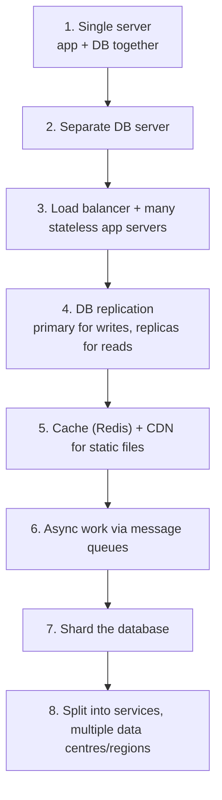

# Scalability Fundamentals

[⬅ Back to index](../README.md)

Covers: vertical vs horizontal scaling, stateless services, latency vs throughput, availability, SLA/SLO/SLI, read vs write scaling, the evolution from one server to millions of users, bottlenecks and cost.

---

### 1. What is scalability?

Answer

A system is **scalable** if it can handle more load (users, data, requests) by adding resources, **without a redesign** and with roughly proportional cost. Load is described by load parameters: requests/s, read/write ratio, concurrent users, data size, fan-out.

Scalability is different from performance: a system can be fast for one user (performance) but collapse at 10K users (scalability).

### 2. Vertical vs horizontal scaling?

Answer

| | Vertical (scale up) | Horizontal (scale out) |
|---|---|---|
| How | Bigger machine (CPU, RAM, disk) | More machines |
| Pros | Simple, no code changes, no distribution problems | Near-unlimited, fault tolerant, can use cheap hardware |
| Cons | Hard ceiling, expensive at the top, single point of failure | Needs load balancing, stateless design, data partitioning, deals with network failures |

In practice: scale **stateless app servers horizontally**, and scale databases vertically first (it's simpler), then add replicas and shards when you must. Modern big machines (hundreds of cores, TBs of RAM) push the vertical limit far, so don't shard prematurely.

### 3. Why should services be stateless?

Answer

A **stateless** server keeps no client data between requests; session and state live in a shared store (Redis, a DB) or in the client token (JWT). Benefits:
- Any server can handle any request → simple load balancing, no sticky sessions.
- Add or remove servers freely (autoscaling).
- A crashed server loses nothing.

State still exists, it just moves to systems designed for it (databases, caches, object storage), which are scaled separately.

### 4. Latency vs throughput?

Answer

- **Latency** – time for one request (ms). Measure percentiles: **p50, p95, p99, p99.9**, not the average. A p99 of 2 s means 1 in 100 requests is slow, and with fan-out to many services, tail latency dominates.
- **Throughput** – requests (or bytes) per second the system handles.

They interact: as utilisation approaches 100%, queues build and latency explodes (queueing theory). Aim for headroom (e.g. run at ≤60–70% CPU). Batching improves throughput but adds latency; parallelism and caching reduce latency.

### 5. What are SLA, SLO and SLI?

Answer

- **SLI (indicator)** – a measured metric: "% of requests that succeed in < 300 ms".
- **SLO (objective)** – the internal target for an SLI: "99.9% over 30 days".
- **SLA (agreement)** – a contract with customers with penalties (credits) if missed; usually looser than the SLO.

An **error budget** = 100% − SLO (0.1% ≈ 43 min/month). If you have budget left, ship faster; if it's spent, freeze risky releases and fix reliability. This is a core SRE practice.

### 6. Availability vs reliability vs durability?

Answer

- **Availability** – the fraction of time the system serves requests successfully (uptime).
- **Reliability** – the system works correctly over time (correct results, no failures).
- **Durability** – once data is acknowledged, it isn't lost (S3 advertises 11 nines of durability).

A system can be available but unreliable (returns wrong data), or durable but unavailable (data safe, service down). Improve availability with redundancy and failover; durability with replication, backups and checksums.

### 7. How does a system evolve from one server to millions of users?

Answer

At each step, add the next piece only when a measured bottleneck demands it. This "start simple, then evolve" story is exactly what interviewers want to hear.

### 8. How do you scale reads?

Answer

- **Caching** at every layer: client, CDN, application cache (Redis), DB buffer pool.
- **Read replicas** – route reads to followers (accept replication lag, or read-your-writes from the primary).
- **Denormalisation and precomputation** – materialised views, precomputed feeds, counters.
- **Indexes** that match the query patterns.
- **CDN** for static and cacheable dynamic content.
- **Search indexes** for complex queries instead of hitting the primary DB.

### 9. How do you scale writes?

Answer

Writes are harder because each must land on the owner of the data:
- **Sharding/partitioning** – spread writes across nodes by a key.
- **Async writes via queues** – accept fast, process later; smooths spikes.
- **Batching** – group many small writes.
- **Write-optimised storage** – LSM-tree databases (Cassandra, RocksDB) turn random writes into sequential ones.
- **Reduce write amplification** – fewer indexes, avoid hot rows (e.g. sharded counters).
- **CQRS** – separate the write model from read models updated asynchronously.

### 10. What is a single point of failure (SPOF) and how do you remove it?

Answer

A SPOF is any component whose failure takes the whole system down: one load balancer, one database primary without failover, one region, one DNS provider, even one engineer's laptop with the deploy keys. Remove it with **redundancy** (N+1, active-active or active-passive), **health checks and automatic failover**, replication across availability zones, and testing failover regularly (chaos engineering).

### 11. What is the difference between active-active and active-passive?

Answer

- **Active-passive** – one node or region serves traffic; a standby takes over on failure. Simpler, no write conflicts, but the standby is idle cost, and failover takes time (seconds to minutes) and may lose un-replicated writes.
- **Active-active** – all nodes or regions serve traffic. Better utilisation and latency (users hit the nearest), instant failover, but concurrent writes in different places need conflict handling (partition data by home region, or use CRDTs/last-write-wins, or a globally consistent DB).

### 12. What is autoscaling and what are its pitfalls?

Answer

Automatically adding or removing instances based on metrics (CPU, request rate, queue depth) or schedules. Pitfalls:
- **Scaling lag** – new instances take minutes; pre-scale for known events (sales, launches).
- **Cold starts** – JIT warm-up, empty caches.
- **Downstream limits** – app servers scale, but the database doesn't; you just move the bottleneck.
- **Thrashing** – scaling up and down repeatedly; use cooldowns.
- Scale on the right metric: for workers, use **queue depth/lag**, not CPU.

### 13. What is a bottleneck and how do you find one?

Answer

The component that limits overall throughput (the slowest stage). Find it with metrics and profiling: saturation of CPU, memory, disk I/O, network, connection pools, locks, thread pools; queue lengths growing; latency percentiles per hop (distributed tracing). Fix the biggest bottleneck, then measure again; the next one appears (Amdahl's law: speeding up a small part barely helps).

### 14. What are the "fallacies of distributed computing"?

Answer

Assumptions that are always false in distributed systems:
1. The network is reliable.
2. Latency is zero.
3. Bandwidth is infinite.
4. The network is secure.
5. Topology doesn't change.
6. There is one administrator.
7. Transport cost is zero.
8. The network is homogeneous.

Designs must handle timeouts, retries, duplicates, partial failures and reordering. Mentioning this when you add a network hop shows maturity.

### 15. How do cost considerations affect design?

Answer

At scale, cost is a real requirement. Levers:
- Right-size instances and use autoscaling; spot/preemptible instances for batch work.
- **Storage tiering** – hot SSD → object storage → archive (Glacier) with lifecycle policies.
- **Egress** – cross-region and internet egress is expensive; use CDNs and keep chatty services in the same zone.
- Caching reduces database cost.
- Compression and efficient formats (Protobuf, Parquet).
- Managed vs self-hosted: managed costs more per unit but less engineering time.

Staff-level candidates mention cost unprompted.

### 16. What are the main ways to partition a system's work?

Answer

The **Scale Cube**:
- **X-axis – cloning**: run identical copies behind a load balancer.
- **Y-axis – functional decomposition**: split by function or service (users, orders, payments).
- **Z-axis – data partitioning**: each server handles a subset of the data (sharding by user ID, region).

Large systems use all three: many copies of each service, each service owning its data, and that data sharded.

---

[⬅ Previous: Back-of-the-Envelope Estimation](02-estimation.md) · [⬅ Back to index](../README.md) · [Next: Networking & Protocols ➡](04-networking-protocols.md)
