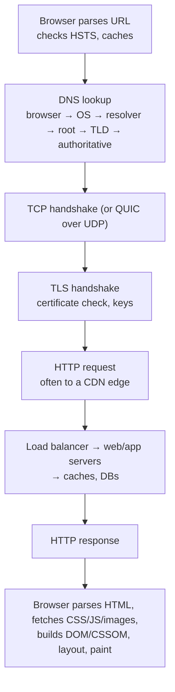

# Networking & Protocols

[⬅ Back to index](../README.md)

Covers: what happens when you type a URL, DNS, TCP vs UDP, HTTP/1.1 vs 2 vs 3, TLS, REST vs GraphQL vs gRPC, WebSockets, SSE, long polling, webhooks, CDNs, API design and pagination.

---

### 1. What happens when you type a URL into the browser and press Enter?

Answer

Mention the caches at each layer (browser, OS DNS cache, CDN), connection reuse (keep-alive, HTTP/2), and that the server side may involve a CDN, load balancer, reverse proxy, application servers and databases. Interviewers use this to see how far down the stack you can go.

### 2. How does DNS work?

Answer

DNS maps names to IP addresses through a hierarchy:
1. The client asks a **recursive resolver** (ISP, 8.8.8.8, 1.1.1.1).
2. The resolver asks a **root server** → gets the **TLD server** for `.com`.
3. The TLD server points to the domain's **authoritative name server**.
4. The authoritative server returns the record (A/AAAA for IPs, CNAME alias, MX mail, TXT, NS).

Answers are cached according to **TTL**. In system design, DNS is used for:
- **Load distribution** – multiple A records, round-robin.
- **Geo/latency-based routing** – return the nearest region (Route 53, Cloudflare).
- **Failover** – health-checked records.

Downsides: TTL caching makes changes slow to propagate, and clients may ignore TTLs.

### 3. TCP vs UDP?

Answer

| TCP | UDP |
|---|---|
| Connection-oriented (3-way handshake) | Connectionless |
| Reliable, ordered delivery, retransmits | No guarantees: packets can be lost, duplicated, reordered |
| Flow and congestion control | No built-in control |
| Higher latency, head-of-line blocking | Low overhead and latency |
| HTTP/1.1, HTTP/2, databases, SSH | Video/voice calls, gaming, DNS, QUIC (HTTP/3) |

Use UDP when timeliness beats completeness (a late video frame is useless) or when you build your own reliability on top (QUIC).

### 4. HTTP/1.1 vs HTTP/2 vs HTTP/3?

Answer

- **HTTP/1.1** – text protocol, one request at a time per connection (pipelining is unused), so browsers open ~6 connections per host. Head-of-line blocking at the HTTP level.
- **HTTP/2** – binary framing, **multiplexes many streams over one TCP connection**, header compression (HPACK), stream priorities. Still suffers **TCP head-of-line blocking**: one lost packet stalls all streams.
- **HTTP/3** – runs over **QUIC (UDP)**: independent streams (no TCP HOL blocking), faster setup (TLS 1.3 built in, 0-RTT resumption), **connection migration** when the client's IP changes (Wi-Fi → mobile). Great for mobile and lossy networks.

gRPC uses HTTP/2. Most CDNs and browsers support HTTP/3 today.

### 5. How does HTTPS/TLS work?

Answer

TLS gives **confidentiality, integrity and server authentication**:
1. The client says hello with supported versions and ciphers.
2. The server sends its **certificate** (signed by a trusted CA).
3. The client verifies the certificate chain and hostname.
4. They agree on session keys using **ephemeral Diffie-Hellman (ECDHE)**, which gives forward secrecy.
5. All data is then encrypted with fast **symmetric** encryption (AES-GCM, ChaCha20).

TLS 1.3 needs only **1 round trip** (0-RTT on resumption). In architectures, TLS often terminates at the load balancer or CDN, with re-encryption (or mTLS) inside the network for zero-trust setups.

### 6. REST vs GraphQL vs gRPC?

Answer

| | REST | GraphQL | gRPC |
|---|---|---|---|
| Model | Resources + HTTP verbs | One endpoint, client-specified query | RPC methods from a `.proto` contract |
| Format | Usually JSON | JSON | Protobuf (binary) over HTTP/2 |
| Strengths | Simple, cacheable (HTTP caching, CDN), universal | No over/under-fetching, one round trip for nested data, typed schema | Fast, small payloads, streaming, codegen, strict contracts |
| Weaknesses | Over/under-fetching, many round trips | Caching is harder, complex queries can be expensive (needs depth/cost limits), N+1 on resolvers | Not browser-native (needs gRPC-Web), less human-readable |
| Typical use | Public APIs | Client-facing APIs with many UIs (mobile + web) | Internal service-to-service |

A common combination: gRPC between microservices, REST or GraphQL at the edge.

### 7. What are WebSockets, SSE and long polling? When do you use each?

Answer

Ways for the server to push data to clients:
- **Short polling** – client asks every N seconds. Simple, wasteful, delayed.
- **Long polling** – client asks; the server holds the request until data arrives or a timeout, then the client immediately asks again. Works everywhere, but has per-message overhead.
- **Server-Sent Events (SSE)** – one long-lived HTTP response streaming events **server → client**. Auto-reconnect with `Last-Event-ID`. Great for notifications, live scores, LLM token streaming.
- **WebSocket** – a **full-duplex** persistent connection after an HTTP upgrade. Best for chat, multiplayer, collaborative editing.

Scaling persistent connections: each server holds many open connections (tens to hundreds of thousands), so you need a **connection registry** (which server holds which user) and a **pub/sub backbone** (Redis, Kafka) to route messages to the right server. Load balancers must support long-lived connections.

### 8. What are webhooks?

Answer

A webhook is a **server-to-server HTTP callback**: when an event happens (payment succeeded), provider A POSTs to a URL registered by system B. Design concerns:
- **Retries with backoff** when the receiver fails, so receivers must be **idempotent** (dedupe by event ID).
- **Signatures** (HMAC with a shared secret) so receivers can verify the sender, plus timestamps against replay.
- **Ordering** isn't guaranteed; include versions or timestamps.
- Receivers should acknowledge fast (200) and process asynchronously via a queue.

### 9. What is a CDN and how does it work?

Answer

A **Content Delivery Network** is a global network of edge servers (PoPs) that cache content close to users:
- Users are routed to the nearest edge (DNS geo-routing or **anycast**).
- On a cache miss, the edge fetches from the **origin** (or a mid-tier shield cache) and caches it per `Cache-Control` headers.
- **Push CDN** – you upload content ahead of time. **Pull CDN** – the edge fetches lazily on the first request.

Benefits: lower latency, offloads origin traffic, absorbs DDoS, TLS termination at the edge. Invalidate with versioned file names (`app.3f9a.js`) rather than purges where possible. Modern CDNs also run code at the edge (Cloudflare Workers, Lambda@Edge).

### 10. Offset vs cursor pagination?

Answer

- **Offset** (`?page=3&size=20`, `LIMIT 20 OFFSET 40`) – simple and allows jumping to page N, but the DB still scans skipped rows (slow for deep pages), and inserts/deletes shift results (duplicates or missed items).
- **Cursor / keyset** (`?after=<opaque cursor>`) – the cursor encodes the last item's sort key (`created_at, id`); the query is `WHERE (created_at, id) < (…) ORDER BY created_at DESC LIMIT 20`, which uses an index. Stable under changes and fast at any depth, but no random page jumps.

Use **cursor pagination for feeds and infinite scroll**; offset is fine for small admin tables.

### 11. What makes a good API design?

Answer

- **Resource-oriented** nouns (`/users/{id}/orders`), correct verbs and status codes (201, 400, 404, 409, 429, 503).
- **Idempotency**: GET/PUT/DELETE are idempotent by definition; for POSTs that must not repeat (payments), accept an `Idempotency-Key` header.
- **Versioning** (`/v1`, or a header) and backward-compatible changes (add fields, never repurpose them).
- **Pagination, filtering and sorting** on list endpoints.
- **Consistent errors** (`{code, message, details}`) and request IDs for tracing.
- **Rate limiting** with `429` + `Retry-After`.
- **Auth** with OAuth 2 / tokens, and least-privilege scopes.
- Avoid chatty APIs: batch endpoints or a BFF for mobile.

### 12. What is the difference between L4 and L7 networking?

Answer

OSI layers in practice:
- **Layer 4 (transport)** – TCP/UDP: IPs and ports. An L4 load balancer forwards connections without reading content. Very fast, protocol-agnostic.
- **Layer 7 (application)** – HTTP: paths, headers, cookies. An L7 load balancer can route `/api` and `/images` differently, terminate TLS, do auth, rewrite, compress and cache.

See [Load Balancing](05-load-balancing-proxies-gateways.md) for when to use which.

### 13. What is anycast?

Answer

**Anycast** announces the **same IP address from many locations** via BGP; the network routes each user to the topologically nearest one. Used by CDNs, DNS resolvers (1.1.1.1, 8.8.8.8) and DDoS protection, because traffic is spread naturally and a failed site's routes are simply withdrawn. Contrast with unicast (one IP → one location) and DNS geo-routing (different IPs per region).

### 14. What are the main serialisation formats and how do you choose?

Answer

- **JSON** – human-readable, universal, but verbose and slow to parse; no schema (unless JSON Schema).
- **Protocol Buffers** – compact binary with a schema, fast, good backward/forward compatibility via field numbers. Used by gRPC.
- **Avro** – binary with schema stored or registered separately, popular with Kafka (schema registry), good for evolving data pipelines.
- **Thrift, FlatBuffers, MessagePack** – other options; FlatBuffers allows zero-copy reads (games, mobile).
- **Parquet/ORC** – columnar formats for analytics storage.

Choose binary + schema for high-volume internal traffic and data pipelines; JSON for public APIs and debugging-friendliness.

### 15. What is a keep-alive connection and why does connection pooling matter?

Answer

Creating a TCP + TLS connection costs 1–3 round trips. **Keep-alive** reuses one connection for many requests; **connection pools** in clients (HTTP clients, DB drivers) keep warm connections ready. Without pooling, high-QPS services waste latency on handshakes and can exhaust ephemeral ports. Database connections are especially expensive (Postgres uses a process per connection), which is why tools like **PgBouncer** pool them.

---

[⬅ Previous: Scalability Fundamentals](03-scalability-fundamentals.md) · [⬅ Back to index](../README.md) · [Next: Load Balancing, Proxies & API Gateways ➡](05-load-balancing-proxies-gateways.md)
