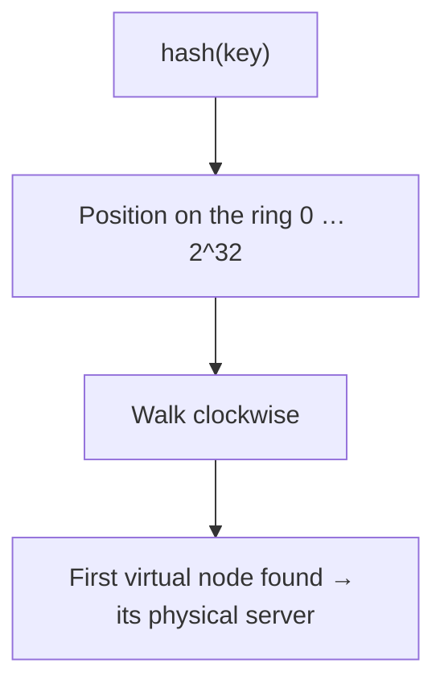

# Load Balancing, Proxies & API Gateways

[⬅ Back to index](../README.md)

Covers: load balancers, L4 vs L7, balancing algorithms, health checks, sticky sessions, consistent hashing, forward vs reverse proxies, API gateways, service mesh, rate limiting algorithms and global traffic management.

---

### 1. What does a load balancer do?

Answer

A load balancer spreads incoming traffic across a pool of servers so that:
- no single server is overloaded (**scalability**),
- unhealthy servers are taken out automatically (**availability**),
- servers can be added or removed without clients noticing (deploys, autoscaling).

Extras it often handles: TLS termination, compression, connection reuse, request routing, basic DDoS protection. Load balancers themselves are made redundant (active-passive pairs with a floating IP, or managed services like AWS ALB/NLB that are distributed internally).

### 2. L4 vs L7 load balancers?

Answer

| L4 (transport) | L7 (application) |
|---|---|
| Routes by IP and port; doesn't read the payload | Reads HTTP: path, host, headers, cookies |
| Very fast, low overhead, any TCP/UDP protocol | Content-based routing (`/api` → API servers, `/static` → CDN origin) |
| Can't do per-request routing on one connection | TLS termination, auth, retries, header rewrites, A/B and canary routing |
| AWS NLB, LVS, Maglev | AWS ALB, Nginx, Envoy, HAProxy (both modes) |

Common setup: an L4 layer in front (scale, DDoS) feeding L7 proxies that do smart routing.

### 3. What load-balancing algorithms are there?

Answer

- **Round robin** – rotate through servers. Simple; assumes equal servers and requests.
- **Weighted round robin** – bigger servers get more traffic.
- **Least connections / least outstanding requests** – best when request durations vary (long-lived connections).
- **Least response time** – favours the fastest servers.
- **IP hash / consistent hashing** – the same client or key goes to the same server (cache locality, sticky behaviour).
- **Power of two random choices** – pick two random servers, send to the less loaded one. Near-optimal, cheap, avoids herding; used by Envoy and many large systems.

### 4. How do health checks work?

Answer

- **Active checks** – the LB calls `/health` every few seconds; after N failures, the server is removed; after M successes, re-added.
- **Passive checks / outlier detection** – the LB watches real traffic and ejects servers with high error rates.

Design a good health endpoint:
- **Liveness** ("the process is alive") vs **readiness** ("can serve traffic: dependencies OK, warmed up").
- Don't make readiness depend on a shared dependency (e.g. the DB); otherwise a DB blip takes **every** server out at once and turns a partial outage into a full one.

### 5. What are sticky sessions and why avoid them?

Answer

**Session affinity** routes a user to the same server every time (cookie or IP hash) because that server holds their session in memory. Problems: uneven load, lost sessions when the server dies, harder autoscaling and deploys. Prefer **stateless servers** with sessions in Redis or in signed tokens. Stickiness is still useful for WebSocket connections and for cache locality (via consistent hashing).

### 6. What is consistent hashing and why is it useful?

Answer

With plain `hash(key) % N`, changing N (adding a server) remaps **almost every key**, which empties caches and moves most data.

**Consistent hashing** places servers and keys on a hash **ring**; a key belongs to the first server clockwise. Adding or removing a server only moves the keys in its neighbouring range (~1/N of keys).

**Virtual nodes**: each physical server gets many points on the ring (e.g. 100–200) to spread load evenly and to let bigger servers take more vnodes. Used in Dynamo, Cassandra, memcached clients, CDNs and load balancers. Alternatives: **rendezvous (HRW) hashing** and **jump consistent hash**.

### 7. Forward proxy vs reverse proxy?

Answer

- **Forward proxy** – sits in front of **clients**, making requests on their behalf to the internet (corporate egress proxy, content filtering, anonymity). The server sees the proxy.
- **Reverse proxy** – sits in front of **servers**, receiving client requests and forwarding them inside (Nginx, Envoy, HAProxy). The client sees only the proxy. Used for load balancing, TLS termination, caching, compression, rate limiting and hiding internal topology.

A load balancer is a kind of reverse proxy.

### 8. What is an API gateway?

Answer

A single entry point for clients in front of many backend services. Typical responsibilities:
- **Routing** to the right service and versioning.
- **Authentication** (validate JWT/OAuth tokens) and coarse authorisation.
- **Rate limiting and quotas** per client or API key.
- **Request aggregation** (compose several service calls into one response) and protocol translation (REST → gRPC).
- Logging, metrics, tracing headers, CORS, caching.

Risks: becoming a bottleneck or a "god layer" with business logic; keep it thin. Examples: Kong, AWS API Gateway, Apigee, Envoy-based gateways. A **BFF (backend for frontend)** is a gateway specialised per client type (mobile vs web).

### 9. What is a service mesh?

Answer

A service mesh moves service-to-service networking concerns out of application code into **sidecar proxies** (Envoy) next to each service, managed by a control plane (Istio, Linkerd):
- mTLS between services (zero trust), identity-based authorisation,
- retries, timeouts, circuit breaking, load balancing,
- traffic shifting (canary releases), fault injection,
- uniform metrics and tracing.

Trade-off: powerful and language-agnostic, but adds latency, resource cost and operational complexity. Worth it with many services and teams; overkill for a handful. Newer "sidecarless/ambient" modes reduce the overhead.

### 10. What rate-limiting algorithms exist?

Answer

| Algorithm | How it works | Notes |
|---|---|---|
| **Token bucket** | Tokens refill at rate r up to capacity b; each request takes one | Allows bursts up to b; most common (AWS, Stripe) |
| **Leaky bucket** | Requests enter a queue drained at a fixed rate | Smooths output; bursts wait or are dropped |
| **Fixed window counter** | Count per minute window | Simple; allows 2× burst at window edges |
| **Sliding window log** | Store timestamps of each request | Precise; memory-heavy |
| **Sliding window counter** | Weighted mix of current + previous window counts | Good accuracy, cheap; common choice |

See the full [rate limiter design](16-designs-core-infrastructure.md) for distributed implementation.

### 11. Where should rate limiting happen?

Answer

In layers:
- **Edge/CDN/WAF** – crude per-IP limits, DDoS absorption.
- **API gateway** – per API key, user or plan (quotas).
- **Service level** – protect expensive endpoints and downstream dependencies (load shedding, concurrency limits).
- **Client side** – backoff and request coalescing to be a good citizen.

Respond with **HTTP 429** + `Retry-After` and rate-limit headers. For internal overload, prefer **adaptive concurrency limits** and load shedding (drop low-priority work first).

### 12. How do you route traffic globally across regions?

Answer

- **GeoDNS / latency-based DNS** – return the nearest healthy region's IP.
- **Anycast** – one IP, the network routes to the nearest PoP (CDNs, Google's global LB).
- **Global server load balancing (GSLB)** – health-aware routing across regions with failover and weights.

Considerations: data residency (EU users must stay in the EU), session and data locality (users should hit the region holding their data), and failover capacity (each region needs headroom to absorb another region's traffic).

### 13. What is connection draining?

Answer

When removing a server (deploy, scale-in), the load balancer stops sending **new** requests to it but lets in-flight requests finish (for a timeout, e.g. 30 s) before shutdown. Combined with graceful shutdown in the app (stop accepting, finish work, close connections), it enables **zero-downtime deployments**. For WebSockets, servers ask clients to reconnect elsewhere.

### 14. What happens if the load balancer itself fails?

Answer

Make it redundant:
- **Active-passive pair** with a floating/virtual IP (keepalived/VRRP): the standby takes over the IP on failure.
- **Multiple LBs behind DNS** or anycast.
- **Managed cloud load balancers** are already distributed across zones.

Also avoid a single LB layer per region being the only path; multi-AZ placement plus health-checked DNS across regions removes the SPOF.

### 15. API gateway vs load balancer vs reverse proxy – what's the difference?

Answer

- **Reverse proxy** – the general idea: a server in front of backends that receives client requests and forwards them (Nginx, Envoy). Adds TLS termination, caching, compression.
- **Load balancer** – a reverse proxy (or network device) whose main job is **spreading traffic** across identical instances and removing unhealthy ones. L4 or L7.
- **API gateway** – an L7 reverse proxy focused on **API management**: routing to many different services, authentication, rate limits and quotas, request transformation, API keys, analytics.

In a typical setup: DNS/CDN → load balancer → API gateway → services (each service may have its own internal load balancing). The lines blur – Envoy can do all three.

---

[⬅ Previous: Networking & Protocols](04-networking-protocols.md) · [⬅ Back to index](../README.md) · [Next: Caching ➡](06-caching.md)
