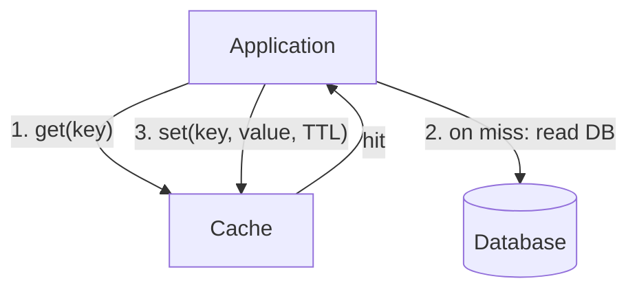

# Caching

[⬅ Back to index](../README.md)

Covers: where to cache, cache-aside vs read-through vs write-through vs write-behind, eviction policies, TTL and invalidation, stampedes, hot keys, consistency, Redis vs Memcached, distributed caches and CDN caching.

---

### 1. Why cache, and where can you cache?

Answer

A cache stores the results of expensive work (DB queries, computations, remote calls) in fast storage so repeated requests are cheaper. It reduces **latency**, **load on the source** and **cost**.

Layers, from closest to the user:
1. **Client** – browser cache, mobile app memory/disk cache.
2. **CDN / edge** – static assets, cacheable API responses.
3. **Load balancer / reverse proxy** – Nginx/Varnish response cache.
4. **Application** – in-process (local LRU) and **distributed** (Redis, Memcached).
5. **Database** – buffer pool, query cache, materialised views.

Caching works when data is **read much more than written** and access is skewed (hot items).

### 2. What are the main caching strategies?

Answer

- **Cache-aside (lazy loading)** – the app reads the cache, on a miss reads the DB and fills the cache (diagram above). The most common. Only requested data is cached; the first read after a miss is slow; data can be stale until TTL or invalidation.
- **Read-through** – the cache itself loads from the DB on a miss (the app only talks to the cache).
- **Write-through** – writes go to the cache and the DB synchronously. Cache is always fresh; writes are slower; may cache data never read.
- **Write-behind (write-back)** – write to the cache, flush to the DB asynchronously. Very fast writes, but risk of **data loss** if the cache dies before flushing.
- **Write-around** – write to the DB only; the cache fills on reads. Good when written data is rarely re-read soon.

Typical: cache-aside + **delete the key on write**.

### 3. On a write, should you update the cache or delete the key?

Answer

Usually **delete (invalidate)**, and do it **after** the DB commit:
- Updating the cache can race: two writers update the DB in order A, B but the cache in order B, A, leaving stale data forever.
- Deleting forces the next read to load the fresh value.

Remaining race: a reader loads the old value, a writer commits and deletes, then the reader writes the old value back. Mitigations: short TTLs as a safety net, **delayed double delete**, versioned values (only set if the version is newer), or driving invalidation from the DB's **change data capture (CDC)** stream.

### 4. What eviction policies exist?

Answer

- **LRU (least recently used)** – evict what hasn't been touched longest. Good default.
- **LFU (least frequently used)** – evict the least-used items; better for stable popularity, slow to adapt. Redis has approximate LRU and LFU.
- **FIFO** – simple, rarely ideal.
- **TTL-based** – items expire after a time.
- **Random** – surprisingly decent and cheap.
- Modern: **W-TinyLFU** (Caffeine) and ARC combine recency and frequency for high hit rates.

Always set a memory limit and policy; a cache without eviction is a memory leak.

### 5. How do you choose a TTL?

Answer

Based on how stale the data may be and how often it changes:
- Seconds for fast-changing or sensitive data (stock levels, prices).
- Minutes to hours for profiles, product pages.
- Very long (or forever with versioned keys) for immutable data (`image:v3`, content-hashed assets).

Add **jitter** (random ±10%) so many keys don't expire at the same moment. Use TTL as a safety net even when you invalidate explicitly.

### 6. What is a cache stampede (thundering herd) and how do you prevent it?

Answer

When a hot key expires, thousands of requests miss at once and all hit the database, which can collapse it.

Fixes:
- **Request coalescing / single flight** – only one request recomputes; others wait for its result (a lock per key, e.g. Redis `SET NX`).
- **Stale-while-revalidate** – serve the expired value while one background job refreshes it.
- **Probabilistic early expiration** – refresh slightly before expiry with increasing probability (XFetch).
- **TTL jitter** so keys don't expire together.
- **Pre-warming** caches before traffic spikes or after deploys.

### 7. What is cache penetration and cache avalanche?

Answer

- **Penetration** – repeated requests for keys that **don't exist** (often malicious) always miss and hit the DB. Fix: cache negative results ("null" with a short TTL), or check a **Bloom filter** of existing keys first.
- **Avalanche** – many keys expire at once, or the cache cluster goes down, sending the full load to the DB. Fix: TTL jitter, a highly available cache cluster (replicas), circuit breakers and rate limits in front of the DB, and graceful degradation.
- **Breakdown/stampede** – a single hot key expiring (see the previous question).

### 8. How do you handle hot keys?

Answer

One key (a celebrity profile, a viral product) gets so much traffic that its cache shard saturates.
- **Local in-process cache** in front of the distributed cache for the hottest keys (short TTL).
- **Key replication** – store copies `key#1…key#N` on different shards and read a random one.
- **Read replicas** of the cache shard.
- Detect hot keys with sampling or the cache's own tooling, and route them specially.

### 9. Redis vs Memcached?

Answer

| Redis | Memcached |
|---|---|
| Rich data structures: strings, hashes, lists, sets, **sorted sets**, streams, HyperLogLog, geo, bitmaps | Simple key → blob |
| Persistence (RDB snapshots, AOF), replication, Redis Cluster sharding | No persistence; client-side sharding |
| Lua scripting, transactions, pub/sub | Very simple |
| Mostly single-threaded command execution (I/O threads help) | Multi-threaded, scales well per node |
| Used for caches, leaderboards, rate limiters, sessions, queues, locks | Pure, large, simple caches |

Redis is the usual default; Memcached is fine for a straightforward high-throughput object cache (Meta still runs it at huge scale). Valkey is the open-source Redis fork.

### 10. How does a distributed cache scale?

Answer

- **Sharding** keys across nodes with consistent hashing (client-side) or hash slots (Redis Cluster: 16,384 slots).
- **Replication** for read throughput and failover (replica promoted automatically).
- **Hot key** handling (see above).
- Clients use connection pooling and pipelining or batching (`MGET`).

Cache misses after a node failure are expected; the DB must survive a partial cache loss, so size it accordingly or use replicas.

### 11. How do you keep a cache consistent with the database?

Answer

Perfect consistency is expensive; choose what's acceptable:
- **TTL only** – eventual consistency bounded by TTL.
- **Invalidate on write** (cache-aside + delete after commit).
- **CDC-driven invalidation** – a consumer reads the DB's change log (Debezium) and deletes or updates cache keys. Reliable and decoupled from application code paths.
- **Write-through** for data that must always be fresh in the cache.
- **Versioned keys** – include a version or updated-at in the key so stale entries are never read.

For data that must be strongly consistent (balances, inventory decrements), read from the source of truth, not a cache.

### 12. In-process (local) cache vs distributed cache?

Answer

- **Local** (Caffeine, Guava, an LRU map) – nanosecond access, no network, but each server has its own copy: memory is duplicated and invalidation across servers is hard (stale data differs per server).
- **Distributed** (Redis) – shared, consistent across servers, larger capacity, but ~0.5–1 ms network hop.

Common pattern: a small local cache with a short TTL for the hottest, rarely changing data (config, feature flags) **in front of** Redis (a two-level cache).

### 13. How does HTTP caching work?

Answer

Controlled by response headers:
- `Cache-Control: public, max-age=3600` – cacheable by browsers and CDNs for an hour. `private` – browser only. `no-store` – never cache. `no-cache` – cache but revalidate.
- `s-maxage` – a different TTL for shared caches (CDN).
- `stale-while-revalidate`, `stale-if-error` – serve stale while refreshing or when the origin is down.
- **Validators**: `ETag` / `If-None-Match` and `Last-Modified` / `If-Modified-Since` → `304 Not Modified` saves bandwidth.
- `Vary` – the cache key includes these request headers (e.g. `Accept-Encoding`).

Use fingerprinted file names for static assets with a long `max-age` and `immutable`.

### 14. When should you NOT cache?

Answer

- Write-heavy data that changes more often than it's read.
- Data requiring strong consistency (account balances, seat availability at checkout).
- Highly personalised data with low reuse (cache hit rate would be tiny).
- When the source is already fast enough (a primary-key lookup on a warm DB).
- Sensitive data you can't secure in the cache layer.

A cache adds complexity, staleness and another failure mode; justify it with numbers (hit rate, latency saved, DB load).

### 15. What metrics do you monitor for a cache?

Answer

Hit rate (and miss rate per key pattern), latency (p99), evictions, memory usage, connections, hot keys, replication lag, and the **DB load when the cache misses**. A sudden drop in hit rate (new deploy changed key formats, cache flush) is a classic cause of outages.

---

[⬅ Previous: Load Balancing, Proxies & API Gateways](05-load-balancing-proxies-gateways.md) · [⬅ Back to index](../README.md) · [Next: Databases ➡](07-databases.md)
