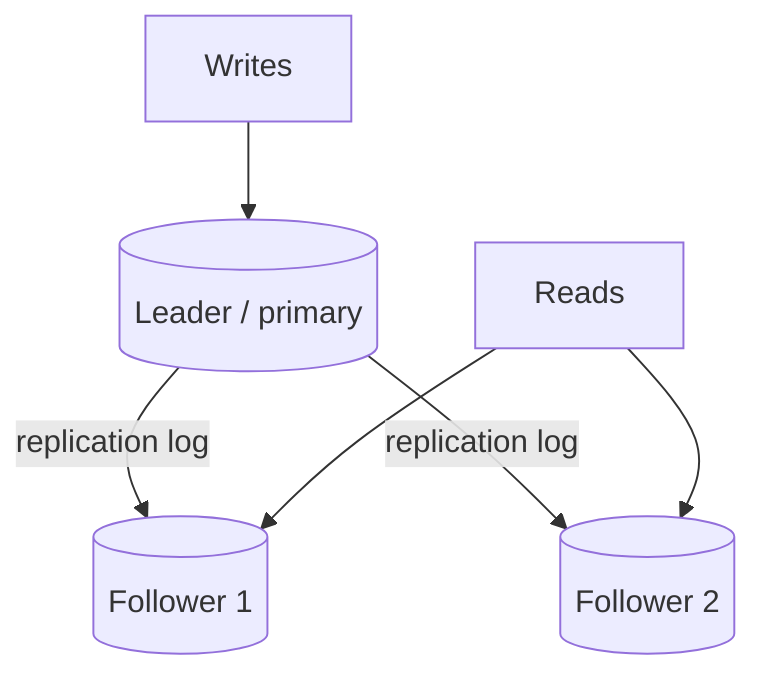

# Replication, Partitioning & Sharding

[⬅ Back to index](../README.md)

Covers: why replicate, leader-follower, multi-leader, leaderless (quorums), sync vs async replication, replication lag problems, failover, partitioning strategies, choosing a shard key, hot spots, rebalancing, secondary indexes and cross-shard queries.

---

### 1. Why replicate data?

Answer

Keeping copies of the same data on multiple machines gives:
- **Availability** – keep serving if a node fails.
- **Durability** – data survives disk or machine loss.
- **Read scalability** – serve reads from many replicas.
- **Lower latency** – put replicas near users in other regions.

The hard part is **keeping copies in sync when data changes**, which is what the replication models are about.

### 2. How does leader-follower (primary-replica) replication work?

Answer

All writes go to the **leader**, which streams its change log to **followers**. Reads can go to followers. Simple and widely used (Postgres, MySQL, MongoDB replica sets, Kafka partitions).

Limits: write throughput is capped by one leader, and reads from followers may be stale (replication lag). Failover is needed if the leader dies.

### 3. Synchronous vs asynchronous replication?

Answer

- **Synchronous** – the leader waits for followers to confirm before acknowledging the write. No data loss on failover, but higher latency, and a slow follower blocks writes.
- **Asynchronous** – the leader acknowledges immediately and ships changes later. Fast, but on leader failure **recent writes can be lost**, and followers lag.
- **Semi-synchronous** – wait for **at least one** follower (common compromise; MySQL semi-sync, Postgres synchronous_standby with one sync replica).

Consensus-based systems (Raft) acknowledge after a **majority** of replicas persist the write.

### 4. What problems does replication lag cause, and how do you handle them?

Answer

- **Read-your-writes** – a user updates their profile, refreshes, and sees the old value from a lagging replica. Fix: read the user's own data from the leader for a short time after a write, or track the write's log position and read from a replica that has caught up.
- **Monotonic reads** – a user sees a new comment, refreshes, and it's gone (hit a more-lagged replica). Fix: pin a user to one replica (hash by user ID).
- **Consistent prefix reads** – seeing an answer before the question in partitioned systems. Fix: keep causally related writes in the same partition, or track causal dependencies.

### 5. What is failover and what can go wrong?

Answer

When the leader dies: detect the failure (heartbeat timeouts), **elect** a new leader (most up-to-date follower, often via consensus or an orchestrator), reconfigure clients to write to it.

Pitfalls:
- **Lost writes** with async replication.
- **Split brain** – two nodes both think they're leader and accept writes. Prevent with consensus, quorum leases and **fencing tokens** (the old leader's writes are rejected).
- **Timeout tuning** – too short causes unnecessary failovers under load; too long means long outages.
- Clients and caches holding the old leader's address.

### 6. What is multi-leader replication and when is it used?

Answer

Several nodes (often one per region or data centre) accept writes and replicate to each other. Benefits: local write latency in each region, tolerance of region outages, offline-capable clients (each device is a "leader": calendar apps, Google Docs, CouchDB).

The big problem is **write conflicts**: the same record edited in two places concurrently. Resolutions:
- **Last-write-wins** (by timestamp) – simple, but silently drops data.
- **Merge by application logic**, or keep both versions and let the user resolve.
- **CRDTs** – data types that merge automatically and deterministically.
- **Avoid conflicts** by routing all writes for a given record to one "home" region.

### 7. How does leaderless replication with quorums work?

Answer

Used by Dynamo-style stores (Cassandra, Riak, DynamoDB internally). The client (or a coordinator) sends each write to **N replicas** and each read to N replicas:
- A write succeeds when **W** replicas acknowledge.
- A read succeeds when **R** replicas respond; the newest version wins.
- If **W + R > N**, the read and write sets overlap, so reads see the latest write (e.g. N=3, W=2, R=2).

Repair mechanisms: **read repair** (fix stale replicas found during reads), **hinted handoff** (another node holds writes for a down replica), and **anti-entropy** with Merkle trees in the background. You can tune per request: W=1 for fast writes, R=1 for fast reads with weaker consistency.

### 8. What is partitioning (sharding) and why do it?

Answer

Splitting a dataset into smaller pieces (**shards/partitions**) stored on different nodes. Each node handles a subset of data and traffic, so you scale **storage and write throughput** beyond one machine. Usually combined with replication: each shard is itself replicated.

Costs: cross-shard queries and transactions get hard, rebalancing is needed as data grows, and a poor shard key creates hot spots. Shard only when vertical scaling, read replicas and caching aren't enough.

### 9. What partitioning strategies exist?

Answer

- **Range partitioning** – by key ranges (A–F, G–M…, or by date). Efficient range scans, but sequential keys (timestamps) create **hot spots** on the latest partition. Used by HBase, Bigtable, Spanner (auto-split ranges).
- **Hash partitioning** – `hash(key)` decides the shard. Even distribution, but range queries must hit all shards. Use **consistent hashing** or many fixed logical partitions to make rebalancing cheap.
- **Directory / lookup-based** – a mapping service records which shard holds each key or tenant. Most flexible (move tenants freely) but the directory must be highly available and cached.
- **Geographic** – by user region; good for latency and data residency.
- **Compound** – e.g. Cassandra: partition key hashed, clustering key sorted within the partition.

### 10. How do you choose a good shard key?

Answer

A good shard key:
- has **high cardinality** and spreads data and traffic **evenly**,
- matches the **main access pattern**, so most queries hit **one shard** (e.g. `user_id` for user-centric apps, `tenant_id` for SaaS, `chat_id` for messages),
- keeps data that's transactionally related together,
- doesn't change over time.

Bad keys: country (skewed), timestamp alone (hot latest shard), boolean status. When the obvious key is skewed (celebrity users, huge tenants), add a **salt/suffix** or give big tenants dedicated shards.

### 11. What is a hot spot / hot partition and how do you fix it?

Answer

One partition gets disproportionate load (a celebrity's posts, a viral product, today's date). Fixes:
- **Salting** the key (`productId#0..9`) to spread writes across N partitions, and aggregate on read.
- **Caching** reads for the hot key.
- **Splitting** the hot range automatically (Bigtable/Spanner/DynamoDB adaptive capacity).
- **Write buffering** – aggregate counters in memory or a queue and flush periodically.
- Application-level special-casing of known hot entities.

### 12. How do you rebalance shards when adding nodes?

Answer

- **Don't use `hash % N`** – changing N moves almost all keys.
- **Fixed number of logical partitions** (e.g. 1,024 or 4,096) mapped to nodes; adding a node moves whole partitions (Elasticsearch, Riak, Couchbase, Redis Cluster's 16,384 slots).
- **Consistent hashing with virtual nodes** – a new node takes small ranges from many nodes.
- **Dynamic splitting** – split ranges when they grow too large (HBase, MongoDB, Spanner).

Move data in the background, throttled, with dual reads/writes during handover, and keep a routing layer (or client metadata) updated.

### 13. How do secondary indexes work with sharding?

Answer

- **Local (document-partitioned) index** – each shard indexes only its own data. Writes are cheap, but a query by the secondary key must **scatter-gather** to all shards (Cassandra secondary indexes, MongoDB, Elasticsearch).
- **Global (term-partitioned) index** – the index itself is partitioned by the indexed value, so a query hits one index shard. Reads are efficient, but a write may update index shards on other nodes, usually **asynchronously** (DynamoDB GSIs are eventually consistent).

Choose based on whether reads or writes by that attribute dominate.

### 14. How do you handle queries and joins across shards?

Answer

- **Avoid them by design** – co-locate related data with the same shard key.
- **Scatter-gather** – query all shards in parallel and merge (fine for rare queries; tail latency grows with shard count).
- **Denormalise** – duplicate data so each query hits one shard.
- **Separate read models** – stream changes into a search index or data warehouse for cross-shard analytics.
- **Distributed transactions** (2PC) only when unavoidable; prefer sagas.

### 15. How would you shard a multi-tenant SaaS database?

Answer

Options from most to least isolation:
- **Database per tenant** – strong isolation, easy per-tenant backup/restore, but expensive and hard to manage at thousands of tenants.
- **Schema per tenant** in shared databases.
- **Shared tables with `tenant_id`** in every row, sharded by `tenant_id` – cheapest and most scalable; protect with row-level security and always filtering by tenant.

A hybrid is common: small tenants share shards (via a directory mapping tenant → shard), and big tenants get dedicated shards. Plan for the **noisy neighbour** problem with per-tenant rate limits.

### 16. What is the difference between partitioning in Kafka and in a database?

Answer

In Kafka, a topic is split into **partitions** – ordered, append-only logs. Messages with the same key go to the same partition, so **ordering is per partition**, and consumer parallelism is capped at the partition count (one consumer per partition within a group). In databases, partitions split stored data for capacity. The shared lessons: choose keys that spread load, beware hot keys, and plan partition counts for future growth (increasing them later changes key-to-partition mapping in Kafka).

---

[⬅ Previous: Databases](07-databases.md) · [⬅ Back to index](../README.md) · [Next: Consistency, Transactions & Consensus ➡](09-consistency-transactions-consensus.md)
