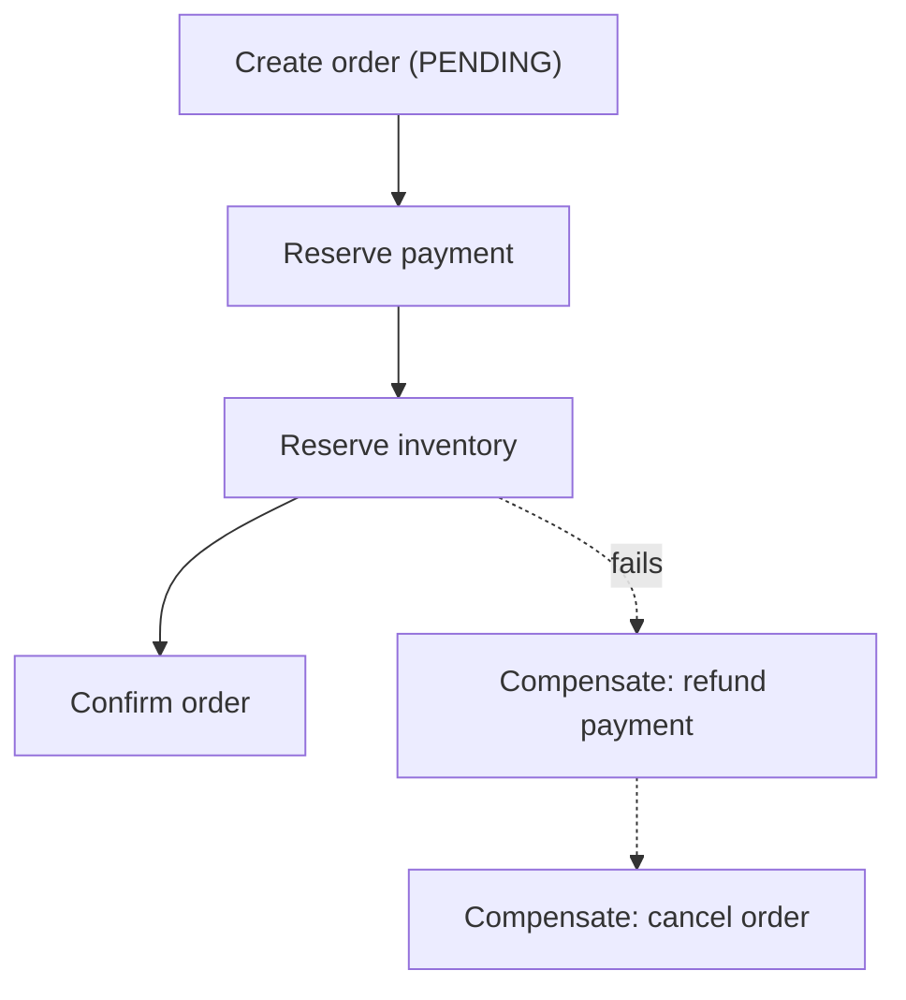

# Consistency, Transactions & Consensus

[⬅ Back to index](../README.md)

Covers: CAP and PACELC, consistency models, isolation levels and anomalies, optimistic vs pessimistic locking, distributed transactions (2PC, sagas, outbox), idempotency and exactly-once, consensus (Raft/Paxos), leader election, distributed locks, clocks and ordering, CRDTs.

---

## Consistency Models

### 1. What is the CAP theorem?

Answer

In a distributed system, when a **network partition (P)** happens, you must choose between:
- **Consistency (C)** – every read sees the latest write (linearizability), so some requests must fail or wait.
- **Availability (A)** – every request to a non-failed node gets a response, which may be stale.

Partitions are unavoidable in real networks, so the real choice is **CP vs AP during a partition**:
- **CP** – banking ledgers, inventory, leader election, config stores (ZooKeeper, etcd, Spanner).
- **AP** – social feeds, likes, shopping carts, DNS (Cassandra, DynamoDB default reads).

When there's no partition, you can have both. Say this nuance in interviews; "pick 2 of 3" is an oversimplification.

### 2. What is PACELC?

Answer

An extension of CAP: **if Partition, choose A or C; Else, choose Latency or Consistency.** Even without failures, strong consistency costs latency (waiting for replicas or consensus).
- **PA/EL** – Cassandra, DynamoDB (default): available and fast, eventually consistent.
- **PC/EC** – Spanner, traditional RDBMS with sync replication: consistent, pays latency.
- **PA/EC** and **PC/EL** systems exist too (e.g. MongoDB depending on settings).

It's a more useful framing because most of the time there's no partition, but every request pays the latency cost.

### 3. What consistency models should you know?

Answer

From strongest to weakest:
- **Linearizability (strong)** – operations appear to happen instantly at one point in time; once a write completes, all reads see it. Needed for locks, leader election, unique constraints.
- **Sequential consistency** – everyone sees the same order of operations, but not necessarily real-time order.
- **Causal consistency** – causally related operations (a reply after the post) are seen in order by everyone; concurrent ones may differ.
- **Session guarantees** – read-your-writes, monotonic reads, monotonic writes, writes-follow-reads.
- **Eventual consistency** – replicas converge if writes stop; no ordering guarantees in between.

Pick per feature: a bank balance needs strong; a like count can be eventual; comments benefit from causal.

### 4. Strong vs eventual consistency – how do you decide per feature?

Answer

Ask: **"What's the cost of a user seeing stale or conflicting data?"**
- Money, inventory, seat booking, auth/permissions, uniqueness (usernames) → **strong**.
- Likes, view counts, follower counts, feeds, recommendations, search results → **eventual** (seconds of staleness are fine).
- A user's own actions → at least **read-your-writes** (seeing your own post immediately matters for trust).

Mixing models within one system is normal and expected in answers.

---

## Transactions & Concurrency

### 5. What are transaction isolation levels and their anomalies?

Answer

| Level | Prevents | Still allows |
|---|---|---|
| **Read uncommitted** | – | Dirty reads |
| **Read committed** (Postgres default) | Dirty reads/writes | Non-repeatable reads, lost updates, write skew |
| **Repeatable read / snapshot isolation** (MySQL default ≈) | Non-repeatable reads, most lost updates | **Write skew**, phantoms (implementation-dependent) |
| **Serializable** | Everything; equivalent to running one at a time | Lower throughput, aborts/retries |

Anomalies:
- **Dirty read** – seeing uncommitted data.
- **Non-repeatable read** – the same row read twice gives different values.
- **Phantom** – a repeated range query returns new rows.
- **Lost update** – two read-modify-write cycles; one overwrites the other.
- **Write skew** – two transactions read the same condition, write different rows, and together break an invariant (two doctors both go off call).

### 6. Optimistic vs pessimistic locking?

Answer

- **Pessimistic** – lock the row before changing it (`SELECT … FOR UPDATE`). Others wait. Safe when conflicts are frequent (popular seat inventory) but reduces concurrency and risks deadlocks.
- **Optimistic** – no lock; each row has a `version`. Update with `UPDATE … SET …, version = version + 1 WHERE id = ? AND version = ?`. If 0 rows changed, someone else won; retry or report a conflict. Great when conflicts are rare (editing a profile, wiki pages). HTTP equivalent: `ETag` + `If-Match`.

Also: **atomic operations** (`UPDATE stock SET qty = qty - 1 WHERE id = ? AND qty > 0`) avoid read-modify-write entirely and are often the best answer.

### 7. Why are distributed transactions hard? How does two-phase commit (2PC) work?

Answer

When one operation spans multiple databases or services, you need all-or-nothing across them.

**2PC:**
1. **Prepare** – the coordinator asks every participant "can you commit?"; each locks resources, writes to its log and votes yes/no.
2. **Commit/abort** – if all vote yes, the coordinator tells everyone to commit; otherwise abort.

Problems: it's **blocking** (if the coordinator crashes after prepare, participants hold locks until it recovers), adds latency, couples availability of all participants, and doesn't fit well across independently owned microservices. It's used inside databases (Spanner uses 2PC over Paxos groups, which removes the blocking issue) and XA transactions, but **sagas** are preferred across services.

### 8. What is the saga pattern?

Answer

A saga splits a distributed transaction into a sequence of **local transactions**, each with a **compensating action** that undoes it if a later step fails.

Two styles:
- **Choreography** – services react to each other's events. Decoupled, but the flow is hard to follow with many steps.
- **Orchestration** – a central orchestrator (often a workflow engine like **Temporal**, AWS Step Functions) tells each service what to do and handles failures. Easier to reason about and monitor.

Sagas give **eventual consistency** (intermediate states are visible, e.g. "pending"), and compensations must be idempotent and designed carefully (you can't un-send an email; send a correction).

### 9. What is the transactional outbox pattern?

Answer

Problem (**dual write**): a service updates its DB **and** publishes an event to Kafka. If it crashes between the two, they disagree.

Solution: in the **same local DB transaction**, write the business change **and** an event row to an `outbox` table. A separate relay process (polling, or CDC with Debezium) reads the outbox and publishes to the broker, marking rows as sent. Delivery is at-least-once, so consumers must be idempotent. The mirror pattern on the consumer side is the **inbox** (record processed message IDs to dedupe).

### 10. What is idempotency and how do you implement it?

Answer

An operation is **idempotent** if doing it several times has the same effect as doing it once. In distributed systems, retries are inevitable (timeouts don't tell you whether the request succeeded), so writes must be safe to retry.

Implementation:
- The client generates an **idempotency key** (UUID) per logical operation and sends it with each retry.
- The server stores `key → result` (with a TTL, e.g. 24 h) in the same transaction as the effect; a repeated key returns the stored result instead of re-executing.
- Use natural idempotency when possible (`PUT` with the full state, "set status = shipped", unique constraints on `order_id`).
- Consumers of queues dedupe by message ID.

This is a must-mention for payments, orders and any money movement.

### 11. What do at-most-once, at-least-once and exactly-once mean?

Answer

- **At-most-once** – send and don't retry; messages can be lost (metrics sampling, some logs).
- **At-least-once** – retry until acknowledged; messages can be **duplicated**. The usual default.
- **Exactly-once** – each message's effect happens once. True exactly-once delivery over a network is impossible in general; in practice you get **effectively-once processing** = at-least-once delivery + **idempotent processing** (dedupe), or transactional systems like Kafka's idempotent producer + transactions (read-process-write within Kafka).

---

## Consensus & Coordination

### 12. What is consensus, and what are Paxos and Raft?

Answer

**Consensus** is getting a group of nodes to agree on a value (or a sequence of log entries) even when some nodes fail, as long as a **majority** is up. It's the foundation for leader election, replicated logs, config stores and distributed locks.

**Raft** (designed to be understandable):
- Nodes are followers, candidates or a **leader**. The leader is elected by majority vote for a **term**.
- The leader appends client commands to its log and replicates them; an entry is **committed** once a majority has it.
- If the leader fails (heartbeats stop), a new election happens; only nodes with up-to-date logs can win.

**Paxos** solves the same problem (Multi-Paxos for logs) but is notoriously hard to implement. Used by: etcd, Consul (Raft); ZooKeeper (ZAB, Paxos-like); Spanner and Chubby (Paxos); Kafka KRaft; CockroachDB/TiKV (Raft).

A cluster of **2f+1** nodes tolerates **f** failures (3 nodes → 1 failure, 5 → 2).

### 13. How does leader election work, and why use it?

Answer

Many systems need exactly one node to do something (be the DB primary, run a scheduler, own a partition). Approaches:
- Use a consensus service: acquire a **lease/lock with TTL** in etcd, ZooKeeper (ephemeral sequential nodes) or Consul; the holder renews it; if it dies, the lease expires and another node takes over.
- Built-in election in Raft-based systems.

Danger: a paused old leader (GC pause) may wake up still believing it's the leader. Protect shared resources with **fencing tokens**: each new leadership gets a higher token, and storage rejects writes with an older token.

### 14. How do you implement a distributed lock? What are the pitfalls?

Answer

- **Redis**: `SET lock:key <unique-id> NX PX 30000`; release only if the value matches (Lua script). Fine for **efficiency** (avoid duplicate work), but not fully safe for **correctness**: failover can lose the lock, and clock or GC pauses can make two holders. Redlock (multi-node) is debated.
- **ZooKeeper/etcd**: consensus-backed, with leases and sessions. Safer for correctness.

Pitfalls: lock expiry while the holder is still working (long GC pause or network delay). Always use **fencing tokens**, keep critical sections short, and prefer designs that avoid locks (single-writer partitioning, atomic DB operations, optimistic concurrency).

### 15. Why are clocks unreliable in distributed systems? What are logical clocks?

Answer

Physical clocks drift and are corrected by NTP (they can jump backwards); machines disagree by milliseconds or more. So you **can't order events across machines by wall-clock timestamps** reliably (last-write-wins with timestamps can drop newer writes).

**Logical clocks:**
- **Lamport timestamps** – a counter incremented on each event and bumped to `max(local, received) + 1` on messages. Gives a total order consistent with causality, but can't detect concurrency.
- **Vector clocks** – one counter per node; can tell whether two events are causally ordered or **concurrent** (used for conflict detection in Dynamo-style stores).
- **Hybrid logical clocks (HLC)** – physical time + logical counter; used by CockroachDB, MongoDB.
- **TrueTime** (Spanner) – a time API with bounded uncertainty; it waits out the uncertainty to guarantee ordering.

### 16. What are CRDTs?

Answer

**Conflict-free Replicated Data Types** are data structures designed so replicas can be updated independently (even offline) and **always merge to the same result**, without coordination. Examples:
- **G-Counter / PN-Counter** – per-replica counters summed on read (likes, views).
- **OR-Set** – add/remove sets that handle concurrent add and remove.
- **LWW-Register** – last-write-wins value.
- **Sequence CRDTs** (RGA, Yjs, Automerge) – collaborative text editing.

Used in collaborative editors (Figma-like multiplayer, Notion-style docs), multi-region active-active databases (Redis Enterprise, Riak), and local-first apps. Trade-off: metadata overhead and some semantics (like "balance must not go negative") can't be expressed without coordination.

### 17. What is the difference between a gossip protocol and consensus?

Answer

- **Gossip** – each node periodically shares state with a few random peers; information spreads epidemically in O(log N) rounds. Used for **membership and failure detection** (Cassandra, Consul's Serf, DynamoDB), spreading metadata. Scalable and robust, but only **eventually** consistent.
- **Consensus** – nodes agree on an exact value with strong guarantees, but it requires a majority and doesn't scale to thousands of voting nodes.

Large systems combine them: gossip for "who is alive", consensus for "who is the leader / what is committed".

### 18. How do you detect node failures?

Answer

- **Heartbeats with timeouts** – simple; choosing the timeout trades false positives vs detection delay.
- **Phi accrual failure detector** (Cassandra, Akka) – outputs a suspicion level based on the heartbeat arrival history instead of a fixed timeout.
- **Gossip-based** membership (SWIM) with indirect probes to avoid false positives from a single bad link.
- Leases in a coordination service (the node is "alive" while it renews its lease).

You can never perfectly distinguish a dead node from a slow one, which is why fencing and idempotency matter.

### 19. What is Byzantine fault tolerance, and do typical systems need it?

Answer

- **Crash faults** – nodes stop or are slow, but don't lie. Raft and Paxos tolerate f crash failures with 2f + 1 nodes.
- **Byzantine faults** – nodes may behave **arbitrarily or maliciously** (send conflicting messages, corrupt data). Byzantine fault-tolerant protocols (PBFT, Tendermint, HotStuff) need **3f + 1** nodes to tolerate f bad nodes and cost more messages.

Typical company systems run inside a trusted environment, so they assume crash faults and protect against corruption with checksums and authentication. BFT matters in blockchains and systems where participants don't trust each other.

The related **Two Generals problem** shows that two parties can never be certain of agreement over an unreliable channel – which is why distributed systems rely on timeouts, retries, idempotency and acknowledgements rather than certainty.

---

[⬅ Previous: Replication, Partitioning & Sharding](08-replication-sharding.md) · [⬅ Back to index](../README.md) · [Next: Storage, Search & Specialised Data Systems ➡](10-storage-search-specialized.md)
