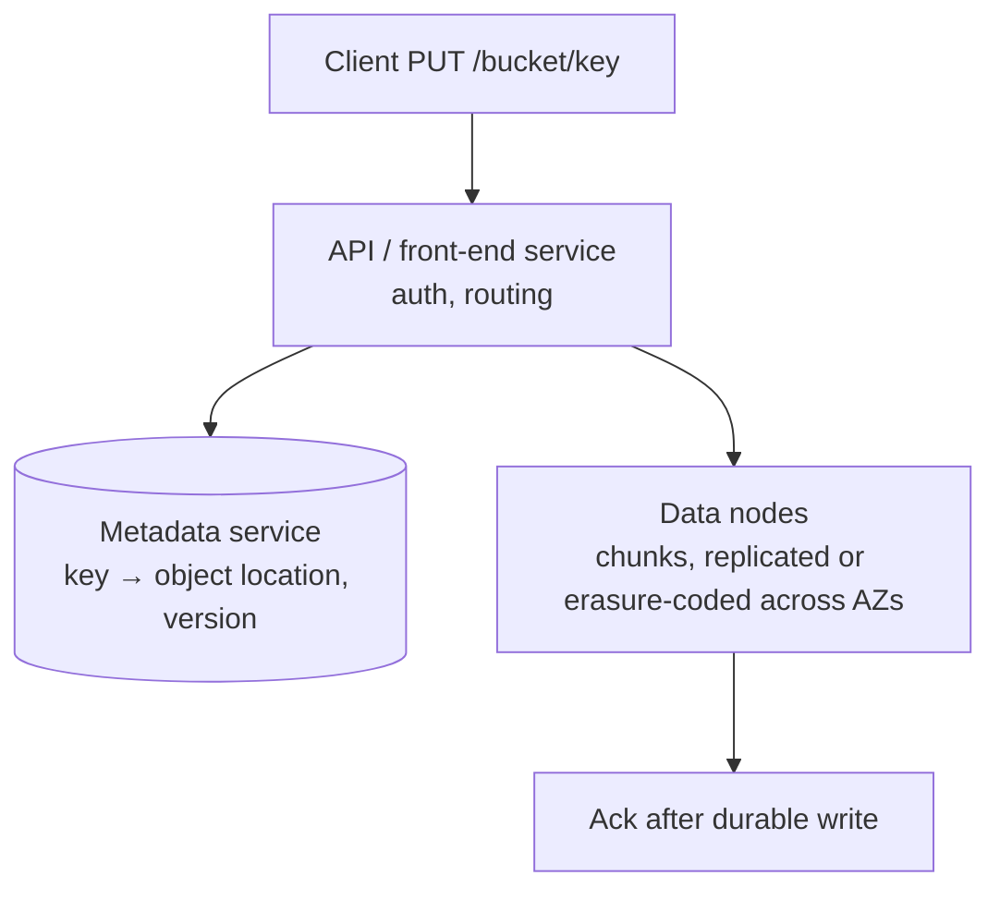

# Storage, Search & Specialised Data Systems

[⬅ Back to index](../README.md)

Covers: block vs file vs object storage, how S3-like object stores work, large file uploads, erasure coding, distributed file systems, search engines and inverted indexes, geospatial indexing (geohash, quadtree, S2/H3), time-series storage, probabilistic data structures, backups.

---

### 1. Block vs file vs object storage?

<details>
<summary>Answer</summary>

| | Block | File | Object |
|---|---|---|---|
| Unit | Fixed-size blocks, raw volume | Files in a directory tree | Objects (data + metadata) by key in a flat namespace |
| Access | Mounted disk (EBS, SAN) | NFS/SMB (EFS) | HTTP API (S3, GCS, Azure Blob) |
| Strengths | Lowest latency, databases, VMs | Shared POSIX access | Virtually unlimited scale, cheap, durable, CDN-friendly |
| Weaknesses | One host at a time, limited size | Harder to scale | No partial in-place updates, higher latency |

Rule of thumb: **media, files, backups, logs, data lakes → object storage**; databases → block storage; legacy shared file access → file storage. Store the object **key/URL in your DB**, never the blob itself.

</details>

### 2. How does an object store like S3 work internally (at a high level)?

<details>
<summary>Answer</summary>



- **Metadata** (bucket, key, size, checksum, version, chunk locations) is stored in a sharded, replicated metadata store.
- **Data** is split into chunks placed on storage nodes across availability zones using replication or **erasure coding**.
- Background processes verify checksums, repair lost chunks, garbage-collect deleted data and move objects between storage tiers.
- S3 provides **strong read-after-write consistency** for objects and 11 nines of durability.

</details>

### 3. What is erasure coding and why use it instead of replication?

<details>
<summary>Answer</summary>

Erasure coding (e.g. Reed–Solomon) splits data into **k data chunks + m parity chunks**; any k of the k+m chunks can rebuild the data. Example: 6+3 tolerates 3 lost chunks with only **1.5× storage**, versus 3× for triple replication.

Trade-offs: much cheaper storage, but higher CPU for encoding, and reads/repairs need multiple chunks (more network). Used for colder or large data (object stores, HDFS EC, backups); hot small data is often replicated for speed.

</details>

### 4. How do you design large file uploads?

<details>
<summary>Answer</summary>

- **Pre-signed URLs** – the app server authorises and returns a time-limited URL; the client uploads **directly to object storage**, so your servers never proxy gigabytes.
- **Multipart / chunked uploads** – split into chunks (5–100 MB), upload in parallel, retry only failed chunks, **resume** after network drops, then "complete" to assemble.
- **Checksums** per chunk for integrity; **deduplication** by content hash (Dropbox-style).
- After upload, an event (S3 notification → queue) triggers processing: virus scan, thumbnails, transcoding, metadata extraction.

</details>

### 5. What is a distributed file system like HDFS/GFS?

<details>
<summary>Answer</summary>

Files are split into large blocks (64–128 MB) replicated (typically 3×) across data nodes. A **NameNode/master** keeps the namespace and block locations in memory; clients ask it where blocks are, then read and write directly to data nodes. Optimised for **large sequential reads/writes and batch analytics** (MapReduce, Spark), not small files or low-latency access. Today, cloud object storage has largely replaced HDFS for data lakes.

</details>

---

## Search

### 6. How does full-text search work (inverted index)?

<details>
<summary>Answer</summary>

An **inverted index** maps each term to the list of documents containing it (a **posting list**, with positions and frequencies):

```
"pizza" → [doc3, doc7, doc42]
"cheap" → [doc7, doc19]
```

Indexing pipeline: **tokenise** → lowercase → remove stop words → **stem/lemmatise** ("running" → "run") → add synonyms → write posting lists. A query is processed the same way; the engine intersects posting lists and **ranks** results with **BM25** (term frequency, inverse document frequency, length normalisation), plus business signals (popularity, recency, personalisation) and increasingly **semantic/vector** retrieval (hybrid search).

</details>

### 7. How does Elasticsearch scale, and how do you keep it in sync with the database?

<details>
<summary>Answer</summary>

- An **index** is split into **shards** (each a Lucene index) with **replicas**. Queries scatter to all shards and gather/merge top results. Choose shard counts up front (resharding = reindex); use time-based indices for logs.
- Near-real-time: new documents become searchable after a **refresh** (~1 s).
- It's **not** a primary database (no transactions, can lose recent writes on some failures). Keep the source of truth in your DB and sync via **CDC** (Debezium → Kafka → indexer) or an outbox, with periodic full re-indexing (using index aliases to swap atomically).

</details>

### 8. How would you implement search autocomplete (typeahead)?

<details>
<summary>Answer</summary>

Key ideas (full design in [Core Infrastructure Designs](16-designs-core-infrastructure.md)):
- A **trie** (prefix tree) where each node stores the **top-k** completions for that prefix, precomputed offline from query logs (weighted by frequency and recency).
- Serve from memory, sharded by prefix; cache hot prefixes at the edge and on the client.
- Rebuild periodically (e.g. hourly batch) and apply real-time trending boosts separately.
- Alternatives: Elasticsearch completion suggester / edge n-grams, Redis sorted sets per prefix.
- Client: debounce keystrokes (~100–200 ms), cancel stale requests, cache results per prefix.

</details>

---

## Geospatial

### 9. How do you find nearby points efficiently (geospatial indexing)?

<details>
<summary>Answer</summary>

Naive `WHERE lat BETWEEN … AND lng BETWEEN …` can't use one index well. Options:
- **Geohash** – encodes lat/lng into a base-32 string; nearby points share **prefixes**. Query the cell + its 8 neighbours. Easy to store in any DB or Redis (`GEOADD`/`GEOSEARCH`). Cells are uneven near the poles, and edge cases need neighbour lookups.
- **Quadtree** – recursively splits a region into 4 until each cell has ≤ N points. Adapts to density (dense cities get small cells). Typically held in memory.
- **Google S2** (sphere → cells on a Hilbert curve) and **Uber H3** (hexagons; uniform neighbour distances, good for surge pricing and aggregation).
- **R-tree** indexes in databases (PostGIS, MySQL spatial) for shapes and polygons.

Choose geohash/Redis for simple "nearby restaurants", quadtree/S2/H3 for dynamic, dense data like moving drivers.

</details>

### 10. How do you store and query moving objects (e.g. drivers) at scale?

<details>
<summary>Answer</summary>

Drivers send location every ~4 s → millions of writes/minute that are only useful for seconds.
- Keep **current locations in memory** (Redis geo sets, or an in-memory grid service sharded by region/cell); don't write each ping to a durable DB.
- Index by cell (geohash/H3); when a driver moves cells, remove from the old one and add to the new.
- Stream pings through Kafka for trip history and analytics (cold storage in batches).
- Query: look up the rider's cell + neighbours, filter by availability, rank by ETA (not straight-line distance).

</details>

---

## Time-Series & Probabilistic Structures

### 11. What makes time-series databases special?

<details>
<summary>Answer</summary>

Time-series data (metrics, IoT, prices) is append-mostly, queried by time windows and aggregated. TSDBs (Prometheus, InfluxDB, TimescaleDB, M3, VictoriaMetrics) optimise with:
- **Time-partitioned storage** (chunks per hour/day), cheap deletion of old chunks via **retention policies**.
- **Columnar compression** (delta-of-delta timestamps, XOR floats – Gorilla) giving 10×+ compression.
- **Downsampling/rollups** (keep 10 s resolution for a week, 1 h for a year).
- Indexing by series labels/tags. Watch for **high-cardinality** labels (user IDs as tags) that explode the number of series.

</details>

### 12. What is a Bloom filter and where is it used?

<details>
<summary>Answer</summary>

A space-efficient structure that answers "**is X in the set?**" with **no false negatives** and a tunable **false positive** rate. It uses a bit array and k hash functions; add sets k bits, lookup checks them.

Uses: LSM-tree databases skip SSTables that can't contain a key; caches avoid lookups for non-existent keys (cache penetration); web crawlers check "already visited"; username availability pre-checks; spam/malicious URL lists. It can't delete items (Counting Bloom filters and Cuckoo filters can).

</details>

### 13. What are HyperLogLog and Count-Min Sketch?

<details>
<summary>Answer</summary>

- **HyperLogLog** – estimates the **number of distinct elements** (cardinality) using ~12 KB with ~1% error, regardless of set size. Unique visitors, distinct search queries. Mergeable across shards/time (Redis `PFADD`/`PFCOUNT`).
- **Count-Min Sketch** – estimates the **frequency** of items in a stream with fixed memory (it may overcount, never undercounts). Used for heavy hitters / top-K (trending hashtags, hot keys), combined with a heap.

Both trade exactness for tiny memory, which is perfect at web scale where approximate answers are fine.

</details>

### 14. What other data structures commonly appear in system design?

<details>
<summary>Answer</summary>

- **Merkle trees** – hash trees to find which ranges differ between replicas (Cassandra anti-entropy, Git, blockchains, Dynamo).
- **Skip lists** – ordered structure with O(log n) ops; Redis sorted sets, LSM memtables.
- **Tries** – prefix lookups (autocomplete, routing tables).
- **Consistent hash rings** – partitioning.
- **Ring buffers** – fixed-size queues for logs/metrics.
- **Sorted sets** – leaderboards, rate-limiting windows, delayed job queues.

</details>

### 15. How do you design backups and disaster recovery for data?

<details>
<summary>Answer</summary>

- Define **RPO** (how much data you can lose) and **RTO** (how fast you must recover).
- Combine **full snapshots** with continuous **WAL/binlog archiving** for point-in-time recovery.
- Store backups in another region/account with **immutability** (object lock) to survive ransomware and accidental deletion.
- Replicas are **not** backups (they replicate deletes and corruption instantly).
- **Test restores regularly**; an untested backup doesn't exist.

</details>

---

[⬅ Previous: Consistency, Transactions & Consensus](09-consistency-transactions-consensus.md) · [⬅ Back to index](../README.md) · [Next: Messaging & Event-Driven Architecture ➡](11-messaging-event-driven.md)
