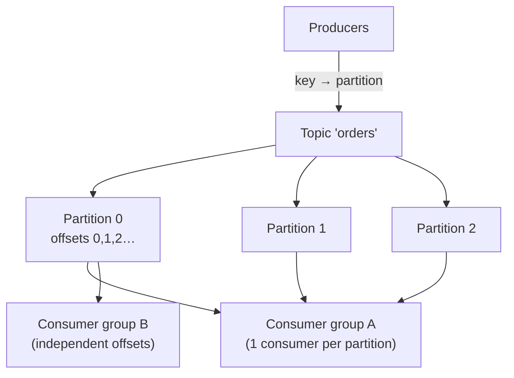
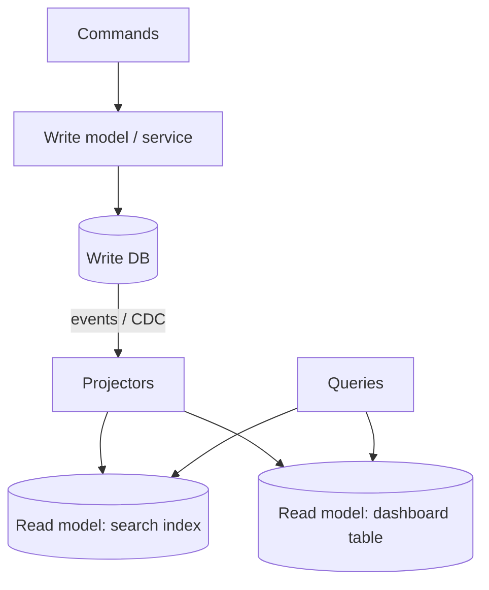

# Messaging & Event-Driven Architecture

[⬅ Back to index](../README.md)

Covers: why queues, queue vs pub/sub vs log, Kafka internals, RabbitMQ vs Kafka vs SQS, delivery guarantees, ordering, consumer groups, retries and dead-letter queues, backpressure, event sourcing, CQRS, CDC, schema evolution and delayed jobs.

---

### 1. Why use a message queue?

Answer

A queue lets producers hand off work without waiting for consumers. Benefits:
- **Decoupling** – producers and consumers evolve, deploy and scale independently.
- **Buffering / load levelling** – absorb traffic spikes; consumers process at their own pace.
- **Asynchronous processing** – respond to the user quickly (accept the upload, process later).
- **Reliability** – messages persist until processed; failed processing is retried.
- **Fan-out** – one event feeds many consumers (email, analytics, search indexing).

Costs: eventual consistency, duplicates, ordering challenges, more infrastructure, and harder debugging (use correlation IDs and tracing).

### 2. Message queue vs pub/sub vs log – what's the difference?

Answer

- **Point-to-point queue** (SQS, RabbitMQ queues) – each message is consumed by **one** consumer, then deleted. Good for task distribution (job workers).
- **Pub/sub** (SNS, Google Pub/Sub, RabbitMQ fanout) – each message is delivered to **every subscriber**. Good for notifications to many services.
- **Distributed log** (Kafka, Pulsar, Kinesis) – messages are appended to a durable, ordered, partitioned log and **retained** (days or forever). Consumers track their own **offsets**, so many independent consumer groups read at their own pace and can **replay** history.

Logs give both queue semantics (within a consumer group) and pub/sub (across groups), plus replay.

### 3. How does Kafka work?

Answer

- A **topic** is split into **partitions**: append-only, ordered logs stored on brokers and replicated (leader + followers, in-sync replicas).
- Producers choose the partition by **key hash** (same key → same partition → ordered).
- Within a **consumer group**, each partition is read by exactly one consumer, so parallelism ≤ partition count. Different groups read independently.
- Consumers **commit offsets**; after a crash, they resume from the last committed offset (hence at-least-once).
- Performance comes from sequential disk I/O, the OS page cache, batching, compression and zero-copy transfer.
- **Retention** by time/size, or **log compaction** (keep the latest value per key; useful for changelogs and state).

Durability settings: `acks=all` + `min.insync.replicas=2` + replication factor 3.

### 4. Kafka vs RabbitMQ vs SQS?

Answer

| Kafka | RabbitMQ | SQS |
|---|---|---|
| Distributed log; retention and replay | Traditional broker; messages deleted after ack | Fully managed queue |
| Very high throughput (millions/s), ordering per partition | Flexible routing (exchanges, topics, headers), priorities, per-message acks | Zero ops, scales automatically; FIFO queues for ordering/dedupe |
| Event streaming, CDC, analytics pipelines, event sourcing | Task queues, complex routing, RPC-style messaging | Simple decoupling on AWS, job queues |
| Consumers pull; offset management | Push to consumers; prefetch limits | Pull with visibility timeouts |

Pick Kafka when events are a shared, replayable stream for many consumers; RabbitMQ/SQS for work queues.

### 5. How do you guarantee message ordering?

Answer

Global ordering doesn't scale, so order **per key**:
- Use the entity ID (order ID, user ID, chat ID) as the **partition key** so all its events land in one partition, consumed by one consumer, in order.
- Use FIFO queues with message group IDs (SQS FIFO).
- Keep **one in-flight message per key** during processing (retries can reorder otherwise).
- Include **sequence numbers or versions** in events so consumers can detect and drop out-of-order or stale updates.

### 6. How do you handle failures in consumers? What is a dead-letter queue?

Answer

- **Retry** transient failures with **exponential backoff + jitter** (e.g. via retry topics with delays: `orders.retry.1m`, `orders.retry.10m`) so one bad message doesn't block the partition.
- After N attempts, move the message to a **dead-letter queue (DLQ)** for inspection and manual or automated redrive.
- Distinguish **poison messages** (bad data – will never succeed) from transient errors (DB down – will succeed later; pause consumption instead of DLQ-ing everything).
- Alert on DLQ size; build tooling to replay.

### 7. How do consumers achieve idempotent processing?

Answer

Since delivery is at-least-once, the same message may arrive twice. Options:
- Store processed **message IDs** (inbox table, unique constraint) in the same transaction as the side effect.
- Make the operation naturally idempotent (upserts, "set status to X", conditional updates with versions).
- For Kafka → Kafka pipelines, use transactions (exactly-once semantics within Kafka).
- Commit the offset **after** the side effect succeeds.

### 8. What is backpressure and how do you handle it?

Answer

Backpressure is when consumers can't keep up with producers. Signals: growing **consumer lag** / queue depth, increasing latency. Responses:
- **Scale consumers** (up to the partition count; plan partitions for peak).
- **Batch** processing and optimise the slow downstream (often the DB).
- **Throttle/slow producers** or reject with 429/503 (load shedding) when the system is saturated.
- **Prioritise** – separate queues for critical vs bulk work.
- Bounded buffers everywhere; unbounded queues just move the outage and run out of memory.

### 9. What is event-driven architecture? Events vs commands?

Answer

Services communicate by **publishing events** about what happened ("OrderPlaced"), and others react, instead of calling each other directly.
- **Event** – a fact in the past tense; the publisher doesn't know or care who listens.
- **Command** – a request for a specific receiver to do something ("ChargeCard").

Event types: **notification** events (thin: "order 42 changed – fetch it if you care") vs **event-carried state transfer** (fat: includes the data, so consumers don't call back).

Benefits: loose coupling, easy to add consumers, natural audit trail. Costs: eventual consistency, harder to trace the end-to-end flow, need for schema governance.

### 10. What is event sourcing?

Answer

Instead of storing the current state, store the **full sequence of events** that changed it ("Deposited 100", "Withdrew 30"); current state = replaying (folding) the events. Snapshots avoid replaying from the beginning every time.

Pros: complete audit history, time travel ("what was the balance on May 1?"), easy to build new read models by replaying, natural fit with event-driven systems.
Cons: complexity, **event schema evolution** forever, querying current state needs projections (usually with CQRS), and deleting personal data (GDPR) is hard (crypto-shredding helps).

Good fits: ledgers, accounting, order lifecycles, collaborative editing. Overkill for simple CRUD.

### 11. What is CQRS?

Answer

**Command Query Responsibility Segregation** splits the **write model** (commands, validation, normalised store) from one or more **read models** (denormalised views optimised for queries – search index, cache, precomputed feed), updated asynchronously from events/CDC.

Pros: read and write sides scale and evolve independently; each read model fits its query. Cons: eventual consistency between sides, more moving parts. Use it when reads and writes have very different shapes or loads.

### 12. What is change data capture (CDC)?

Answer

CDC reads a database's **transaction log** (Postgres WAL, MySQL binlog, DynamoDB Streams) and emits every row change as an event (Debezium → Kafka). Uses:
- Keep caches, search indexes and data warehouses in sync **without dual writes**.
- Implement the outbox pattern.
- Migrate databases (stream changes from old to new while backfilling).
- Feed analytics in near real time.

It's reliable because the log is the DB's own source of truth, and it doesn't touch application code.

### 13. How do you evolve event schemas safely?

Answer

- Use a schema format with compatibility rules (Avro, Protobuf, JSON Schema) and a **schema registry** that rejects incompatible changes.
- **Backward compatible** changes only: add optional fields with defaults; never remove or retype fields that consumers use; never reuse field numbers in Protobuf.
- Version the event type (`OrderPlaced.v2`) for breaking changes and run both during migration.
- Consumers should ignore unknown fields (tolerant reader).

### 14. How do you implement delayed or scheduled jobs?

Answer

- **Delay queues** – SQS delay (up to 15 min), RabbitMQ delayed-message plugin.
- **Redis sorted set** keyed by execution time; workers poll `ZRANGEBYSCORE` for due jobs and claim them atomically.
- **Database table** with `run_at` + index; workers `SELECT … FOR UPDATE SKIP LOCKED`.
- **Workflow engines** (Temporal, Step Functions) for long timers and multi-step flows (e.g. "send a reminder 3 days after signup unless they've completed onboarding").
- Timing wheels for huge numbers of in-memory timers (Kafka uses them internally).

See [Distributed Job Scheduler](16-designs-core-infrastructure.md) for a full design.

### 15. Synchronous (request/response) vs asynchronous communication between services?

Answer

- **Sync (HTTP/gRPC)** – simple, immediate result, but **temporal coupling**: if B is down or slow, A is too; latency adds up along call chains; cascading failures.
- **Async (events/queues)** – A doesn't wait; B can be down temporarily; smooths load. But eventual consistency and harder debugging.

Rule of thumb: use sync when the caller **needs the answer now** to respond (get price, auth check); use async for side effects and anything that can happen later (emails, analytics, search indexing, notifications, downstream workflows).

### 16. Push vs pull consumers – what's the trade-off?

Answer

- **Push** (RabbitMQ, SNS, webhooks) – the broker sends messages to consumers as they arrive. Low latency, but the broker must track consumer capacity (prefetch limits) or it can overwhelm slow consumers.
- **Pull** (Kafka, SQS) – consumers request messages when ready. Natural **backpressure** (consumers only take what they can handle), easy batching and replay, but slightly more latency and polling overhead (mitigated with long polling).

Pull suits high-throughput pipelines and variable consumer speed; push suits low-latency notifications and simple fan-out.

---

[⬅ Previous: Storage, Search & Specialised Data Systems](10-storage-search-specialized.md) · [⬅ Back to index](../README.md) · [Next: Microservices & Architecture Patterns ➡](12-microservices-patterns.md)
