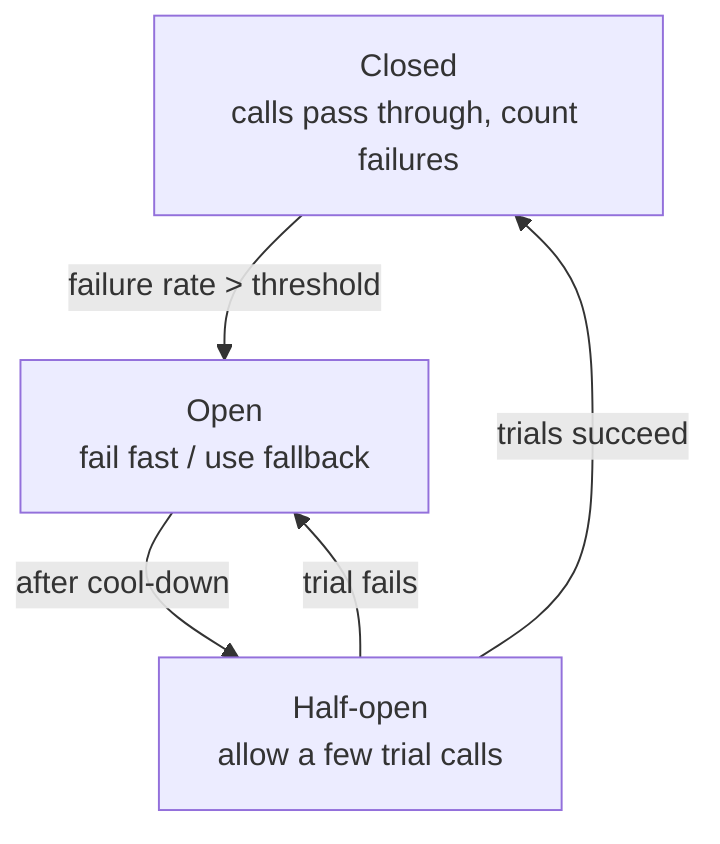

# Microservices & Architecture Patterns

[⬅ Back to index](../README.md)

Covers: monolith vs modular monolith vs microservices, service boundaries, database per service, service discovery, timeouts, retries and backoff, circuit breakers, bulkheads, BFF, sidecar, strangler fig, API versioning, serverless, multi-tenancy and cell-based architecture.

---

### 1. Monolith vs microservices – how do you choose?

Answer

| Monolith | Microservices |
|---|---|
| One deployable unit, one codebase | Many small services, each deployed independently |
| Simple to build, test, debug and deploy early on | Teams own services end to end; deploy independently |
| In-process calls, local transactions | Network calls, distributed data and transactions |
| Scales as a whole | Scale hot services individually |
| Becomes slow to change with many teams | Operational overhead: discovery, observability, CI/CD per service |

Start with a **(modular) monolith** for new products and small teams. Move to microservices when **team scaling** (many teams stepping on each other) or very different scaling/reliability needs justify the operational cost. Microservices solve an organisational problem as much as a technical one (Conway's law).

### 2. What is a modular monolith?

Answer

A single deployable application split internally into **well-bounded modules** (by business domain), each with its own public interface and data ownership, with enforced boundaries (no reaching into another module's tables). You get most of the design benefits of microservices (clear ownership, low coupling) without network calls and distributed transactions, and modules can be extracted into services later if needed. Shopify is a famous example.

### 3. How do you define service boundaries?

Answer

Use **domain-driven design**: identify **bounded contexts** (Ordering, Payments, Catalog, Shipping), each with its own model and language. A good service:
- owns one business capability and **its data**,
- changes mostly for one reason (high cohesion),
- needs few synchronous calls to others to do its job (low coupling),
- can be owned by one team.

Red flags: services that must deploy together (distributed monolith), chatty call chains for one request, or shared databases.

### 4. Why "database per service", and how do you query across services?

Answer

Each service owns its data, so others can't couple to its schema; it can choose its own store and evolve freely. Cross-service needs are handled by:
- **API calls** for real-time lookups (with caching),
- **API composition** in a gateway/BFF (call several services, merge),
- **events + local read models** (subscribe to `ProductUpdated` and keep a local copy),
- **CQRS / a reporting warehouse** for analytics across domains,
- **sagas** for cross-service transactions.

### 5. What is service discovery?

Answer

In dynamic environments, service instances come and go with changing IPs. Discovery tells callers where to send requests:
- **Client-side discovery** – the client queries a registry (Consul, Eureka) and load-balances itself.
- **Server-side discovery** – the client calls a load balancer or DNS name that knows the instances (Kubernetes Services + kube-proxy, AWS ALB).
- **Service mesh** – the sidecar handles it.

Instances register on start (or the platform does it) and are removed via health checks.

### 6. How should you set timeouts?

Answer

**Every network call needs a timeout**; without one, a slow dependency ties up threads until the whole service hangs.
- Base it on the dependency's latency (e.g. slightly above its p99.9), not a random big number.
- Use **deadline propagation**: the edge sets a total budget (e.g. 1 s) and each hop passes the remaining time down (gRPC deadlines), so downstream work stops once the user has given up.
- Separate connect and read timeouts.

### 7. How do you implement retries safely?

Answer

- Retry only **transient** errors (timeouts, 503, connection resets), never 4xx validation errors.
- Use **exponential backoff with jitter** (e.g. 100 ms, 200 ms, 400 ms ± random) so clients don't retry in sync.
- Cap attempts (2–3) and respect `Retry-After`.
- Only retry **idempotent** operations (or use idempotency keys).
- **Avoid retry storms**: retrying at every layer multiplies load (3 layers × 3 retries = 27× calls). Retry at one layer, and use a **retry budget** (e.g. retries ≤ 10% of requests).

### 8. What is a circuit breaker?

Answer

A wrapper around calls to a dependency that stops calling it when it's failing, so you fail fast instead of piling up timeouts:

While open, return a **fallback** (cached data, default value, degraded feature) or an error immediately. This protects both the caller's resources and the struggling dependency, giving it time to recover. Libraries: Resilience4j, Polly, Envoy/Istio outlier detection.

### 9. What is the bulkhead pattern?

Answer

Like a ship's watertight compartments: **isolate resources** so one failing part can't sink everything. Separate thread pools, connection pools or even service instances per dependency or per customer tier. If the recommendations service hangs, only its small pool fills; checkout keeps working. Cell-based architecture is bulkheading at the infrastructure level.

### 10. What is graceful degradation and load shedding?

Answer

- **Graceful degradation** – when a non-critical dependency fails, keep the core working with reduced features: show a product page without reviews, a feed without personalised ranking, cached prices with a "may be outdated" note.
- **Load shedding** – when overloaded, **reject excess requests early** (503/429) rather than slowing everyone down, prioritising important traffic (checkout over browsing, interactive over batch). Combine with admission control and concurrency limits.

Define in advance which features are critical and which can be turned off (kill switches).

### 11. What is the Backend for Frontend (BFF) pattern?

Answer

A separate backend layer **per client type** (iOS/Android app, web, TV) that aggregates and shapes data from downstream services for that client: one round trip per screen, payloads trimmed for mobile, client-specific auth and caching. Owned by the client team, it lets them move fast without changing core services. Risk: duplicated logic across BFFs; keep business rules in domain services. GraphQL often plays a similar role.

### 12. What are the sidecar and ambassador patterns?

Answer

- **Sidecar** – a helper process deployed alongside each service instance (same pod) that adds capabilities without changing the service: proxying and mTLS (Envoy), log shipping, config reloads, secrets.
- **Ambassador** – a sidecar specialised as an outbound proxy to external services (retries, circuit breaking, routing).
- **Adapter** – normalises a service's output (e.g. metrics format) for the platform.

They let platform teams provide cross-cutting features to services written in any language.

### 13. What is the strangler fig pattern?

Answer

A way to migrate from a legacy system incrementally: put a **routing facade** (proxy/gateway) in front of the old system, build new functionality as new services, and gradually route more paths to them until the legacy system can be switched off. No big-bang rewrite, rollback is easy (route back), and value is delivered continuously. Pair with an **anti-corruption layer** to translate between old and new models.

### 14. How do you version APIs and evolve them without breaking clients?

Answer

- Prefer **additive, backward-compatible** changes: add optional fields and endpoints; never change field meaning or remove fields that are used.
- When breaking changes are needed: new version (`/v2`, header or media type), run both, migrate clients, monitor usage of the old version, then deprecate with notice (`Sunset` header).
- Use contract tests (Pact) between services.
- Mobile apps make this critical: old app versions live for years, so the server must support several versions or force upgrades for unsupported ones.

### 15. What is serverless, and when is it a good or bad fit?

Answer

**Functions as a Service** (AWS Lambda, Cloud Functions, Cloudflare Workers) run code on demand; the provider handles servers and scaling, and you pay per invocation.

Good fit: spiky or low traffic, event processing (S3 upload → thumbnail), glue code, cron jobs, webhooks, prototypes.
Bad fit: steady high traffic (more expensive than containers), long-running jobs (time limits), latency-critical paths (cold starts), heavy stateful work or many DB connections (use proxies like RDS Proxy), and vendor lock-in concerns.

### 16. What is cell-based architecture?

Answer

The system is split into many identical, independent **cells**, each a full copy of the stack (services + data) serving a subset of users/tenants. A thin **routing layer** maps each user to a cell.
- A failure or bad deploy affects only one cell (**limited blast radius**).
- Scale by adding cells; each cell stays within tested size limits.
- Deploy cell by cell (wave-based rollouts).

Used by AWS, Slack, DoorDash and others for high availability. Cost: cross-cell features (global search, moving users between cells) need extra work.

### 17. What is the difference between orchestration and choreography?

Answer

- **Orchestration** – a central coordinator tells services what to do in a workflow and handles failures (workflow engine). Clear flow, single place for status and retries, but the orchestrator is a coupling point.
- **Choreography** – each service listens for events and reacts. Very decoupled, but the overall flow is implicit and hard to monitor; cyclic dependencies can creep in.

Use orchestration for complex, business-critical workflows (order fulfilment, onboarding) and choreography for simple fan-out reactions.

### 18. What is a distributed monolith and how do you avoid it?

Answer

Microservices that are so tightly coupled they behave like a monolith with network calls: they must be deployed together, share a database, call each other synchronously in long chains, or share domain libraries that force lockstep upgrades. You get the costs of both worlds. Avoid it with clear bounded contexts, data ownership, async communication for side effects, backward-compatible contracts and independent deployability as a hard rule.

### 19. Containers vs virtual machines, and what does Kubernetes do?

Answer

- **Virtual machines** virtualise hardware: each VM runs its own OS kernel. Strong isolation, heavier (GBs, slower to boot).
- **Containers** (Docker) share the host kernel and isolate processes with namespaces and cgroups. Lightweight (MBs), start in seconds, and package an app with its dependencies so it runs the same everywhere.

**Kubernetes** orchestrates containers across a cluster:
- **Pods** (one or more containers scheduled together), **Deployments** (desired replica count, rolling updates and rollbacks), **Services** (stable virtual IP/DNS and load balancing across pods), **Ingress/Gateway** (HTTP routing from outside), **ConfigMaps/Secrets**, **StatefulSets** (stable identity and storage for databases), **HorizontalPodAutoscaler**.
- It continuously reconciles actual state to desired state: restarts crashed containers, reschedules pods from failed nodes, and scales replicas.

Trade-off: powerful and standard, but operationally complex – managed services (EKS, GKE, AKS) or simpler platforms reduce the burden.

---

[⬅ Previous: Messaging & Event-Driven Architecture](11-messaging-event-driven.md) · [⬅ Back to index](../README.md) · [Next: Reliability, Observability & Operations ➡](13-reliability-observability.md)
