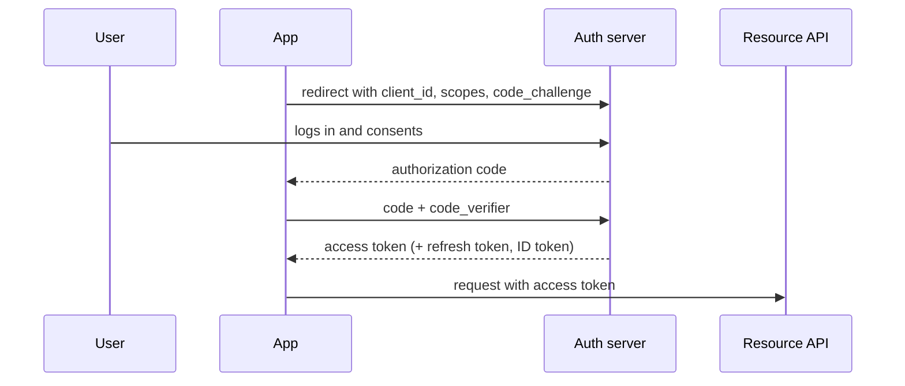

# Security in System Design

[⬅ Back to index](../README.md)

Covers: authentication vs authorisation, sessions vs JWT, OAuth 2.0 and OIDC, SSO, password storage, RBAC/ABAC/ReBAC, encryption in transit and at rest, key management, secrets, API security, DDoS protection, zero trust, multi-tenant isolation, privacy and compliance.

---

### 1. Authentication vs authorisation?

Answer

- **Authentication (authn)** – *who are you?* Passwords, passkeys, OTP, SSO, certificates.
- **Authorisation (authz)** – *what are you allowed to do?* Roles, permissions, ownership checks.

Authenticate once at the edge (gateway validates the token); authorise **in each service** close to the data ("can user 42 edit document 7?"). Never trust IDs from request parameters for identity; take them from the verified token.

### 2. Server-side sessions vs JWTs?

Answer

| Sessions | JWT (stateless tokens) |
|---|---|
| Random session ID in a cookie; data in a server store (Redis) | Signed token containing claims (user, roles, expiry) |
| Easy to revoke (delete the session) | Hard to revoke before expiry (need deny lists or short TTLs) |
| Requires a lookup per request | Verified locally with a public key; no lookup → scales well across services |
| Small cookie | Larger, and claims can go stale |

Common approach: **short-lived access tokens (5–15 min JWT) + long-lived refresh tokens** stored server-side and **rotated** on each use (reuse detection signals theft). Store web tokens in `HttpOnly`, `Secure`, `SameSite` cookies rather than localStorage (XSS).

### 3. How does OAuth 2.0 work? What is OIDC?

Answer

**OAuth 2.0** is a delegation framework: a user lets an app access their resources at another service without sharing their password. The standard flow for apps today is **Authorization Code + PKCE**:

- **Scopes** limit what the token can do.
- **Client credentials** flow for service-to-service.
- **OpenID Connect (OIDC)** adds an **identity layer** on top (an ID token with who the user is), enabling "Sign in with Google/Apple" and enterprise SSO.

### 4. How should passwords be stored?

Answer

Never store plaintext or plain hashes (SHA-256 is too fast to brute-force). Use a **slow, salted password hashing** algorithm: **Argon2id** (preferred), bcrypt or scrypt, with a per-user random salt (built in) and tuned cost. Add rate limiting and lockouts on login, breached-password checks, and MFA. Better still, support **passkeys (WebAuthn)**, which remove shared secrets entirely and resist phishing.

### 5. RBAC vs ABAC vs ReBAC?

Answer

- **RBAC (role-based)** – users get roles (admin, editor, viewer); roles have permissions. Simple; can explode into many roles.
- **ABAC (attribute-based)** – policies over attributes of the user, resource and context ("managers can approve expenses < $5K in their own department during work hours"). Flexible; harder to audit. Engines: OPA, Cedar.
- **ReBAC (relationship-based)** – permissions derive from relationships in a graph ("viewer of a folder → viewer of its documents"). Google's **Zanzibar** model (SpiceDB, OpenFGA) powers sharing in Drive/Docs-like products at huge scale.

### 6. How do you encrypt data in transit and at rest?

Answer

- **In transit** – TLS everywhere: client → edge, and service → service (**mTLS** in zero-trust networks). HSTS for web.
- **At rest** – disk/volume encryption and database/object-store encryption (AES-256), managed by a **KMS**. For sensitive fields (SSN, card data), add **application-level / field-level encryption** so DB admins and backups don't expose plaintext.
- **End-to-end encryption** (Signal protocol in WhatsApp) – only the endpoints hold keys; the server can't read content (this limits server-side features like search and moderation).

### 7. What is envelope encryption and how is key management done?

Answer

Data is encrypted with a **data encryption key (DEK)**; the DEK is encrypted with a **key encryption key (KEK)** held in a **KMS/HSM** that never exports it. You store the encrypted DEK next to the data. Benefits: the KMS only handles tiny keys (fast, cheap), **key rotation** re-wraps DEKs instead of re-encrypting all data, and access to the KEK is audited and controlled by IAM. **Crypto-shredding**: delete a user's key to make their data unreadable (useful for GDPR erasure in immutable logs).

### 8. How should secrets (API keys, DB passwords) be managed?

Answer

- Never in source code, images or plain environment files in repos.
- Store in a **secrets manager** (Vault, AWS Secrets Manager, GCP Secret Manager); inject at runtime with least privilege.
- Prefer **short-lived, automatically rotated** credentials (dynamic DB credentials, IAM roles / workload identity instead of static keys).
- Audit access; scan repos for leaked secrets (pre-commit hooks, GitHub secret scanning).

### 9. What are the key API security practices?

Answer

- Strong authn (OAuth/OIDC, mTLS for services) and **object-level authorisation** on every request (the #1 API vulnerability is broken object-level authorisation: changing `/orders/123` to `/orders/124`).
- **Input validation** and parameterised queries (SQL injection), output encoding (XSS), CSRF protection for cookie auth.
- **Rate limiting** and quotas; pagination limits; payload size limits.
- Don't leak internals in errors; return consistent error formats.
- Signed webhooks; idempotency keys; audit logs for sensitive actions.
- Follow the **OWASP API Security Top 10**.

### 10. How do you protect a system from DDoS attacks?

Answer

Layered defence:
- **Edge/CDN with anycast** absorbs volumetric attacks across a huge global network (Cloudflare, AWS Shield, Akamai).
- **WAF** rules for application-layer (L7) attacks; bot detection and challenges (CAPTCHA, proof of work).
- **Rate limiting** per IP/user/API key; connection limits.
- **Autoscaling** plus load shedding to stay up under legitimate surges.
- Hide origin IPs behind the CDN; restrict origin to accept CDN traffic only.
- Cache aggressively so attacks hit cached content.

### 11. What is zero-trust architecture?

Answer

"Never trust, always verify": being **inside the network grants no trust**. Every request (user or service) is authenticated, authorised and encrypted, based on identity and device posture, with least privilege. In practice: mTLS between services with workload identities (SPIFFE), identity-aware proxies instead of VPNs (Google BeyondCorp), fine-grained policies, continuous monitoring. It limits lateral movement after a breach.

### 12. How do you isolate tenants in a multi-tenant system?

Answer

- **Data isolation** – separate databases/schemas for high-value tenants, or shared tables with a mandatory `tenant_id` enforced at the data layer (row-level security, a repository layer that always filters, tests that try cross-tenant access).
- **Per-tenant encryption keys** for strong isolation and easy offboarding.
- **Resource isolation** – quotas, rate limits, separate queues or cells to prevent noisy neighbours.
- Tenant context propagated in tokens, never trusted from user input.

### 13. How do privacy regulations (GDPR, CCPA, data residency) affect design?

Answer

- **Data minimisation** – collect only what you need; retention policies with automatic deletion.
- **Right to erasure / access** – you must find and delete or export all of a user's data across services, caches, backups, logs and analytics. Design a user-data inventory and deletion pipeline (fan-out delete events; crypto-shredding for immutable stores).
- **Data residency** – keep EU users' data in EU regions (route by user home region, partition storage by region).
- **Consent** tracking, pseudonymisation of analytics, audit trails, encryption.

### 14. What is the principle of least privilege and defence in depth?

Answer

- **Least privilege** – every user, service and credential gets only the permissions needed, for only as long as needed (scoped tokens, IAM roles per service, just-in-time admin access).
- **Defence in depth** – multiple independent layers (WAF + authn + authz + encryption + network segmentation + monitoring), so one failure doesn't mean a breach.

Mention both when wrapping up a design: security reviewers look for them.

### 15. How do you secure file uploads?

Answer

- Upload directly to object storage via **short-lived pre-signed URLs** scoped to one key and size limit.
- Validate content type by inspecting bytes (not just the extension); size limits.
- **Malware scanning** in an async pipeline before files become visible.
- Serve user content from a **separate domain** (sandbox) to prevent XSS/cookie theft; strip metadata (EXIF GPS) from images.
- Private buckets; access via signed URLs or a CDN with token auth.

---

[⬅ Previous: Reliability, Observability & Operations](13-reliability-observability.md) · [⬅ Back to index](../README.md) · [Next: Big Data & Stream Processing ➡](15-big-data-streaming.md)
