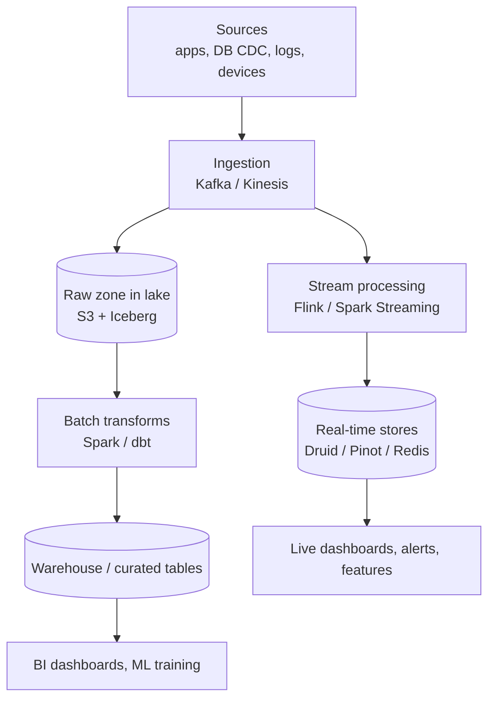

# Big Data & Stream Processing

[⬅ Back to index](../README.md)

Covers: OLTP vs OLAP, data warehouses vs lakes vs lakehouses, ETL vs ELT, batch vs stream processing, MapReduce and Spark, Flink and Kafka Streams, windowing and watermarks, exactly-once in streams, Lambda vs Kappa architecture, columnar storage, top-K and counting at scale.

---

### 1. OLTP vs OLAP?

Answer

| OLTP (transactional) | OLAP (analytical) |
|---|---|
| Many small reads/writes by key (place order, update profile) | Few large queries scanning millions of rows (revenue by region per month) |
| Row-oriented storage, indexes, low latency | **Columnar** storage, compression, massively parallel scans |
| Normalised schemas | Denormalised star/snowflake schemas (fact + dimension tables) |
| Postgres, MySQL, DynamoDB | Snowflake, BigQuery, Redshift, ClickHouse, Druid, Pinot |

Never run heavy analytics on the production OLTP database; replicate data (CDC/ETL) into an analytical store.

### 2. Data warehouse vs data lake vs lakehouse?

Answer

- **Data warehouse** – structured, cleaned, schema-on-write data optimised for SQL analytics (Snowflake, BigQuery, Redshift). Reliable and fast, more expensive, less flexible.
- **Data lake** – raw data of any format in cheap object storage (S3), schema-on-read. Flexible and cheap, but can become a "swamp" without governance.
- **Lakehouse** – open table formats (**Apache Iceberg, Delta Lake, Hudi**) on object storage that add ACID transactions, schema evolution, time travel and good query performance, so one copy of data serves both BI and ML (Databricks, Iceberg + Trino/Spark/Snowflake).

### 3. ETL vs ELT?

Answer

- **ETL** – Extract, **Transform** (in a separate processing layer), then Load into the warehouse. Traditional; good when the warehouse was expensive or data must be cleaned before landing.
- **ELT** – Extract, **Load raw** into the warehouse/lake, then Transform inside it with SQL (dbt). The modern default because cloud warehouses are scalable and raw data stays available for re-processing.

Orchestrate pipelines with Airflow/Dagster, and add data quality checks and lineage.

### 4. Batch vs stream processing?

Answer

- **Batch** – process a bounded dataset periodically (hourly/daily): reports, ML training, billing, rebuilding indexes. High throughput, simpler, latency of hours.
- **Stream** – process unbounded data continuously as events arrive: fraud detection, real-time metrics, alerting, live dashboards, recommendations. Latency of milliseconds to seconds, but harder (state, out-of-order events, exactly-once).

Many systems use both: streaming for fresh approximate results, batch for complete accurate ones.

### 5. How does MapReduce work, and why did Spark replace it?

Answer

**MapReduce:** the input is split across workers; **map** emits key-value pairs; the framework **shuffles** (groups by key, across the network); **reduce** aggregates each key's values. Example – word count: map emits `(word, 1)`, reduce sums. It's fault-tolerant (re-run failed tasks) and scales to petabytes, but writes intermediate results to disk between every stage, so multi-step jobs are slow.

**Spark** keeps intermediate data **in memory** where possible, builds a DAG of operations with lazy evaluation and optimisation, and offers SQL/DataFrames, streaming and ML libraries. It's 10–100× faster for iterative and multi-stage workloads.

### 6. What are Flink and Kafka Streams used for?

Answer

Stateful stream processors:
- **Apache Flink** – true event-at-a-time streaming with large managed state, **event-time** processing with watermarks, exactly-once state via distributed **checkpoints**, low latency. Used for fraud detection, real-time ETL, ad-click aggregation, CEP.
- **Kafka Streams** – a library (no separate cluster) for apps that read from and write to Kafka; state stored in local RocksDB backed by changelog topics. Simple to deploy for Kafka-centric pipelines.
- **Spark Structured Streaming** – micro-batch streaming with the Spark API.

### 7. What are windows in stream processing?

Answer

Aggregating an infinite stream requires grouping events into windows:
- **Tumbling** – fixed, non-overlapping (clicks per minute).
- **Sliding/hopping** – fixed size, overlapping (last 5 minutes, every 1 minute).
- **Session** – grouped by activity separated by gaps of inactivity (a user's browsing session).
- **Global** with custom triggers.

### 8. Event time vs processing time? What are watermarks?

Answer

- **Event time** – when the event actually happened (timestamp in the event).
- **Processing time** – when the system processes it.

Mobile devices go offline and networks delay events, so events arrive **late and out of order**. Aggregating by processing time gives wrong answers. A **watermark** is the processor's estimate that "no more events older than T will arrive"; when it passes the end of a window, the window's result is emitted. Late events after the watermark are dropped, sent to a side output, or used to **update** results within an allowed lateness.

### 9. How do you achieve exactly-once results in stream processing?

Answer

- **Checkpointing** state and input offsets together (Flink's distributed snapshots) so a restart resumes from a consistent point without double counting internal state.
- **Transactional or idempotent sinks** – Kafka transactions (two-phase commit with checkpoints), upserts keyed by a deterministic ID, or deduplication at the destination.
- Deduplicate input by event ID within a window if producers may send duplicates.

End-to-end exactly-once requires the source to be replayable, state to be checkpointed, and the sink to be transactional or idempotent.

### 10. Lambda vs Kappa architecture?

Answer

- **Lambda** – two parallel paths: a **batch layer** recomputes accurate views over all data, a **speed layer** handles recent data in real time; a serving layer merges them. Accurate and fresh, but you maintain the **same logic twice**.
- **Kappa** – **streaming only**: everything is a stream from a replayable log (Kafka); to fix bugs or change logic, replay the log through a new version of the job. One codebase; requires long log retention and a capable stream processor.

Modern stacks lean towards Kappa (plus lakehouse tables for history).

### 11. Why is columnar storage so fast for analytics?

Answer

Analytical queries read a few columns across many rows. Columnar formats (Parquet, ORC, warehouse internals) store each column contiguously, so a query reads **only the needed columns**; values of one column are similar, so **compression** (dictionary, run-length, delta) is very effective; and CPUs process them with **vectorised** (SIMD) execution. Plus min/max statistics per block allow skipping irrelevant data (predicate pushdown) and **partitioning** by date prunes whole files.

### 12. How do you compute top-K (heavy hitters) over a huge stream?

Answer

Example: top 100 trending hashtags in the last hour.
- **Exact** – count per key in a stream processor with windows (partitioned by key), then each partition sends its local top-K to a merger for the global top-K. Memory grows with the number of distinct keys.
- **Approximate** – **Count-Min Sketch** for frequencies + a min-heap of size K; fixed memory, small overcount error. Good for very high-cardinality streams.
- For time decay ("trending"), use sliding windows or exponentially decayed counts, and compare against a baseline to find **unusual** growth, not just raw popularity.

### 13. How do you count things (likes, views) at very large scale?

Answer

- Don't increment one database row per event (a hot row): **buffer and batch** – aggregate counts in memory or in a stream processor and flush periodically (e.g. every few seconds).
- **Sharded counters** – split one counter into N rows/keys and sum on read.
- Redis `INCR` for fast approximate real-time counts, periodically persisted.
- **HyperLogLog** for unique counts (unique viewers).
- Accept eventual consistency in displayed counts ("1.2M views").
- Deduplicate events for correctness-sensitive counts (ad billing).

### 14. What is a data pipeline's typical architecture?

Answer

Add: a schema registry, data quality checks, lineage and catalog, access control and PII handling, and backfill/replay capability.

### 15. What is a feature store (for ML)?

Answer

A system that manages ML features consistently for **training (offline)** and **serving (online)**: an offline store (warehouse/lake) with historical feature values for building training sets with **point-in-time correctness** (no data leakage from the future), and an online store (Redis, DynamoDB) with the latest values for low-latency inference. Features are computed by batch and streaming pipelines from shared definitions, preventing **training-serving skew**. Examples: Feast, Tecton, in-house stores at Uber (Michelangelo) and Airbnb.

---

[⬅ Previous: Security in System Design](14-security.md) · [⬅ Back to index](../README.md) · [Next: Designs – Core Infrastructure ➡](16-designs-core-infrastructure.md)
