# Designs – Core Infrastructure

[⬅ Back to index](../README.md)

Covers full interview walkthroughs of the classic infrastructure prompts: URL shortener, rate limiter, unique ID generator, key-value store, distributed cache, web crawler, notification system, search autocomplete, job scheduler, distributed message queue, and metrics monitoring & alerting.

Each answer follows the interview flow: **requirements → estimates → API → data model → high-level design → deep dives → trade-offs**.

---

### 1. Design a URL shortener (like bit.ly / TinyURL).

<details>
<summary>Answer</summary>

**Requirements**
- Functional: create a short URL for a long URL (optional custom alias, expiry); redirect short → long; basic click analytics.
- Non-functional: very low redirect latency, high availability (broken links are bad), short codes not guessable in sequence, read-heavy (~100:1).

**Estimates** – 100M new URLs/month → ~40 writes/s; ~4K redirects/s (peak ~10K). 6B URLs over 5 years × ~500 B ≈ 3 TB. 7 base62 chars = 3.5 trillion codes.

**API**
```
POST /v1/urls { longUrl, alias?, expiresAt? } → 201 { code, shortUrl }
GET  /{code} → 301/302 Location: longUrl
```

**Data model** – `urls(code PK, long_url, user_id, created_at, expires_at)`. A key-value store (DynamoDB/Cassandra) or sharded Postgres keyed by `code`.

**High-level design**
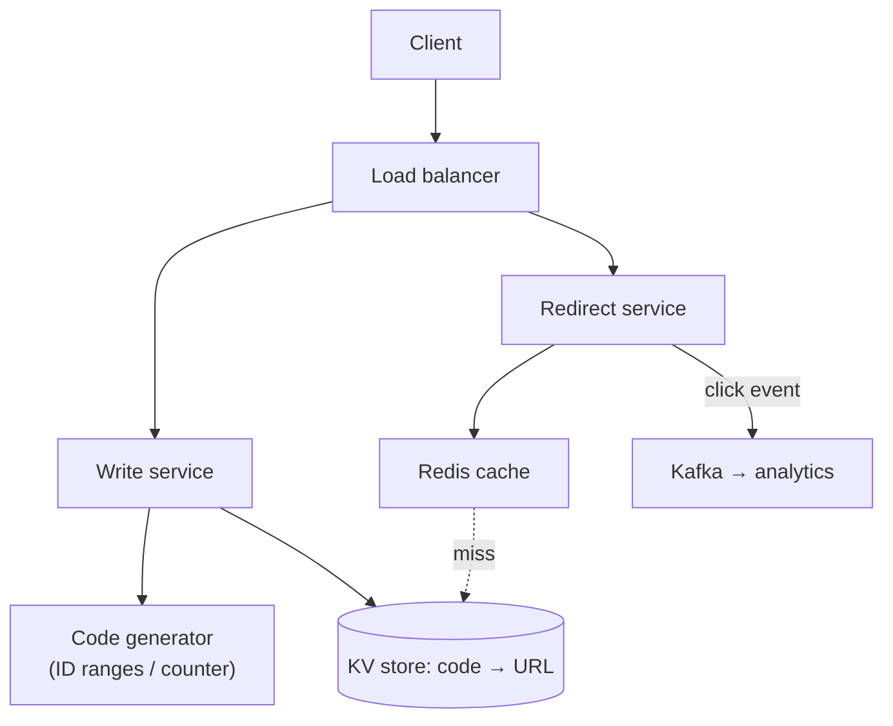

**Deep dives**
- **Generating codes**:
  - *Hash* (MD5/SHA of the URL, take 7 chars) – collisions need checking and retrying.
  - *Counter + base62* – unique and short, but sequential (guessable) and needs a distributed counter: give each server a **range** of IDs from a coordinator (ZooKeeper/DB) so there's no per-request coordination; optionally shuffle bits so codes look random.
  - *Pre-generated key service* – generate random unique codes offline into a pool; servers take batches.
- **301 vs 302** – 301 (permanent) is cached by browsers, which reduces load but hides clicks from analytics; 302 keeps every click visible. Choose by whether analytics matters.
- **Caching** – the hot 20% of codes fit in ~tens of GB of Redis; cache-aside with long TTL (URLs rarely change).
- **Analytics** – emit click events asynchronously to Kafka; aggregate in a stream processor; never slow the redirect.
- **Abuse** – rate-limit creation, scan URLs against malware/phishing lists, custom aliases need uniqueness checks.
- **Expiry** – lazy check on read + background cleanup.

**Trade-offs** – random codes avoid enumeration but need collision checks; counter ranges are simple and collision-free. A KV store scales simply because access is always by key.

</details>

### 2. Design a distributed rate limiter.

<details>
<summary>Answer</summary>

**Requirements**
- Limit requests per user/API key/IP per time window (e.g. 100/min), with different rules per endpoint and plan.
- Low latency overhead (< 1–2 ms), accurate across many servers, highly available (if the limiter fails, **fail open** for most APIs), return 429 with headers.

**Where** – in the API gateway or as middleware/sidecar, with a shared counter store.

**Algorithm** – **token bucket** (allows bursts) or **sliding window counter** (accurate, cheap). See [algorithms](05-load-balancing-proxies-gateways.md).

**High-level design**
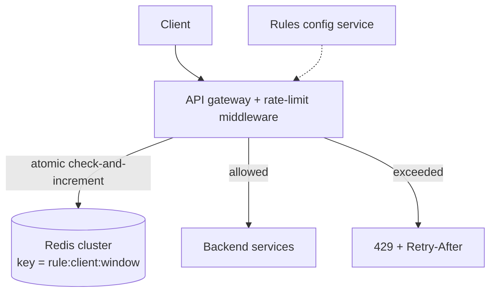

**Deep dives**
- **Atomicity** – read-check-increment must be atomic across concurrent requests: use a **Redis Lua script** (or `INCR` + `EXPIRE` for fixed windows; sorted sets for sliding logs).
- **Latency/scale** – Redis round trip per request; shard keys across a Redis cluster; for extremely high QPS, keep **local token buckets** per server that sync with Redis periodically (slightly less accurate, much faster).
- **Multi-region** – limits per region (simple) or asynchronously synced global counters (approximate).
- **Failure** – if Redis is unreachable, fail open (allow) for normal APIs, fail closed for sensitive ones (login attempts, OTP sends).
- **Response** – `429`, `Retry-After`, `X-RateLimit-Limit/Remaining/Reset`.
- **Rules** – stored in config, cached in each limiter, hot-reloaded.

**Trade-offs** – centralised Redis = accurate but adds a hop and a dependency; local limits = fast but approximate. Token bucket allows bursts; leaky bucket smooths them.

</details>

### 3. Design a unique ID generator in a distributed system.

<details>
<summary>Answer</summary>

**Requirements** – IDs are unique across all servers, 64-bit numeric, **roughly time-sortable**, generated at high rate (10K+/s per node) with no central bottleneck.

**Options**
- **DB auto-increment** – simple, but a single point of failure and bottleneck. Multi-master with step (server 1: 1,3,5; server 2: 2,4,6) breaks with scaling.
- **UUID v4** – no coordination, but 128-bit, random (bad index locality), not sortable. **UUIDv7/ULID** are time-ordered and fix locality.
- **Ticket server / range allocation** – a central service hands out blocks of 1,000 IDs; servers allocate locally.
- **Twitter Snowflake** – 64-bit: `1 sign bit | 41 bits timestamp (ms since custom epoch, ~69 years) | 10 bits machine ID | 12 bits sequence (4,096 per ms per machine)`.

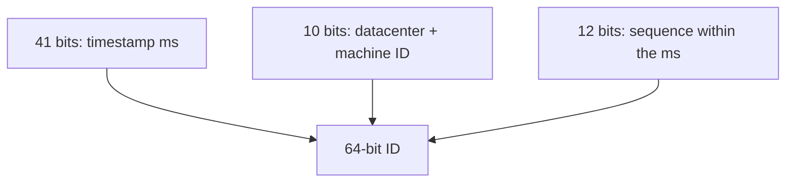

**Deep dives (Snowflake)**
- **Machine IDs** assigned via ZooKeeper/etcd or config on startup.
- **Clock going backwards** (NTP) – refuse to generate until the clock catches up, or use the last timestamp + sequence; alert.
- **Sequence overflow** within a millisecond – wait for the next millisecond.
- IDs are k-sorted (roughly ordered by time across machines), good for DB indexes and feed ordering.

**Trade-offs** – Snowflake gives compact, sortable IDs with no coordination per ID, but depends on clock sanity and machine ID management. Use UUIDv7 when 128 bits are fine and you want zero setup.

</details>

### 4. Design a distributed key-value store (like DynamoDB / Cassandra).

<details>
<summary>Answer</summary>

**Requirements** – `put(key, value)`, `get(key)`; huge scale (TBs–PBs), high availability, tunable consistency, low latency, automatic scaling, tolerate node failures.

**High-level design**
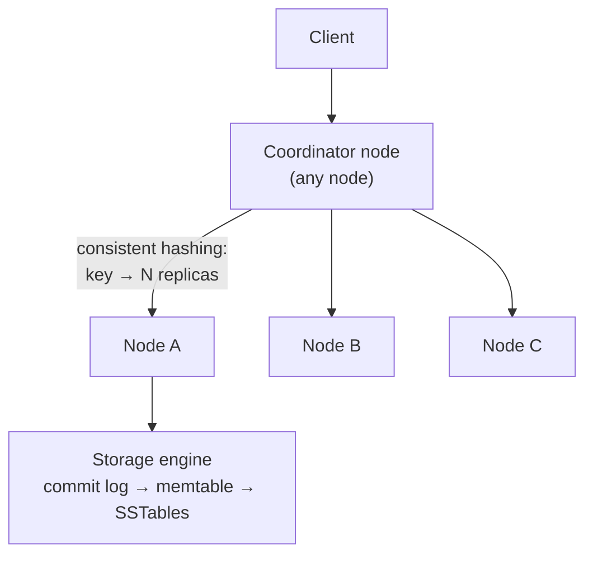

**Key components**
- **Partitioning** – consistent hashing with virtual nodes; each key stored on N successive nodes (replication factor 3).
- **Replication + quorum** – write to N, wait for W; read from N, wait for R; W + R > N for strong-ish reads. Tunable per request.
- **Versioning and conflicts** – vector clocks or last-write-wins timestamps; read returns siblings for the app to resolve (Dynamo), or LWW (Cassandra).
- **Failure handling** – **hinted handoff** for temporary failures; **Merkle-tree anti-entropy** for permanent repair; **read repair**.
- **Membership/failure detection** – gossip protocol.
- **Storage engine** – LSM tree: commit log for durability, memtable, flushed to SSTables, compaction, Bloom filters to skip SSTables on reads.

**Trade-offs** – AP design (always writable, eventually consistent) vs CP (consensus per partition, e.g. Raft groups like TiKV: strongly consistent, unavailable for a partition without a majority). Mention CAP/PACELC choice explicitly.

</details>

### 5. Design a distributed cache (like Redis Cluster / Memcached at scale).

<details>
<summary>Answer</summary>

**Requirements** – get/set/delete with TTL, sub-millisecond latency, scale to TBs of memory and millions of ops/s, high availability, eviction when full.

**Design**
- **Partitioning** – hash slots (Redis: 16,384 slots mapped to nodes) or consistent hashing; clients cache the slot map and route directly (smart clients), or go through a proxy (Twemproxy, Envoy, mcrouter).
- **Node internals** – in-memory hash table, LRU/LFU eviction with memory limits, TTL handled by lazy expiry on access + periodic sampling.
- **Replication** – each shard has a primary + replicas (async); automatic failover via sentinel/cluster gossip.
- **Hot keys** – client-side local cache, replicate hot keys across shards.
- **Resharding** – move slots between nodes online (keys migrate; clients redirected with MOVED/ASK).
- **Persistence (optional)** – snapshots + append-only file for warm restarts.

**Deep dives** – cache stampede protection (single-flight, stale-while-revalidate), consistency with DB (invalidate on write, CDC), multi-region (local cache per region, invalidation via a replicated event stream like Meta's mcsqueal reading MySQL binlogs).

**Trade-offs** – async replication may lose recent writes on failover (acceptable for a cache). Proxies simplify clients but add a hop.

</details>

### 6. Design a web crawler.

<details>
<summary>Answer</summary>

**Requirements** – crawl billions of pages for a search index; politeness (respect robots.txt and per-host rate limits); avoid duplicates; prioritise important/fresh pages; recrawl periodically; robust to traps and bad HTML.

**Estimates** – 1B pages/month ≈ 400 pages/s; 100 KB each → ~40 MB/s download, ~100 TB/month raw.

**High-level design**
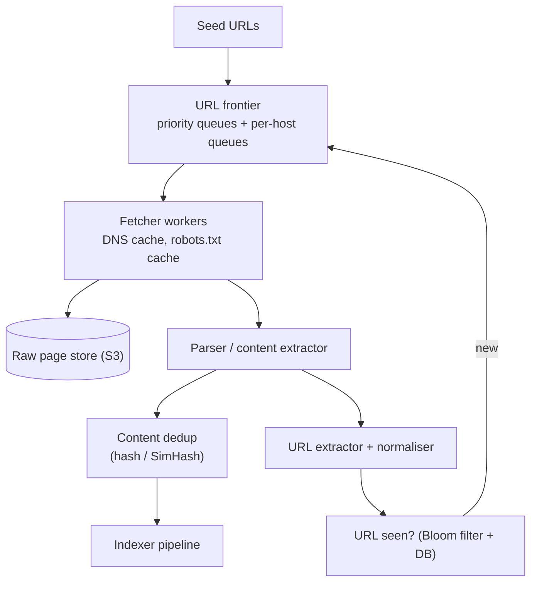

**Deep dives**
- **URL frontier** – front queues by **priority** (PageRank, freshness, domain importance); back queues **one per host** so each host is fetched by one worker with delays (politeness).
- **Deduplication** – URL-level (normalise URLs, Bloom filter + persistent set) and content-level (exact hash, **SimHash/MinHash** for near-duplicates).
- **DNS** – a local DNS cache; DNS lookups are a hidden bottleneck.
- **Traps** – limit URL length/depth, detect infinite calendars, cap pages per host.
- **Recrawl** – schedule by change frequency (news sites hourly, static pages monthly); use `If-Modified-Since`/ETag.
- **Distribution** – partition the frontier by host hash across crawler nodes so politeness state stays local.
- **Rendering** – a separate headless-browser pool for JavaScript-heavy pages (expensive; use selectively).

</details>

### 7. Design a notification system (push, SMS, email).

<details>
<summary>Answer</summary>

**Requirements**
- Send notifications from many internal services via push (APNs/FCM), SMS, email and in-app.
- User preferences and opt-outs, templates and localisation, scheduling, rate limiting (don't spam), deduplication, delivery tracking, millions per minute at peak (marketing blasts), priorities (OTP ≫ marketing).

**High-level design**
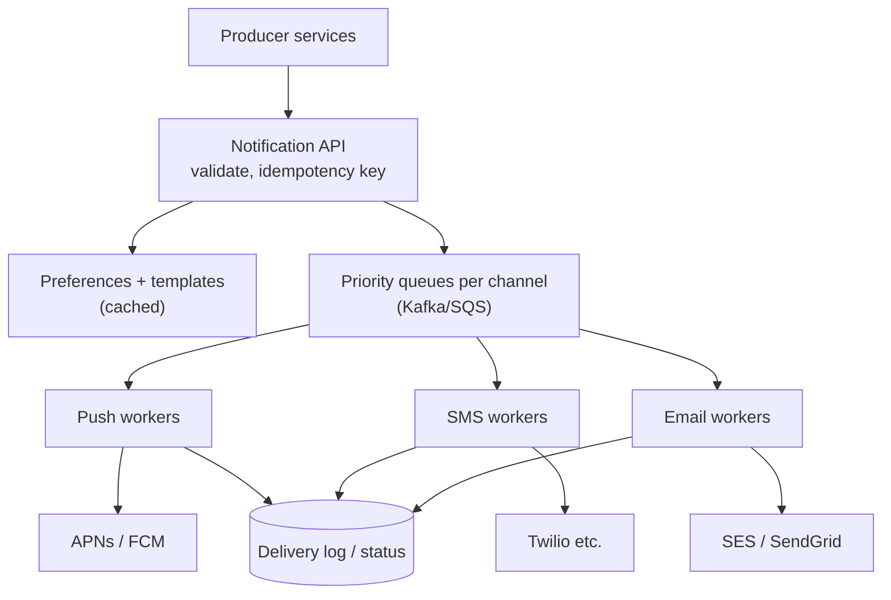

**Deep dives**
- **Decoupling via queues** – separate queues per channel and priority so a marketing blast doesn't delay OTPs.
- **Device tokens** – a table of user → device tokens; remove tokens APNs/FCM report as invalid.
- **Reliability** – at-least-once with retries and backoff; dedupe by notification ID so users don't get doubles; DLQ for failures; fallback channel (push failed → SMS for critical).
- **Rate limiting & batching** – per-user caps, quiet hours, digesting ("5 new likes"); respect provider rate limits.
- **Templates & i18n** – template service renders per locale.
- **Scheduling** – delayed queue / scheduler for "send at 9 am local time" (bucket by time zone).
- **Tracking** – delivered/opened/clicked events into analytics; unsubscribe links (legal requirements).

**Trade-offs** – third-party providers are the bottleneck and failure point; use multiple providers with failover for critical channels.

</details>

### 8. Design search autocomplete (typeahead).

<details>
<summary>Answer</summary>

**Requirements** – return the top 5–10 suggestions for a prefix within ~100 ms as the user types; ranked by popularity (and freshness/personalisation); billions of queries/day; suggestions updated at least daily (trending faster).

**Estimates** – 10B searches/day, ~20 keystroke requests per search → but debounced; still ~100K+ QPS of prefix lookups.

**High-level design**
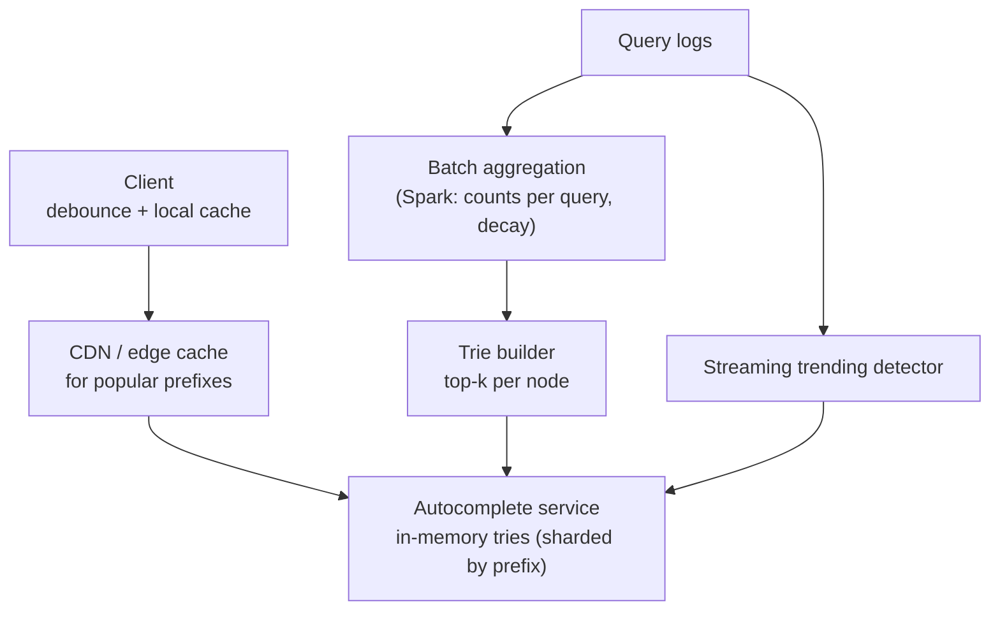

**Deep dives**
- **Data structure** – a **trie** where each node caches the **top-k completions** for its prefix, so a lookup is O(prefix length) with no subtree walk.
- **Building** – offline from query logs (weighted by frequency with time decay), filtered for offensive/PII content; atomically swap new versions into servers.
- **Sharding** – by prefix range (balanced by traffic, not alphabet: "s" is huge, "x" tiny) or replicate the whole trie if it fits in memory.
- **Caching** – short prefixes are very hot; cache at the CDN and the client.
- **Personalisation** – blend global results with the user's recent searches client-side or in a light re-ranking step.
- **Trending** – a streaming job detects sudden spikes and injects them between batch rebuilds.

</details>

### 9. Design a distributed job scheduler (like cron at scale).

<details>
<summary>Answer</summary>

**Requirements** – schedule one-off and recurring jobs (cron expressions); execute each run **exactly once** (or at-least-once with idempotent jobs); millions of jobs; retries, timeouts, priorities; job status and history; horizontally scalable; no single point of failure.

**High-level design**
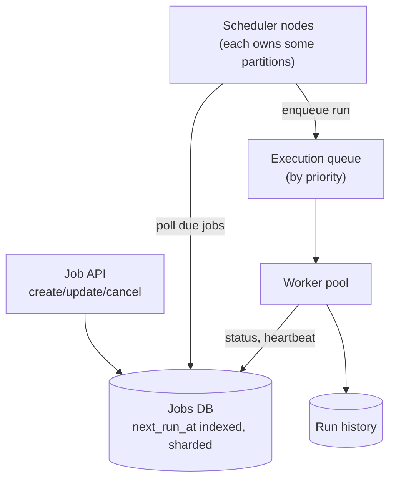

**Deep dives**
- **Finding due jobs** – an index on `next_run_at`; schedulers claim partitions (leader per partition via etcd/ZooKeeper leases) and poll `WHERE next_run_at <= now`, or use time buckets (per-minute lists in Redis sorted sets / timing wheels) for efficiency.
- **Exactly-once execution** – claim a run atomically (`UPDATE … SET status='RUNNING', owner=? WHERE id=? AND status='SCHEDULED'`, or `SELECT … FOR UPDATE SKIP LOCKED`), make jobs idempotent with a run ID.
- **Failures** – workers heartbeat; a reaper reschedules runs whose heartbeat expired; retries with backoff; DLQ after max attempts.
- **Recurring jobs** – after scheduling a run, compute and store the next `next_run_at`.
- **Scale & fairness** – per-tenant quotas, priorities, separate pools for long jobs.
- **Existing tools** – Airflow (DAG workflows), Temporal (durable workflows), Kubernetes CronJobs, Quartz.

</details>

### 10. Design a distributed message queue (like Kafka).

<details>
<summary>Answer</summary>

**Requirements** – producers publish to topics; consumers in groups read messages; durability (no loss after ack), high throughput, ordering per key, configurable retention, replay, horizontal scale.

**High-level design**
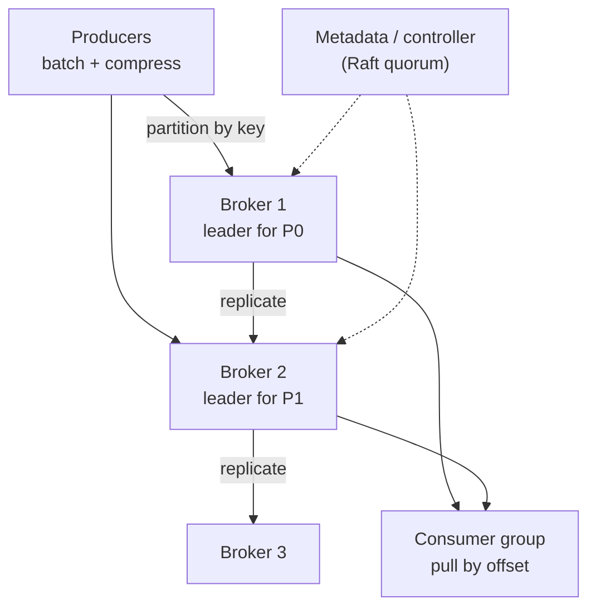

**Key design points**
- **Storage** – each partition is an **append-only log** split into segment files; sequential writes, page cache, zero-copy reads; an index from offset → file position. Retention deletes old segments (cheap).
- **Replication** – leader + followers; a write is committed when all **in-sync replicas** have it (`acks=all`); a controller (Raft-based) handles leader election on failure.
- **Consumers** – pull-based (consumers control their rate), track offsets per group (stored in an internal topic); a group coordinator assigns partitions and rebalances on membership changes.
- **Delivery semantics** – at-least-once by committing offsets after processing; idempotent producers (sequence numbers per producer) remove duplicates from retries; transactions for exactly-once in pipelines.
- **Ordering** – only within a partition.
- **Scaling** – more partitions and brokers; partitions are the unit of parallelism.

**Trade-offs** – pull vs push (pull handles slow consumers and batching better), more partitions = more parallelism but more metadata and longer failovers.

</details>

### 11. Design a metrics monitoring and alerting system (like Datadog / Prometheus).

<details>
<summary>Answer</summary>

**Requirements** – collect metrics from hundreds of thousands of hosts/services; store time-series with labels; query and dashboard (last hour fast, last year possible); alert on rules within ~1 min; high write volume (millions of points/s); retention with downsampling.

**High-level design**
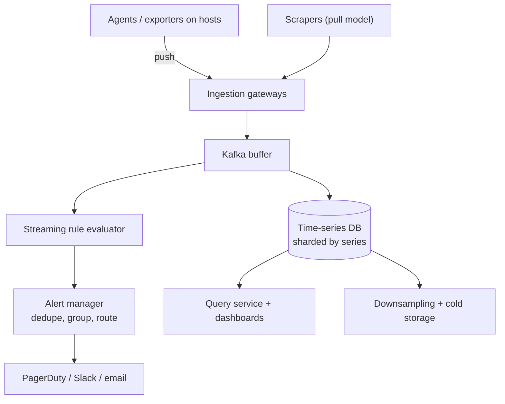

**Deep dives**
- **Push vs pull** – pull (Prometheus) knows which targets are down and controls load; push suits short-lived jobs and firewalled hosts. Both are common.
- **Storage** – TSDB with Gorilla compression (delta-of-delta timestamps, XOR values), time-partitioned blocks, inverted index on labels.
- **Cardinality** – each unique label set is a series; limit high-cardinality labels (user ID), enforce quotas per team.
- **Downsampling** – raw data for days, 1-minute rollups for weeks, 1-hour for a year; old blocks in object storage (Thanos/Cortex/Mimir).
- **Alerting** – evaluate rules on recent data (in memory or streaming); dedupe and group alerts; silences and escalation; the alerting path must be **more reliable than what it monitors** (separate deployment, meta-monitoring).

</details>

### 12. Design Pastebin.

<details>
<summary>Answer</summary>

**Requirements** – users paste text and get a short link; optional expiry, visibility (public/unlisted/private), syntax highlighting; read-heavy; pastes up to ~10 MB.

**Design**
- **Write** – generate a unique key (same options as the [URL shortener](#1-design-a-url-shortener-like-bitly--tinyurl): counter ranges + base62, or random with collision check); store the **content in object storage** (S3) keyed by paste ID and **metadata** (key, owner, size, created, expiry, visibility, content hash) in a KV/SQL database.
- **Read** – look up metadata (cache hot keys in Redis), fetch content from object storage – or serve it through a **CDN** with long cache lifetimes, since pastes are immutable.
- **Expiry** – lazy check on read + a background job that deletes expired pastes and their objects (or object-storage lifecycle rules).
- **Dedup** – identical content can share one stored object (content hash).
- **Abuse** – rate limits, size limits, malware/secret scanning, takedown flow.

Difference from the URL shortener: the payload is large, so storage and CDN delivery matter more than the redirect path.

</details>

### 13. Design a content delivery network (CDN).

<details>
<summary>Answer</summary>

**Requirements** – serve static and cacheable content from locations near users worldwide; reduce origin load; high availability; purge/invalidation; TLS; DDoS resilience.

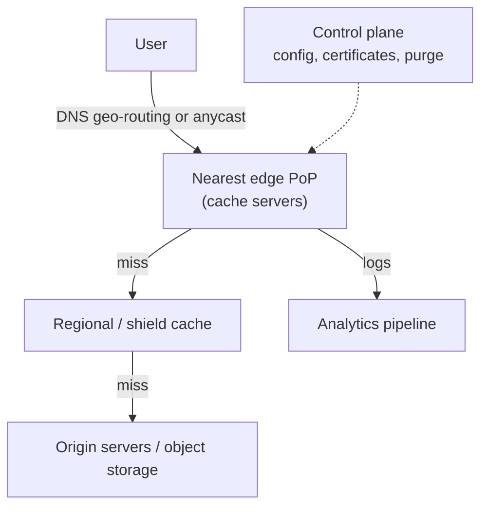

**Deep dives**
- **Routing** – anycast IPs or DNS returning the closest healthy PoP based on latency measurements.
- **Cache hierarchy** – edge → regional shield → origin. The shield collapses misses so the origin sees one request per object, and **request coalescing** merges concurrent misses for the same object.
- **Within a PoP** – consistent hashing of URLs across cache servers so each object lives on one (or a few) servers; memory for hot objects, SSD for the long tail.
- **Cache keys and rules** – based on URL + selected headers (`Vary`), TTLs from `Cache-Control`, stale-while-revalidate, query-string handling.
- **Invalidation** – purge by URL/tag pushed from the control plane to all PoPs (eventually consistent within seconds); prefer versioned file names.
- **TLS** at the edge with certificates distributed securely; HTTP/2 and HTTP/3.
- **Resilience** – absorb DDoS with huge distributed capacity; withdraw failing PoPs from anycast; serve stale content if the origin is down.

</details>

### 14. Design a distributed logging system (like ELK / Splunk).

<details>
<summary>Answer</summary>

**Requirements** – collect logs from thousands of services, search them within seconds, keep them for weeks (hot) to years (cold, for audit), alert on patterns, control cost.

**Design**
- **Collection** – agents on each host (Fluent Bit, Vector, OpenTelemetry Collector) tail files/stdout, add metadata (service, host, trace ID), batch and compress.
- **Buffer** – Kafka absorbs spikes and decouples producers from indexing.
- **Processing** – parse structured logs, enrich, redact PII, drop or sample noisy debug logs.
- **Storage and indexing** – recent logs in a searchable store (Elasticsearch/OpenSearch, ClickHouse, Loki which indexes only labels, not full text); time-based indices/partitions; older data rolled to object storage in compressed columnar form, queryable on demand.
- **Query and alerting** – search UI, saved queries, alerts on error rates or patterns, links from traces to logs via trace IDs.
- **Cost** – logs are often one of the largest observability costs: structured logs, sampling, retention tiers, and limiting high-cardinality fields.

</details>

### 15. Design an authentication service (login, sessions, SSO, MFA).

<details>
<summary>Answer</summary>

**Requirements** – sign-up/login with password, social login and enterprise SSO; multi-factor authentication; sessions across web and mobile; token issuance for APIs; account recovery; brute-force protection; very high availability (if auth is down, everything is down).

**Design**
- **Identity store** – users, credentials (Argon2id hashes), MFA factors, linked identities; strongly consistent DB.
- **Login flow** – verify password (rate-limited by IP and account, breached-password check), then MFA (TOTP, WebAuthn/passkeys, SMS as fallback), risk-based checks (new device/location).
- **Tokens** – an OAuth 2.0 / OIDC authorisation server issuing **short-lived access tokens** (JWT signed with rotating keys, published via a JWKS endpoint so services verify locally) and **refresh tokens** stored server-side with rotation and reuse detection.
- **Sessions** – web uses `HttpOnly`, `Secure`, `SameSite` cookies; a session store (Redis) allows revocation ("log out all devices").
- **SSO** – SAML/OIDC federation with enterprise identity providers; SCIM for user provisioning.
- **Recovery** – single-use, expiring reset tokens; notify on sensitive changes.
- **Availability and scale** – token verification is local (no call to auth per request); the auth service itself is multi-region with replicated data; protect it with rate limits and bot detection.
- **Audit** – log all authentication events for security monitoring.

</details>

### 16. Design a feature flag / remote configuration service.

<details>
<summary>Answer</summary>

**Requirements** – teams create flags and configs with targeting rules (percentage rollouts, user segments, regions); services and apps evaluate flags with **near-zero latency**; changes propagate within seconds; safe when the service is unreachable; full audit history.

**Design**
- **Control plane** – UI/API to edit flags, stored in a versioned database with approvals and audit logs.
- **Distribution** – compiled flag rules are published to a fast delivery layer (CDN-hosted JSON, or a streaming endpoint/SSE that pushes changes to SDKs).
- **SDKs** – evaluate rules **locally in memory** (hash of user ID for stable percentage rollouts), cache the last config on disk, fall back to code defaults; never make a network call per flag check.
- **Consistency** – each config has a version; clients report the version they're using for debugging.
- **Safety** – staged rollouts of config changes, validation (schemas), instant kill switches, and automatic rollback tied to monitoring.
- **Experiments** – exposure events logged for A/B analysis.

</details>

### 17. Design a code deployment system (CI/CD at scale).

<details>
<summary>Answer</summary>

**Requirements** – build and test every change, produce versioned artefacts, deploy to thousands of servers across regions safely, roll back fast, and record who deployed what.

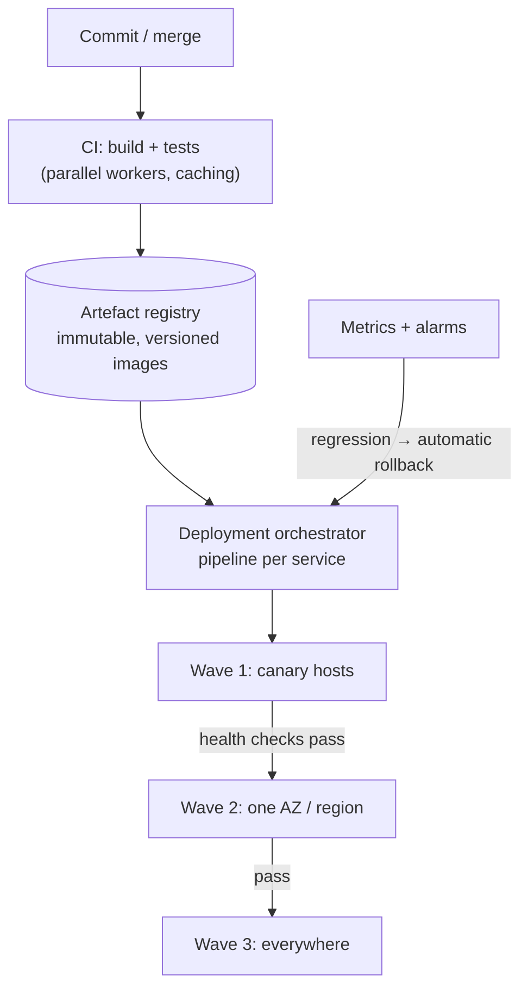

**Deep dives**
- **Builds** – hermetic, cached builds (Bazel-style remote caching), test sharding across many workers, only testing what changed in a monorepo.
- **Artefacts** – immutable container images or packages identified by commit SHA; deploy the same artefact to every environment.
- **Rollout** – canary → waves by AZ/region with **bake time** and automated health checks (error rate, latency, business metrics) between waves; feature flags separate deploy from release.
- **Distribution to many hosts** – pull-based agents on hosts or a container orchestrator; peer-to-peer or regional caches for large artefacts.
- **Rollback** – redeploy the previous artefact quickly; DB migrations must be backward compatible (expand and contract).
- **Governance** – approvals for sensitive services, deploy freezes, audit trail.

</details>

---

[⬅ Previous: Big Data & Stream Processing](15-big-data-streaming.md) · [⬅ Back to index](../README.md) · [Next: Designs – Social, Media & Collaboration ➡](17-designs-social-media.md)
