# Designs – Social, Media & Collaboration

[⬅ Back to index](../README.md)

Covers full interview walkthroughs of: news feed, Twitter/X, Instagram, WhatsApp chat, YouTube, live streaming with live comments, Dropbox/Google Drive, Google Docs, Reddit (comments and voting), a web search engine, Spotify, and Zoom video calls.

Each answer follows: **requirements → estimates → API → data model → high-level design → deep dives → trade-offs**.

---

### 1. Design a news feed (like Facebook / LinkedIn).

<details>
<summary>Answer</summary>

**Requirements**
- Functional: users post (text, media); see a feed of posts from friends/followed accounts, ranked; like and comment; infinite scroll.
- Non-functional: feed loads < 200–500 ms, highly available, eventual consistency OK (a post may appear seconds later), very read-heavy.

**Estimates** – 500M DAU × 10 feed loads = 5B reads/day (~60K QPS, peak ~150K). 500M × 0.5 posts = 250M posts/day (~3K writes/s). Average 300 friends → fan-out ~1M feed inserts/s if done on write.

**API**
```
POST /v1/posts { text, mediaIds[] }
GET  /v1/feed?cursor=…&limit=20 → { posts[], nextCursor }
```

**Data model** – `posts(post_id, author_id, content, media, created_at)` sharded by `post_id`/author; social graph `follows(follower_id, followee_id)`; **feed cache** per user: list of post IDs (Redis), capped at ~500–1,000 entries.

**High-level design**
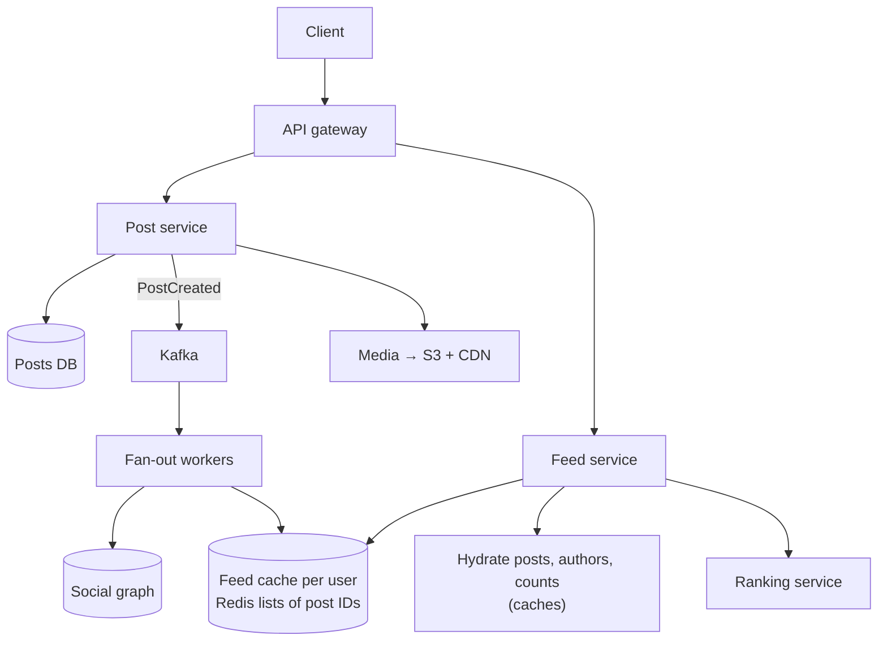

**Deep dives**
- **Fan-out on write (push)** – on post, insert the post ID into every follower's feed cache. Reads are a cheap list fetch. Expensive for users with millions of followers and wasted for inactive users.
- **Fan-out on read (pull)** – build the feed at request time by merging recent posts of everyone you follow. No write amplification, but slow reads.
- **Hybrid (the expected answer)** – push for normal users, **pull for celebrities** (merge their recent posts at read time); skip pushing to inactive users (rebuild their feed on login).
- **Ranking** – candidate generation (recent posts from the feed cache + celebrity posts + recommendations) → feature lookup → ML scoring (engagement prediction) → diversity rules. Do it at read time with caching of the first page.
- **Hydration** – feed stores IDs only; fetch post bodies, author info and counts in batch from caches (multi-get).
- **Pagination** – cursor based on rank position/time; keep the ranked list for the session so pages don't shift.
- **Media** – upload to object storage via pre-signed URLs; serve through CDN in multiple resolutions.
- **Counts** (likes) – sharded counters/asynchronous aggregation.

**Trade-offs** – push = fast reads/expensive writes; pull = cheap writes/slow reads; hybrid balances by user type. Ranking freshness vs latency (precompute vs compute on read).

</details>

### 2. Design Twitter / X.

<details>
<summary>Answer</summary>

**Requirements** – post tweets (280 chars + media), follow users, home timeline, user timeline, likes/retweets, search, trending topics. 300M DAU, read:write ≈ 100:1, timeline < 200 ms.

**Core design** – the home timeline uses the same **hybrid fan-out** as a news feed (Twitter famously precomputed timelines in Redis for most users and merged in celebrity tweets at read time).

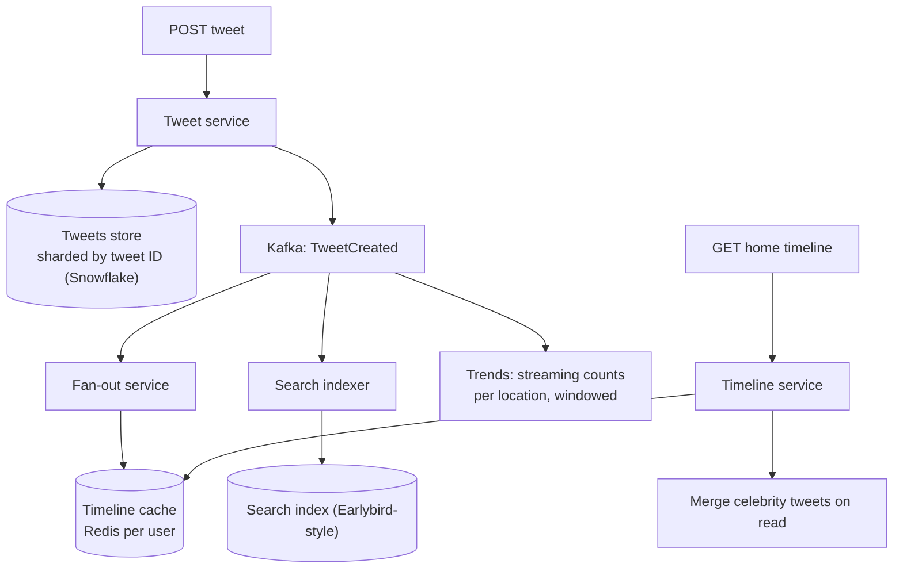

**Deep dives**
- **IDs** – Snowflake IDs, time-sortable, so timelines can be merged and paginated by ID.
- **User timeline** – query tweets by `author_id` (index or a separate per-author list).
- **Search** – real-time inverted index updated within seconds of tweeting, partitioned by time; recent index in memory.
- **Trends** – stream processing counts hashtags/phrases in sliding windows per region, compares with a baseline to detect **spikes** (not just volume), filters spam.
- **Likes/retweet counts** – asynchronous aggregated counters.
- **Celebrity problem** – don't fan out tweets from accounts with > ~100K followers.

**Trade-offs** – memory cost of timelines for 300M users (store only IDs, cap at ~800); eventual consistency on counts and timelines.

</details>

### 3. Design Instagram (photo sharing).

<details>
<summary>Answer</summary>

**Requirements** – upload photos/videos with captions; follow users; feed; likes/comments; Stories (24 h); profile grid. Very large media volume; fast image loads globally.

**Estimates** – 100M uploads/day × ~2 MB → ~200 TB/day raw; several resized variants per photo; reads ≫ writes.

**High-level design**
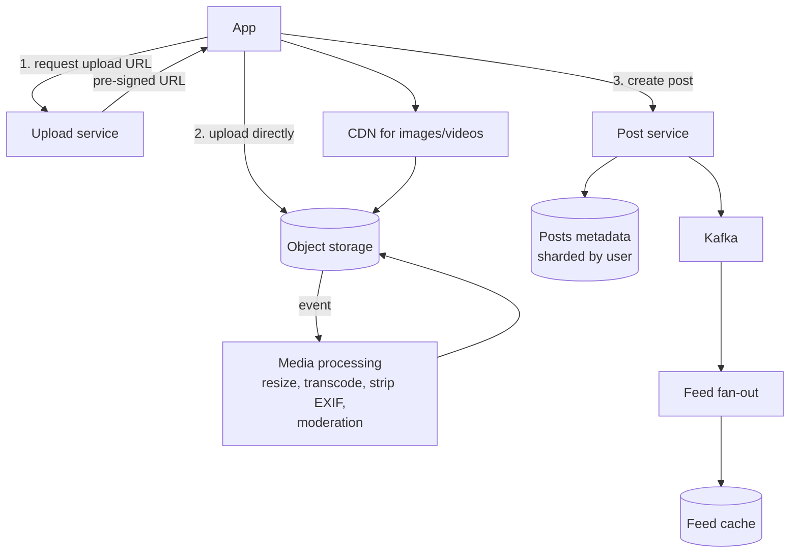

**Deep dives**
- **Media pipeline** – generate multiple sizes (thumbnail, feed, full) and formats (WebP/AVIF); video in adaptive bitrates; serve via CDN with long cache lifetimes (immutable URLs).
- **Metadata storage** – posts sharded by `user_id` so a profile grid is a single-shard query; IDs that embed the shard ID (Instagram's famous Postgres sharding with Snowflake-like IDs).
- **Feed** – hybrid fan-out + ML ranking (see news feed).
- **Stories** – separate store with a **24-hour TTL**; a "story tray" for each user listing followed accounts with unseen stories, ranked; prefetch the next stories' media on the client.
- **Likes/comments** – separate services; counts aggregated asynchronously.
- **Moderation** – async ML classifiers before or shortly after publishing.

</details>

### 4. Design a chat app (like WhatsApp / Messenger).

<details>
<summary>Answer</summary>

**Requirements**
- 1:1 and group chats (up to ~1,000 members), text + media, delivery states (sent/delivered/read), online/last seen, push notifications when offline, message history across devices, ordering within a chat.
- Low latency (< 200 ms delivery when online), no message loss, end-to-end encryption (optional discussion).

**Estimates** – 1B DAU × 50 messages = 50B messages/day (~600K/s). ~100 bytes each → ~5 TB/day of text.

**API / protocol** – persistent **WebSocket** (or MQTT) connection per device for send/receive; REST for history, media upload and profile.

**Data model** – `messages(chat_id, message_id, sender_id, body, created_at)` in a wide-column store (**Cassandra/HBase**) partitioned by `chat_id`, clustered by `message_id` (time-sortable) → "latest messages in chat X" is one partition read. Per-user inbox/sync state (last delivered/read message per chat).

**High-level design**
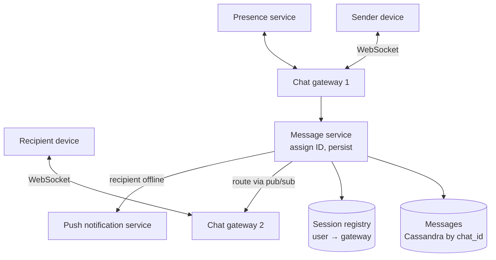

**Deep dives**
- **Routing** – gateways keep connections; a registry (Redis) maps user/device → gateway. The message service persists first, then routes to the recipient's gateway (direct RPC or pub/sub topic per gateway).
- **Delivery guarantees** – client sends with a client-generated ID (dedupe on retries); server ack = "sent" (✓). Recipient's device ack = "delivered" (✓✓). Read receipt = "read". Offline recipients sync on reconnect from their last acknowledged message ID.
- **Ordering** – server-assigned per-chat sequence numbers (or time-sortable IDs) and clients order by them.
- **Group chats** – fan-out on write to members' inboxes for small groups; for large groups, store once per group and members pull.
- **Presence** – heartbeats over the connection; last seen stored with TTL; fan presence out only to contacts currently viewing (it's chatty).
- **Media** – upload to object storage, send a reference in the message.
- **Multi-device** – each device has its own sync cursor.
- **E2EE** – Signal protocol; the server stores only ciphertext, which limits server-side search.

**Trade-offs** – storing messages long-term (Messenger) vs deleting after delivery (classic WhatsApp); WebSocket connection count per gateway (~100K–1M with tuning) drives the number of gateway servers.

</details>

### 5. Design YouTube (video upload and streaming).

<details>
<summary>Answer</summary>

**Requirements** – upload videos; process them; stream smoothly worldwide on any device/network; views, likes, comments; search and recommendations (black boxes for this round).

**Estimates** – 500 hours uploaded per minute; billions of views/day; egress in Tbps → CDN essential.

**High-level design**
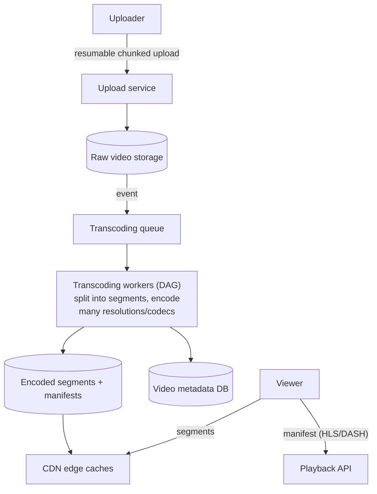

**Deep dives**
- **Upload** – resumable chunked uploads directly to storage (pre-signed URLs).
- **Transcoding** – split the video into chunks processed **in parallel**, encode into multiple resolutions (240p–4K) and codecs (H.264, VP9, AV1), generate thumbnails, run content checks (copyright Content ID, moderation). Model it as a DAG of tasks with retries.
- **Adaptive bitrate streaming** – HLS/DASH: the video is cut into 2–6 s segments at each bitrate; the player picks the bitrate per segment based on bandwidth and buffer.
- **CDN strategy** – popular videos pushed to edges proactively; long-tail served from regional/origin caches. Netflix-style ISP-embedded appliances for the heaviest traffic.
- **Metadata & views** – metadata in a sharded DB with caches; view counts via async aggregated counting (dedupe bots).
- **Cost** – encoding is expensive: encode popular videos in more formats (and better codecs like AV1), long-tail in fewer.

</details>

### 6. Design a live streaming platform with live comments (like Twitch / YouTube Live).

<details>
<summary>Answer</summary>

**Requirements** – a streamer broadcasts live video; up to millions of concurrent viewers; latency of a few seconds; live chat/comments and reactions visible to all viewers in near real time.

**Video path**
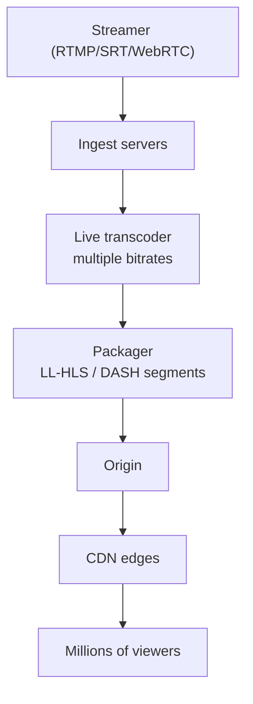
- Ingest over RTMP/SRT; transcode in real time; package into short segments (**low-latency HLS** with partial segments gives ~2–5 s latency; WebRTC for sub-second interactive use cases).
- The CDN fans out to viewers; request coalescing at the edge so millions of requests for the same new segment become one origin fetch.

**Live comments path**
- Viewers send comments to a comment service (rate-limited, moderated) which publishes to a **per-stream channel**.
- Viewers hold **WebSocket/SSE** connections to edge gateway servers; each gateway subscribes to channels of streams its viewers watch, and broadcasts locally. This two-level fan-out (pub/sub → gateway → viewers) scales to millions.
- For huge streams, **sample** comments (viewers can't read 10K/s anyway) and aggregate reactions into counts.
- Persist comments asynchronously for replay.

**Trade-offs** – latency vs cost and stability (shorter segments = more requests); dropping/sampling comments is acceptable to keep the experience usable.

</details>

### 7. Design Dropbox / Google Drive (file storage and sync).

<details>
<summary>Answer</summary>

**Requirements** – upload/download files; sync across a user's devices automatically; sharing with permissions; version history; offline edits; large files (GBs); conflict handling.

**High-level design**
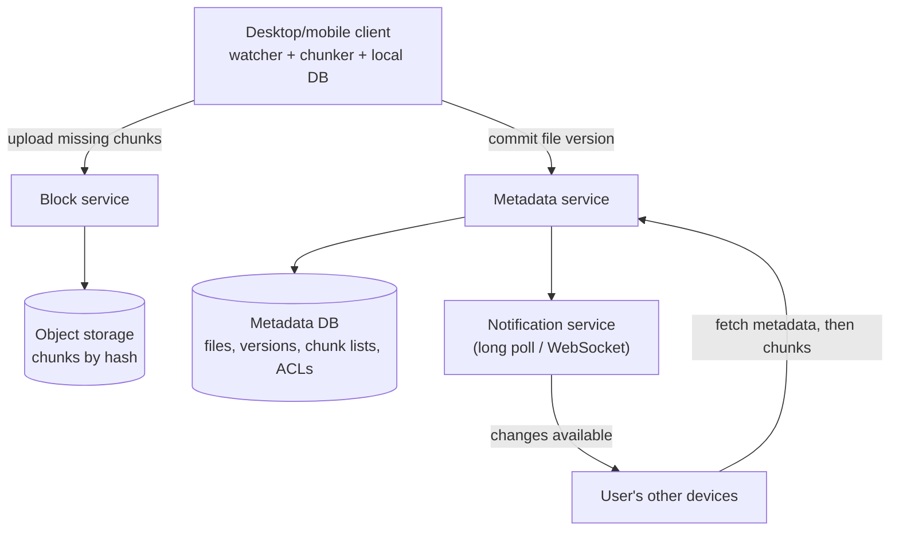

**Deep dives**
- **Chunking** – split files into ~4 MB blocks identified by **content hash**; upload only blocks the server doesn't have (**delta sync + deduplication** across users/versions). Content-defined chunking (rolling hash) keeps chunk boundaries stable when bytes are inserted.
- **Metadata** – files, folders, versions (list of chunk hashes), sharing ACLs; strongly consistent (relational, sharded by namespace/user).
- **Sync protocol** – each device keeps a cursor; the notification service tells clients something changed; clients pull the change list since their cursor.
- **Conflicts** – two devices edit offline: detect by version mismatch on commit; keep both ("file (conflicted copy)") rather than silently overwriting.
- **Large files** – resumable, parallel chunk uploads.
- **Sharing** – ACLs per file/folder, link sharing with tokens; permission checks on every metadata and download request (Zanzibar-style).
- **Storage cost** – dedupe, compression, cold tiering for old versions.

</details>

### 8. Design Google Docs (real-time collaborative editing).

<details>
<summary>Answer</summary>

**Requirements** – many users edit the same document concurrently and see each other's changes and cursors in real time (< ~100–200 ms); no lost edits; offline editing then merge; version history; comments; permissions.

**Core problem** – concurrent edits at different positions must converge to the same document on every client.

**Approaches**
- **Operational Transformation (OT)** – clients send operations (insert "x" at 5); a central server orders them and **transforms** concurrent operations against each other (shifting positions) before applying. Used by Google Docs. Needs a central authority per document.
- **CRDTs** (Yjs, Automerge) – each character gets a unique ID with ordering metadata, so concurrent inserts merge deterministically without a central transform. Great for offline/peer-to-peer; more metadata overhead. Used by Figma-like and local-first apps.

**High-level design**
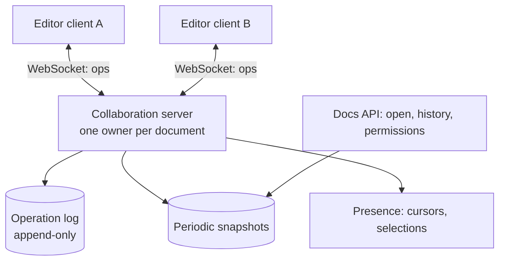

**Deep dives**
- **Document ownership** – route all sessions of a document to the same collaboration server (consistent hashing on doc ID) so ordering is simple; failover reloads from snapshot + log.
- **Persistence** – append operations to a log; snapshot periodically so loading doesn't replay everything; version history = snapshots + ops.
- **Presence** – cursors/selections are ephemeral: broadcast, never persist.
- **Offline** – queue local ops; transform/merge on reconnect.
- **Scale** – documents are independent, so scaling is horizontal by document; a very popular document limits per-document concurrency (cap editors, others view-only).

</details>

### 9. Design Reddit (posts, nested comments, voting and ranking).

<details>
<summary>Answer</summary>

**Requirements** – communities (subreddits); posts; upvote/downvote; ranked listings (hot, new, top); deeply nested comment threads; very read-heavy; vote counts approximately real time.

**Data model**
- `posts(post_id, subreddit_id, author_id, title, body, score, created_at)`.
- `comments(comment_id, post_id, parent_id, path, author_id, body, score)` – nested threads stored with `parent_id` (adjacency list), plus a **materialised path** (`/1/7/42/`) or closure table for efficient subtree fetches.
- `votes(user_id, item_id, value)` with a unique key (one vote per user per item).

**Design**
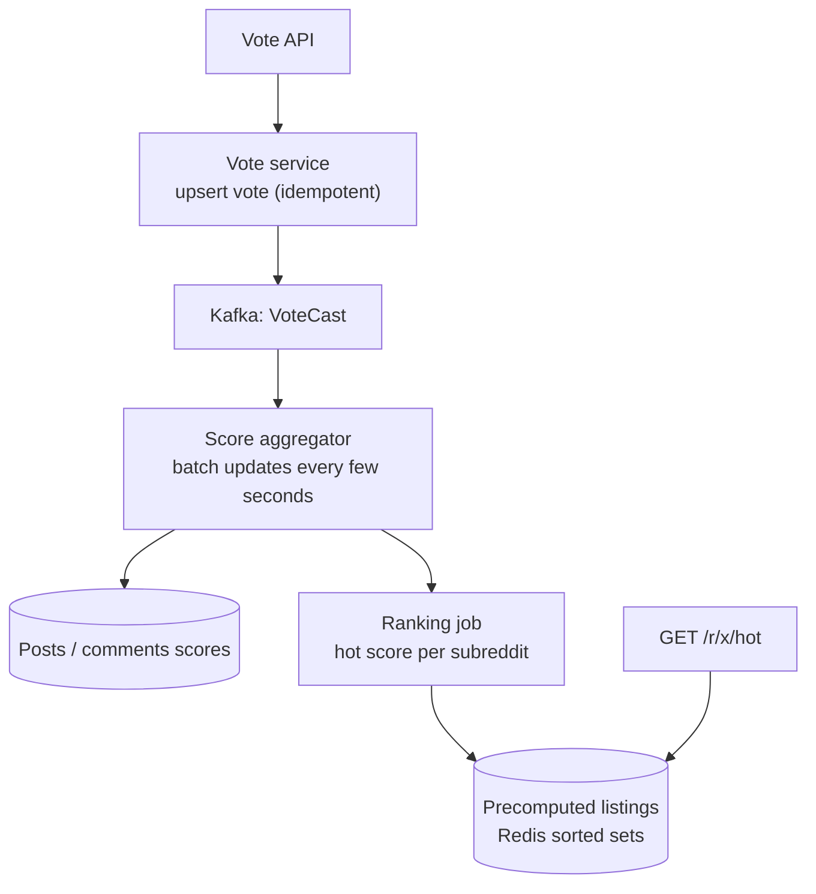

**Deep dives**
- **Votes** – store each user's vote (to show their arrow and prevent double votes); aggregate scores asynchronously to avoid hot rows on viral posts.
- **Hot ranking** – a score combining votes and age, e.g. `log10(max(|ups−downs|,1)) + sign × (created_at / 45000)`, precomputed in sorted sets per subreddit and for the front page; recompute as votes arrive.
- **Comments** – fetch the top N comments per level with their best children (lazy "load more replies"); rank by "best" (Wilson score confidence interval), not raw score.
- **Caching** – listings and comment trees are cached heavily (most traffic is logged-out readers → CDN).
- **Anti-abuse** – vote fuzzing, rate limits, detection of vote rings.

</details>

### 10. Design a web search engine (like Google, at a high level).

<details>
<summary>Answer</summary>

**Components**
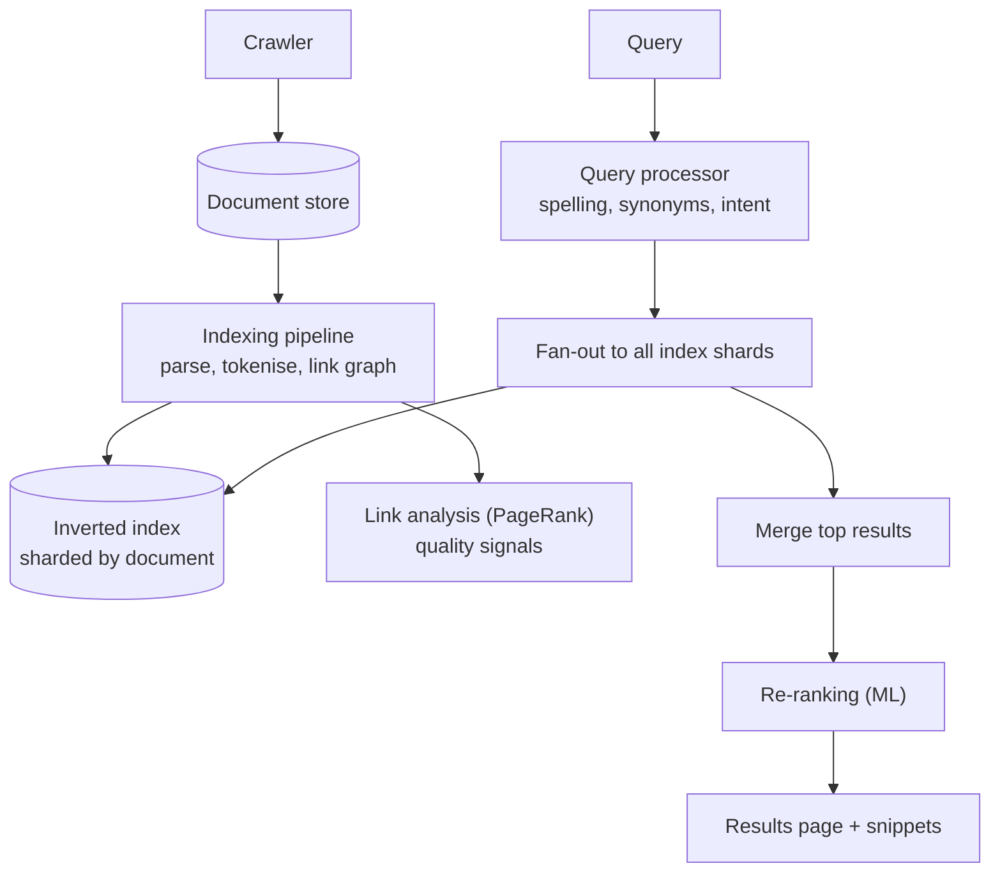

**Deep dives**
- **Index sharding** – by document (each shard holds a subset of docs and a full local index → every query fans out to all shards, each returns its top-k; merge). Replicate shards for throughput. Alternative: by term (fewer shards per query but hot terms and expensive multi-term intersections).
- **Ranking stages** – cheap scoring on every shard (BM25 + static quality like PageRank) → top few thousand → expensive ML re-ranking (learning-to-rank, neural/semantic models) on the top hundreds.
- **Latency** – tail latency matters with fan-out: replicas with **hedged requests** (send to a second replica if the first is slow), partial results if a shard is late.
- **Freshness** – a small real-time index for new content merged with the main index rebuilt periodically.
- **Caching** – a results cache for popular queries (huge hit rate due to the head of the distribution).

</details>

### 11. Design Spotify (music streaming).

<details>
<summary>Answer</summary>

**Requirements** – search and browse catalog; stream songs with instant start; playlists; offline downloads (premium); recommendations; play counts for royalties.

**Design highlights**
- **Audio storage & delivery** – songs encoded at several bitrates (e.g. Ogg/AAC 96–320 kbps), stored in object storage and served through CDNs; files are small (~3–10 MB), so the first chunk is fetched immediately and the rest progressively. Prefetch the next track in the queue.
- **Catalog & metadata** – artists, albums, tracks in a sharded DB + search index; heavily cached (rarely changes).
- **Playlists** – user-owned lists with collaborative editing (versioned, last-write-wins per operation); stored by playlist ID.
- **Offline** – encrypted files cached on device with DRM licence keys that expire (the app must check in every 30 days).
- **Play events** – every play is an event into Kafka → royalty calculation (must be accurate: dedupe, fraud detection for fake streams), charts, and recommendation features.
- **Recommendations** – offline batch jobs (collaborative filtering, embeddings) generate Discover Weekly-style playlists; online ranking for home screen shelves.

</details>

### 12. Design a video conferencing system (like Zoom / Google Meet).

<details>
<summary>Answer</summary>

**Requirements** – multi-party audio/video calls (2–1,000 participants), screen sharing, chat, low latency (< 150–300 ms mouth-to-ear), works across poor networks, recording.

**Media architectures**
- **Peer-to-peer mesh** – everyone sends to everyone. Fine for 2–3 people; upload bandwidth explodes beyond that.
- **MCU (Multipoint Control Unit)** – the server decodes all streams, mixes one composite stream per participant. Low client bandwidth but very CPU-heavy and adds latency.
- **SFU (Selective Forwarding Unit)** – the standard today: each client uploads its stream once (often in several qualities via **simulcast/SVC**); the server **forwards** selected streams to each participant without decoding, choosing quality per receiver's bandwidth and layout (active speaker in high quality, thumbnails low).

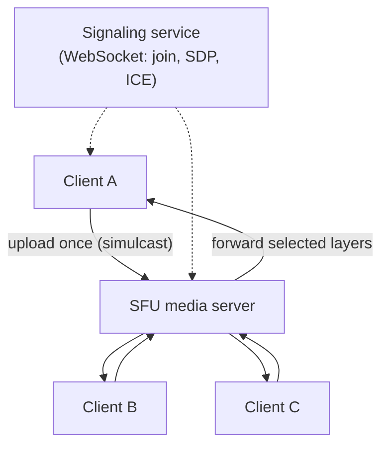

**Deep dives**
- **Transport** – WebRTC over **UDP** (RTP/SRTP); late packets are useless, so no retransmission for most media; jitter buffers, forward error correction, congestion control adjusting bitrate.
- **NAT traversal** – ICE with STUN to discover public addresses and **TURN** relays when direct paths are blocked.
- **Signalling** – a separate service handles meeting state, joins, permissions and SDP negotiation.
- **Scale** – place SFUs regionally near participants; cascade SFUs across regions for global meetings; large webinars switch to one-to-many streaming.
- **Recording** – a bot participant receives streams and composes them server-side.

</details>

### 13. Design Tinder (location-based matching).

<details>
<summary>Answer</summary>

**Requirements** – users create profiles with photos and preferences (age, distance, gender); swipe through nearby recommended profiles; a **match** happens when both swipe right; matched users can chat. Tens of millions of DAU; billions of swipes per day.

**Design**
- **Profiles** – profile service + DB; photos in object storage via CDN.
- **Recommendations** – find candidates near the user: a geo index (geohash cells / Elasticsearch geo queries) filtered by preferences and excluding people already swiped; rank by an ML model (likelihood of mutual interest, activity, freshness). **Precompute a queue** of candidates per user in the background so swiping is instant.
- **Swipes** – very high write volume: write to a swipe store partitioned by `swiper_id` (Cassandra/DynamoDB): `(swiper, target) → like/pass`.
- **Match detection** – when A likes B, check whether B already liked A (point lookup on B's swipes for A). If yes, create a match atomically (idempotently – both could swipe at the same moment) and notify both via push/WebSocket.
- **Chat** – reuse the [chat design](#4-design-a-chat-app-like-whatsapp--messenger), limited to matched pairs.
- **Location updates** – update the user's geo cell when they move significantly, not continuously.
- **Abuse and safety** – rate-limit swipes, detect bots and fake profiles, photo moderation, block/report.

</details>

### 14. Design an online presence system ("online / last seen").

<details>
<summary>Answer</summary>

**Requirements** – show whether contacts are online and when they were last seen, update within seconds, for hundreds of millions of users; presence is high-churn and doesn't need perfect accuracy.

**Design**
- **Heartbeats** – clients with an open connection (WebSocket gateway) send a heartbeat every ~30 s; the gateway updates presence on connect, heartbeat and disconnect.
- **Store** – an in-memory, TTL-based store (Redis: `presence:{user} = online` with TTL ~60 s; `last_seen:{user} = timestamp`). If heartbeats stop (app killed, network lost), the key expires and the user is offline – no explicit "goodbye" required.
- **Fan-out** – don't broadcast every change to every contact. Instead: subscribe only while a contact's chat or list is **visible**, or fetch presence in batches when a screen opens. For large friend lists, fan out only to currently online contacts.
- **Debouncing** – ignore rapid online/offline flapping (brief network drops) with a short grace period.
- **Privacy** – respect settings ("hide last seen") at read time.
- **Scale** – presence store sharded by user ID; gateways publish changes through pub/sub to the gateways holding interested subscribers.

</details>

---

[⬅ Previous: Designs – Core Infrastructure](16-designs-core-infrastructure.md) · [⬅ Back to index](../README.md) · [Next: Designs – Location, Commerce & Fintech ➡](18-designs-location-commerce.md)
