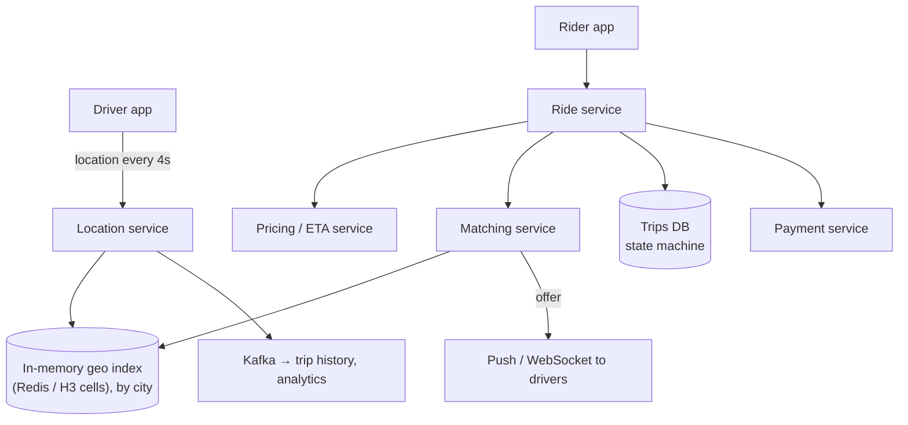
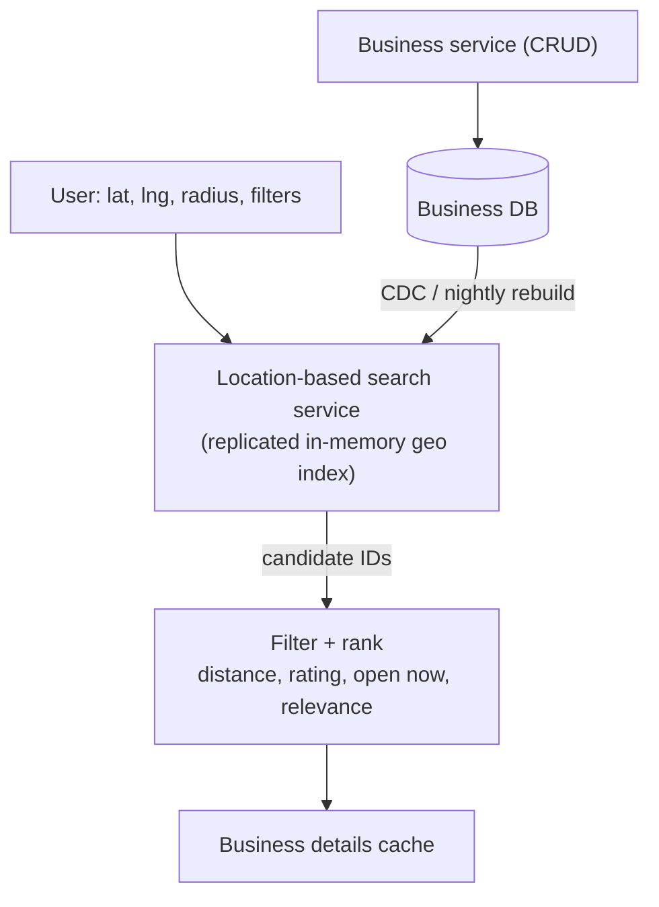
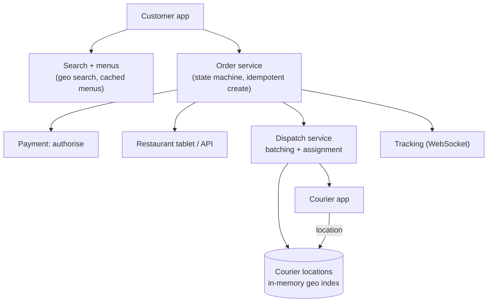
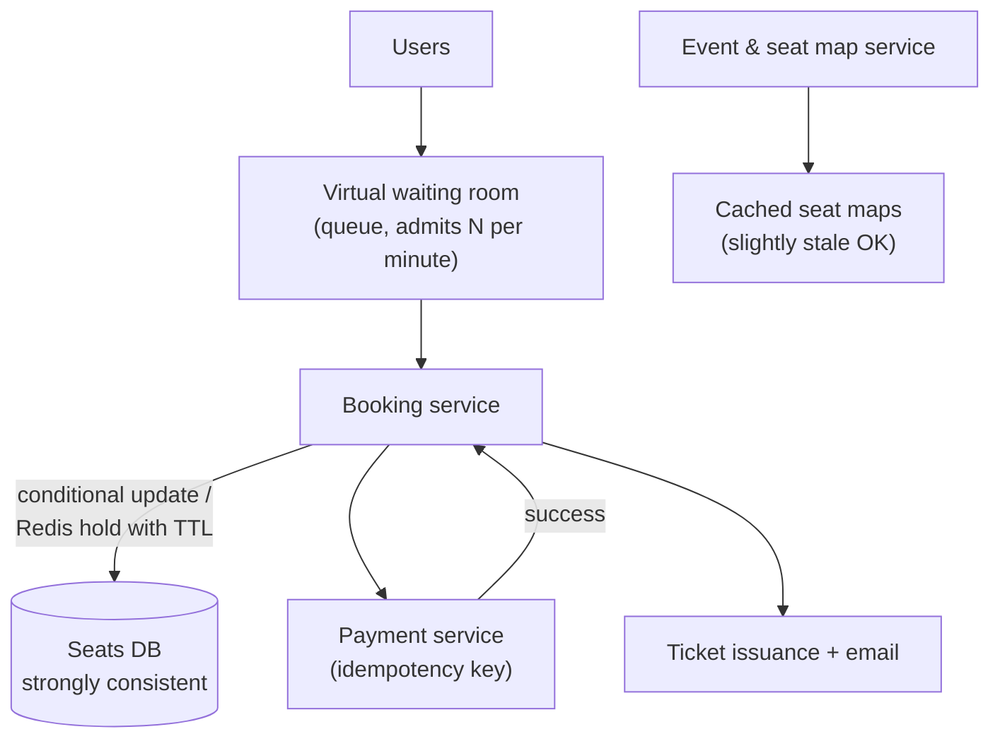
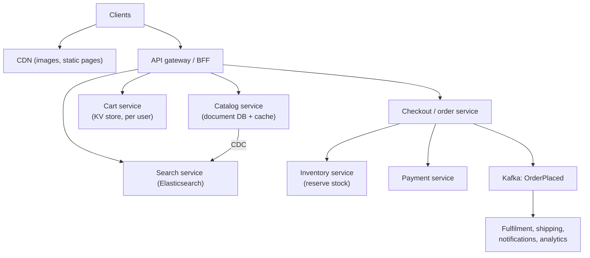
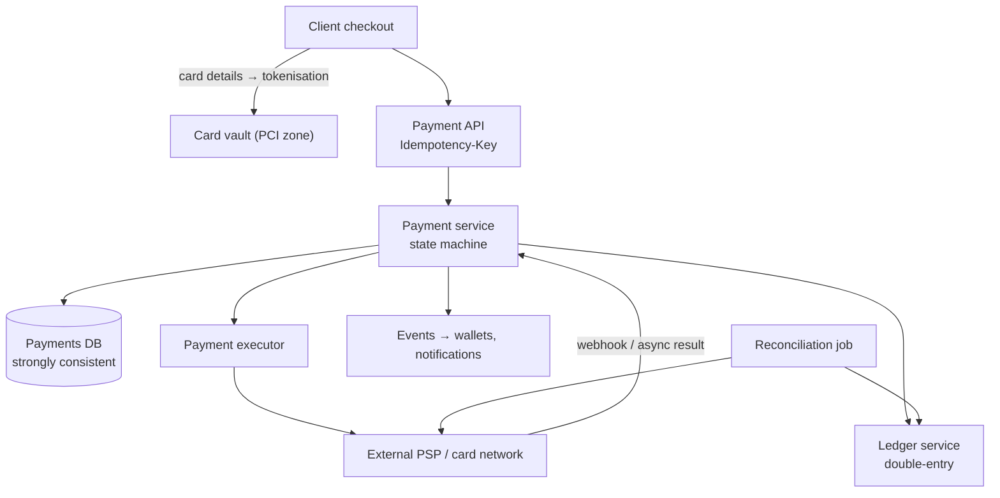
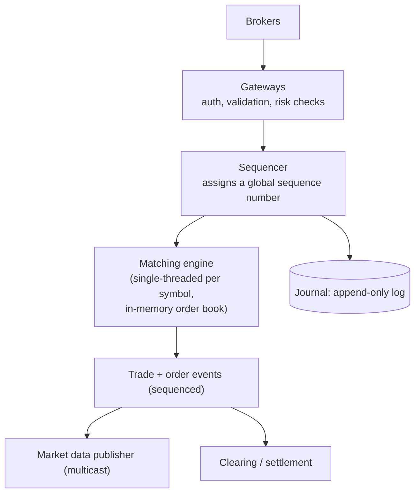
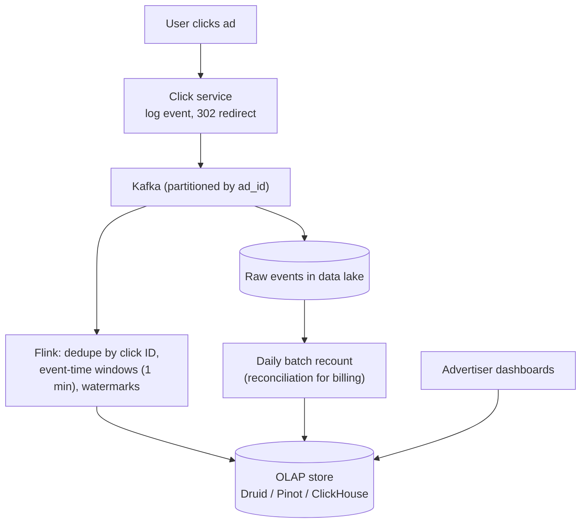
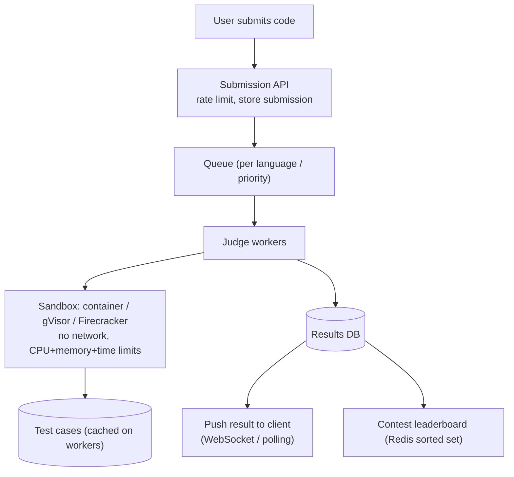

# Designs – Location, Commerce & Fintech

[⬅ Back to index](../README.md)

Covers full interview walkthroughs of: Uber, Yelp (proximity search), Google Maps, food delivery, Ticketmaster, Amazon-style e-commerce, flash sales, a payment system, a digital wallet with a ledger, hotel booking, a stock exchange, an ad click aggregator, a real-time leaderboard and an online judge (LeetCode).

Each answer follows: **requirements → estimates → API → data model → high-level design → deep dives → trade-offs**.

---

### 1. Design Uber (ride-hailing).

Answer

**Requirements**
- Riders request a ride with pickup/destination, see a fare estimate and ETA; nearby drivers get offers; one driver accepts; both see each other's live location; trip completes and payment is charged.
- Non-functional: matching within seconds; location updates every ~4 s; **a driver must never be matched to two rides**; highly available in each city.

**Estimates** – 5M active drivers sending location every 4 s → ~1.25M location writes/s. Matching requests: thousands/s at peak.

**High-level design**

**Deep dives**
- **Location index** – current positions only, in memory, indexed by geohash/**H3** cells, sharded by city/region. Ephemeral: losing it is fine (drivers resend in 4 s).
- **Matching** – find available drivers in nearby cells, rank by **ETA** (road network, not straight line), send offers to one or a few drivers with a timeout. Batch matching (optimise across many riders and drivers every few seconds) improves global efficiency.
- **No double booking** – lock the driver atomically when offering/accepting (`SET driver:42:lock NX` with TTL, or a conditional update on driver state `available → reserved`).
- **Trip state machine** – requested → matched → driver arriving → in progress → completed/cancelled; persisted in a strongly consistent DB; events for every transition.
- **Live tracking** – during the trip, the rider subscribes (WebSocket) to the driver's location stream.
- **Surge pricing** – stream processing compares demand (requests) and supply (available drivers) per H3 cell every minute.
- **Reliability** – city-level isolation (cells); graceful degradation if pricing is slow (cached multipliers).

### 2. Design Yelp / a proximity service ("find restaurants near me").

Answer

**Requirements** – search businesses within a radius, filter (category, open now, rating), view details and reviews; business owners update info rarely. 100M DAU, read-heavy, ~5K search QPS; 200M businesses.

**Design**
- **Business data** – a relational DB (source of truth) + caches for details pages.
- **Geo index** – businesses rarely move, so a **static index** works: geohash precision chosen by radius (search the cell + 8 neighbours), or a **quadtree** built in memory (200M × small entries fits in a few GB; replicate to every search server and rebuild nightly + apply updates).
- Alternatives: Postgres + PostGIS, Elasticsearch geo queries, Redis `GEOSEARCH`.

**Deep dives** – choosing geohash precision (expand search if too few results), edge cases at cell boundaries (neighbour cells), ranking beyond distance (rating, popularity, personalisation), reviews in a separate service, caching popular areas.

### 3. Design Google Maps (routing and ETA).

Answer

**Requirements** – show maps, search places, compute the fastest route between two points with ETA including live traffic, turn-by-turn navigation with rerouting.

**Design pieces**
- **Map tiles** – the world pre-rendered (or vector tiles) at zoom levels, served from CDN; clients cache tiles; vector tiles let the client render and rotate smoothly.
- **Road graph** – nodes (intersections) and edges (road segments with lengths, speed limits, live travel times). Too big for plain Dijkstra at continent scale → use **hierarchical routing**: contraction hierarchies, or partition the graph into regions with precomputed shortcuts between boundary nodes. Queries become milliseconds.
- **Live traffic** – anonymised location pings from phones → stream processing estimates current speed per road segment → update edge weights continuously.
- **ETA** – route travel time from current + historical speeds, refined by ML models (time of day, events).
- **Navigation** – the client follows the route locally, reports position, and requests a reroute when it deviates or when traffic changes significantly.
- **Geocoding/search** – address and place search with a geo-aware search index.

**Trade-offs** – precomputation speeds queries but must be updated when weights change (customisable contraction hierarchies separate structure from weights).

### 4. Design a food delivery platform (like DoorDash / Swiggy / Uber Eats).

Answer

**Requirements** – browse nearby restaurants and menus; place and pay for an order; the restaurant accepts; a courier is assigned; live tracking; ETAs.

**Design**

**Deep dives**
- **Order state machine** – created → paid (authorised) → accepted by restaurant → preparing → courier assigned → picked up → delivered; each transition is an event; payment **captured** on completion.
- **Dispatch** – assign couriers considering food prep time (arrive just as food is ready), courier location, **batching** multiple orders on one route; re-optimise every few seconds; driver acceptance with timeouts.
- **ETA** – ML on prep time, travel time, historical restaurant data.
- **Menus** – cached heavily; item availability updated by restaurants (eventual consistency, validate at checkout).
- **Peak load** – lunch/dinner spikes; city-level sharding; graceful degradation (disable promotions, simplify ranking).

### 5. Design Ticketmaster (event ticket booking with high contention).

Answer

**Requirements**
- Browse events, view the seat map, select seats, **hold them for ~10 minutes** while paying, then confirm.
- **Never sell a seat twice.** Handle massive spikes when popular events go on sale (millions of users for 50K seats). Fairness.

**Data model** – `seats(event_id, seat_id, status [AVAILABLE|HELD|SOLD], hold_expires_at, order_id, version)`; `orders`; `events`.

**High-level design**

**Deep dives**
- **Holding seats safely** – atomic conditional update: `UPDATE seats SET status='HELD', hold_expires_at=now()+10min, order_id=? WHERE event_id=? AND seat_id IN (…) AND status='AVAILABLE'` in a transaction; succeeds only if all seats are free. Alternatively a Redis `SET seat:{id} NX EX 600` hold + DB confirmation. Expired holds are released lazily (treat expired as available) and by a sweeper.
- **Confirmation** – after payment succeeds, change HELD → SOLD only if the hold still belongs to this order (and hasn't expired); otherwise refund.
- **Spikes** – a **virtual waiting room** admits users at a controlled rate (tokens), protecting the booking system and providing fairness; serve event pages and seat maps from CDN/cache; bot protection.
- **Seat map freshness** – show approximately current availability from cache; the authoritative check happens at hold time.
- **General admission** – instead of seat rows, an atomic decrement of a counter (`remaining > 0`), possibly sharded counters for throughput.

**Trade-offs** – strong consistency only on the booking path; everything else cached and eventually consistent.

### 6. Design an e-commerce platform (like Amazon).

Answer

**Requirements** – product catalog and search, product pages, cart, checkout, payments, inventory, order tracking, reviews; massive read traffic; checkout must be correct.

**High-level design**

**Deep dives**
- **Catalog** – read-mostly, flexible attributes per category → document store, heavily cached; product pages assembled from several services (price, availability, reviews) with fallbacks if one fails.
- **Cart** – per-user KV store (DynamoDB), highly available; Amazon's Dynamo paper famously chose availability for carts (merging conflicting carts).
- **Checkout** – a **saga**: create order (pending) → reserve inventory → authorise payment → confirm order → (later) capture payment on shipment. Compensate on failure (release stock, void authorisation). Idempotency keys everywhere.
- **Inventory** – avoid overselling: atomic conditional decrements per SKU/warehouse; reservations with expiry; for hot items, partition stock into buckets.
- **Search** – Elasticsearch fed by CDC, with ranking by relevance + sales + personalisation.
- **Prices** – price changes must be consistent at checkout (validate price at order time and show changes).

### 7. How would you design for a flash sale (e.g. 10,000 phones at a fixed time)?

Answer

Millions of users hit "buy" at the same second for limited stock.
- **Absorb traffic before it reaches the core**: static pages on CDN, a countdown handled client-side, **waiting room / queue** with admission tokens, CAPTCHA and bot detection, per-user purchase limits.
- **Inventory in memory** – pre-load stock into Redis; use an atomic `DECR` (or Lua script checking > 0) to grant a purchase slot. Only winners proceed to create real orders asynchronously via a queue (the DB sees ~10,000 orders, not millions of attempts).
- **Reservation timeout** – winners have N minutes to pay; unpaid slots are returned to stock.
- **Idempotency** – one order per user per sale (unique constraint), dedupe double clicks.
- **Isolation** – run the sale on separate infrastructure or cells so normal shopping isn't affected; pre-scale and load test.

### 8. Design a payment system (like Stripe / a checkout payment service).

Answer

**Requirements**
- Accept payments from customers to merchants via cards/wallets through external **payment service providers (PSPs)** and card networks; refunds; payouts; reconciliation.
- **Correctness above all**: never double-charge, never lose a payment; full audit trail; PCI compliance; high availability.

**High-level design**

**Deep dives**
- **Idempotency** – every create/charge request carries an idempotency key; stored with the result in the same transaction; retries return the same result. Also send an idempotency/reference ID to the PSP so its side is deduplicated.
- **State machine** – `created → authorised → captured → (refunded)` with `failed`/`pending` states; transitions are persisted before and after external calls.
- **Unknown outcomes** – a timeout to the PSP doesn't mean failure: mark `pending`, query the PSP status or wait for its webhook, and reconcile. Never blindly retry a charge without the same idempotency key.
- **Double-entry ledger** – every movement is recorded as balanced debit and credit entries in an append-only ledger; balances are derived. Makes errors detectable (books must balance).
- **Reconciliation** – daily (or continuous) comparison of internal records with PSP/bank settlement files; mismatches flagged for investigation.
- **Security** – card data only in the PCI vault (tokenisation); the rest of the system handles tokens. 3-D Secure for strong customer authentication.
- **Async processing** – payment results and webhooks to merchants are delivered at-least-once with retries.

### 9. Design a digital wallet / money transfer system (like PayPal, Venmo, UPI apps).

Answer

**Requirements** – users hold balances and transfer money to each other instantly; balances never go negative; exact auditability; high throughput (e.g. 1M transfers/s for UPI-scale systems).

**Design**
- **Ledger as source of truth** – an append-only **double-entry** ledger: a transfer of $10 from A to B writes `A: −10` and `B: +10` atomically. Balances are materialised from the ledger (with snapshots).
- **Atomicity** – if A and B live on the same shard, a local transaction. Across shards: a **saga** (debit A into a holding account → credit B; compensate on failure), or a distributed transaction (2PC / a database with distributed transactions like Spanner/CockroachDB).
- **Concurrency** – prevent overdraft with a conditional update (`balance >= amount`) or by **serialising operations per account** (partition the command stream by account ID; a single writer per account processes commands in order – an event-sourcing approach).
- **Idempotency** – transfer request IDs deduplicated; exactly-once effect.
- **Event sourcing** – storing commands/events allows rebuilding state and auditing; snapshots for fast recovery.
- **Reconciliation** with banks/partners; fraud checks (velocity limits, ML scoring) inline but fast.

**Trade-offs** – strong consistency is non-negotiable for balances; scale via partitioning by account and keeping cross-partition work asynchronous with sagas.

### 10. Design a hotel booking system (like Booking.com / Airbnb).

Answer

**Requirements** – search hotels by location and dates with availability and prices; view details; book rooms; cancel; prevent overbooking; handle high search volume (search ≫ bookings).

**Data model** – `room_type_inventory(hotel_id, room_type_id, date, total, reserved)` – one row per room type per night. A booking for 3 nights reserves 3 rows.

**Design**
- **Search** – Elasticsearch/geo index with cached availability and prices (eventually consistent; refreshed via CDC). It's fine if search shows slightly stale availability.
- **Booking** – in a transaction, for each night: `UPDATE inventory SET reserved = reserved + 1 WHERE hotel_id=? AND room_type_id=? AND date=? AND reserved < total` (allowing a configured overbooking %). All rows must succeed or roll back.
- **Idempotency** – a reservation ID generated when the user starts checkout prevents double bookings on retries.
- **Payment** – authorise, then confirm the reservation; or pay at the hotel.
- **Scale** – shard inventory by `hotel_id`; booking traffic is modest; search is the heavy part (cache).
- **Airbnb specifics** – each listing is unique (one unit), calendar availability, host approval flows, and both sides' trust and reviews.

### 11. Design a stock exchange (order matching engine).

Answer

**Requirements** – accept buy/sell orders (limit/market), match them fairly by **price-time priority**, publish trades and market data, extremely low latency (microseconds), deterministic, no lost orders, full audit.

**Design**

**Deep dives**
- **Order book** – per symbol: bids (max-heap by price) and asks (min-heap), each price level a FIFO queue of orders. Matching: incoming buy matches the lowest asks ≤ its price in time order.
- **Single-threaded, in-memory, deterministic** – one thread per symbol avoids locks (LMAX disruptor style); all inputs are sequenced and journaled, so the engine can be **replayed** to rebuild state and a hot standby processes the same sequenced input in lockstep for instant failover.
- **Latency** – kernel bypass networking, co-location, avoiding GC pauses, pre-allocated memory.
- **Fairness** – the sequencer defines the order of arrival; market data published to all at the same time.
- **Risk checks** – pre-trade checks in gateways (credit limits, fat-finger protection).

### 12. Design an ad click aggregator.

Answer

**Requirements** – ingest ad click events (billions/day), aggregate clicks per ad per minute, query aggregated metrics with low latency for dashboards and **billing**; results must be accurate (no double counting) and support late events; redirect users to the advertiser quickly.

**Design**

**Deep dives**
- **Dedupe** – each click gets a unique ID (signed impression ID) to reject duplicates and replays; fraud/bot filtering.
- **Event time + watermarks** – aggregate by when clicks happened, allow late arrivals, update windows.
- **Exactly-once** – Flink checkpoints + idempotent upserts into the OLAP store keyed by (ad_id, minute).
- **Hot ads** – pre-aggregate locally before the shuffle; salt hot keys.
- **Reconciliation** – a batch job recomputes from raw data and corrects streaming results (Lambda-style) because billing must be exact.

### 13. Design a real-time gaming leaderboard.

Answer

**Requirements** – update a player's score after each match; show top 10/100; show a player's rank and nearby players; millions of players; near-real-time updates; monthly/seasonal resets.

**Design**
- **Redis sorted set** per leaderboard (`ZADD leaderboard:2025-06 score user`, `ZINCRBY` for increments): `ZREVRANGE` gives top N, `ZREVRANK` gives a user's rank, both O(log n). Tens of millions of members per set is fine.
- **Persistence** – scores also written to a durable DB (source of truth); Redis can be rebuilt from it.
- **Scale beyond one node** – shard by score range (top shard is small and hot; ranks computed by summing counts of higher shards) or by user hash with **scatter-gather** for top N (each shard returns its top N; merge). Approximate ranks for the long tail ("top 15%") are often acceptable.
- **Ties** – break by earliest achievement (encode timestamp into the score).
- **Friends leaderboard** – fetch friends' scores (`ZMSCORE`) and sort in the app.
- **Anti-cheat** – validate scores server-side.

### 14. Design an online judge (like LeetCode).

Answer

**Requirements** – browse problems; submit code in many languages; run it against hidden test cases securely; return results within seconds; contests with thousands of simultaneous submissions and live rankings.

**Design**

**Deep dives**
- **Security** – untrusted code runs in strongly isolated sandboxes (microVMs, seccomp), no network, read-only file systems, strict resource limits, killed on timeout.
- **Scale** – autoscale workers on queue depth; pre-warm containers per language; contests need pre-scaling.
- **Fairness** – identical hardware/limits for timing; run each submission against all tests and record worst time.
- **Leaderboard** – sorted set keyed by (solved count, penalty time).
- **Results** – async: the client polls or listens for the submission's status.

---

[⬅ Previous: Designs – Social, Media & Collaboration](17-designs-social-media.md) · [⬅ Back to index](../README.md) · [Next: Mobile System Design ➡](19-mobile-system-design.md)
