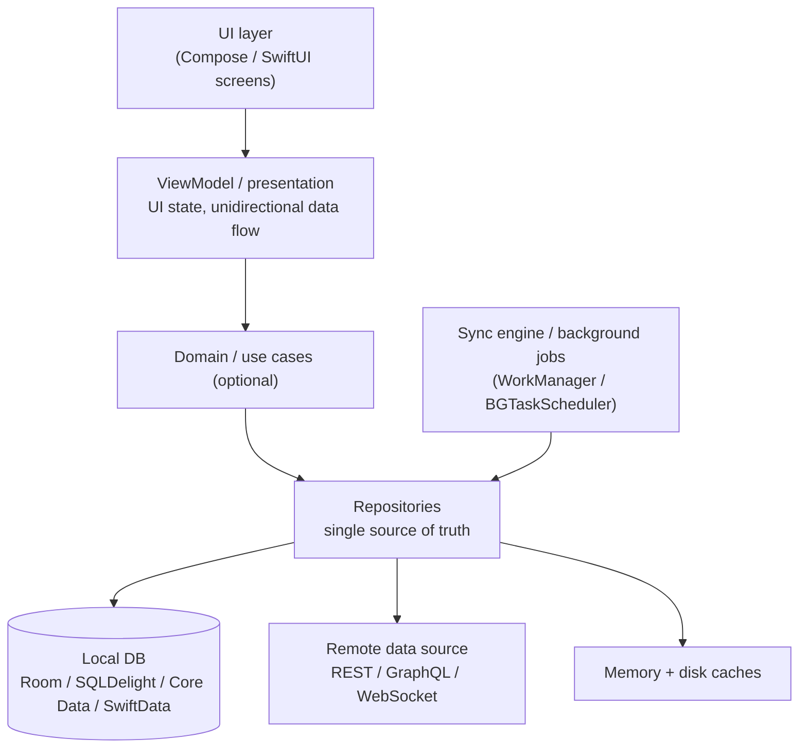
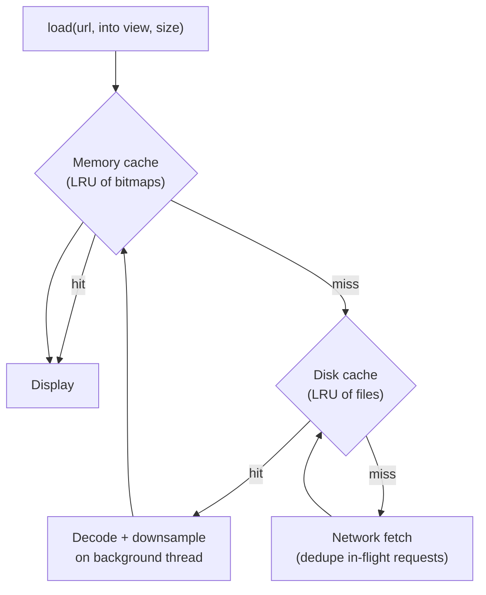

# Mobile System Design

[⬅ Back to index](../README.md)

Covers: how the mobile round differs, the client architecture, API design for mobile, offline-first and sync, caching, pagination, real-time updates, push notifications, image loading, background work, performance and battery, releases and feature flags, plus worked designs (feed, chat, offline notes, image loader, downloader, analytics SDK). Platform notes compare Android and iOS.

For platform-specific depth, see the [Android](https://github.com/AkshayAshokCode/Android-Interview-Questions-cheat-sheet) and [iOS](https://github.com/AkshayAshokCode/iOS-Interview-Questions-cheat-sheet) repos.

---

## Foundations

### 1. How is a mobile system design interview different from a backend one?

Answer

The focus is the **client**: architecture inside the app, the contract with the backend, and the constraints of phones:
- **Unreliable networks** – offline, slow, flaky, switching Wi-Fi ↔ cellular.
- **Limited resources** – battery, memory, storage, data plans, CPU on low-end devices.
- **The OS controls the app's lifecycle** – it can be killed in the background at any time; background work is restricted.
- **Releases are slow** – app store review and users who never update; old versions live for years, so APIs must stay backward compatible.
- **UX expectations** – instant UI, smooth 60/120 fps scrolling, optimistic updates.

You still sketch the backend (API, push, CDN), but depth is expected on the client: storage, sync, caching, threading, pagination, real-time.

### 2. What client architecture should you propose?

Answer

- **MVVM/MVI with unidirectional data flow** – the UI observes a single state stream.
- **Repository + local DB as the single source of truth** – the UI reads from the DB; the network refreshes the DB.
- **Dependency injection** (Hilt / manual / Swift DI) and **modularization by feature** for large teams.
- Cross-cutting: networking layer (auth refresh, retries), image loader, analytics, logging, feature flags.

### 3. How do you design the API for a mobile client?

Answer

- **Minimise round trips** – one request per screen (a BFF or GraphQL), batch endpoints.
- **Small payloads** – only needed fields, compression (gzip/Brotli), binary formats (Protobuf) for heavy use, image URLs sized for the device.
- **Cursor pagination** for lists.
- **Delta sync** endpoints (`GET /changes?since=<token>`) instead of re-downloading everything.
- **Idempotency keys** on writes so retries after flaky network don't duplicate.
- **Backward compatibility** – never break old app versions; additive changes; a minimum-supported-version endpoint for forced upgrades.
- **Real-time channel** choice: polling vs SSE vs WebSocket vs push.
- **Auth** – short-lived access tokens + refresh tokens, refreshed transparently once for concurrent 401s.

### 4. How do you design an offline-first app with sync?

Answer

- **Local DB is the source of truth** – the UI always reads locally, so it works offline and renders instantly.
- **Writes** – apply locally immediately (optimistic), and record them in an **outbox/pending-operations table** with a client-generated ID.
- **Sync engine** – when connectivity returns (WorkManager with network constraint / BGTaskScheduler / on app foreground), push pending ops in order with idempotency keys, then pull server changes since the last sync token.
- **Conflicts** – detect with versions/ETags. Strategies: last-write-wins (simple, may drop edits), field-level merge, server-wins with user notification, or CRDTs for collaborative data.
- **Deletes** – tombstones so other devices learn about deletions.
- Show sync state in the UI (pending, failed, retry).

### 5. How do you handle real-time updates on mobile?

Answer

| Method | Use |
|---|---|
| Polling | Rare updates; simple; wasteful |
| Long polling / SSE | Server → client streams (scores, statuses) |
| WebSocket | Bidirectional, frequent: chat, collaboration, live tracking |
| Push notifications (FCM/APNs) | App in background or killed; also "silent" pushes to trigger a sync |

Mobile specifics: sockets die when the app backgrounds (iOS suspends quickly), so **combine** a WebSocket while foregrounded with push notifications when backgrounded, and **resync from a cursor** on reconnect to fill gaps. Use exponential backoff for reconnects and heartbeats to detect dead connections.

### 6. How do push notifications work end to end?

Answer

1. The app registers with **FCM (Android) / APNs (iOS)** and gets a **device token**.
2. The app sends the token to your backend (on every launch; tokens change), linked to the user and device.
3. A backend notification service sends payloads to FCM/APNs targeting tokens.
4. The OS displays it or wakes the app (data/silent message, throttled).
5. Tapping it deep-links into the right screen.

Design points: preference management, dedupe, rate limiting, invalid-token cleanup, rich notifications (images via a notification service extension on iOS), localisation, analytics on opens, and never relying on silent pushes for critical delivery.

### 7. How do you approach caching on mobile?

Answer

- **Memory cache** (LRU) for hot objects and decoded images.
- **Disk cache** – HTTP cache (OkHttp / URLCache honouring Cache-Control/ETag), image disk cache, and the local database for structured data.
- **Stale-while-revalidate** in the UI: show cached data immediately, refresh in the background, update the screen.
- Eviction and size limits (respect the device's storage), clear on logout, encrypt sensitive cached data.

### 8. How do background work limits affect mobile design?

Answer

- **Android** – Doze and App Standby restrict background execution; use **WorkManager** for deferrable, guaranteed work (with constraints like network/charging), foreground services (with a declared type) for user-visible long tasks, and FCM high-priority messages for urgent wakeups.
- **iOS** – the app is suspended soon after backgrounding; use **BGTaskScheduler** (refresh/processing tasks run when the system decides), **background URLSession** for uploads/downloads, silent pushes (throttled), and specific background modes (audio, location, VoIP).

So designs must tolerate deferred sync, and anything time-critical should be server-driven (push).

### 9. What performance and battery considerations should you mention?

Answer

- **Startup time** – lazy initialisation, defer SDKs, Baseline Profiles (Android), avoid main-thread I/O.
- **Smooth scrolling** – background threads for parsing/decoding, image downsampling to view size, stable list item IDs, prefetching.
- **Network** – batching requests, compression, avoiding chatty polling, respecting metered connections, prefetching on Wi-Fi.
- **Battery** – fewer radio wake-ups (batch network calls), efficient location (significant changes, geofences), limit background work.
- **Memory** – bounded caches, avoid leaks, handle low-memory signals.
- **App size** – code shrinking, on-demand resources/feature modules.

### 10. How do releases, feature flags and versioning work for mobile apps?

Answer

- **Staged rollouts** (Play Console percentage rollout, App Store phased release) with crash-rate monitoring and the ability to halt.
- **Feature flags / remote config** to turn features on or off without a release, run A/B tests, and kill broken features.
- **Forced/soft update** – a minimum supported version from the backend; block or nudge old versions.
- **Server-driven UI** for frequently changing screens (home, promotions) to avoid release cycles.
- **Backward-compatible APIs** – old versions keep working for years.
- **Observability** – crash reporting (Crashlytics), performance monitoring, analytics, and logs uploaded selectively.

---

## Worked Mobile Designs

### 11. Design the client for a social feed (Instagram/Twitter app).

Answer

- **Requirements** – infinite scrolling feed with images/videos, like/comment, pull to refresh, works offline with cached content, new posts indicator.
- **API** – `GET /feed?cursor=&limit=20` returning items with pre-sized media URLs; `POST /posts/{id}/like` with idempotency.
- **Data** – a `feed_items` table (ID, position, payload, cursor) as the source of truth; the Paging library (Paging 3 + RemoteMediator on Android; a similar pager on iOS) loads pages from the DB and fetches more from the network at the end.
- **Images** – an image loader with memory + disk caches, downsampling, prefetching the next items, placeholders; video autoplay only when visible and on suitable networks.
- **Likes** – optimistic update in the DB, queued request, rollback on permanent failure.
- **Fresh content** – pull to refresh fetches from the top; a "new posts" pill instead of jumping the list.
- **Performance** – stable item keys, diffing, avoid re-layout, background parsing.

### 12. Design the client for a chat app.

Answer

- **Connection** – WebSocket while in foreground (reconnect with backoff, heartbeats); push notifications in background.
- **Local DB** – conversations and messages tables; the UI observes the DB.
- **Sending** – insert locally with a client message ID and status `sending`; send over the socket; update to `sent` on server ack, `delivered/read` on receipts; retry from an outbox if offline.
- **Receiving** – write to the DB, ack to the server; on reconnect, sync from the last received message ID per conversation (gaps fixed).
- **Ordering** – by server sequence number; local pending messages shown at the bottom.
- **Media** – upload via a background upload job with progress, then send the message referencing the media.
- **Pagination** – load older messages from the DB, fetch from server when the local history ends.
- **Security** – E2EE keys in Keystore/Keychain.

### 13. Design an image loading library (Glide/Coil/Kingfisher).

Answer

Key points: request deduplication (same URL in flight once), cancellation when views are recycled, downsampling to target size, bitmap pooling/reuse, priority for visible items, transformations (rounded corners) cached by key, lifecycle awareness, placeholders and error images, respecting HTTP cache headers.

### 14. Design a large file downloader (offline videos/podcasts).

Answer

- **Queue of download tasks** persisted in a DB (URL, status, bytes downloaded, priority).
- **Execution** – WorkManager/foreground service with notification (Android), background URLSession (iOS) so downloads continue when the app is backgrounded or killed.
- **Resumable** – HTTP Range requests from the last byte; checksum verification at the end.
- **Constraints** – Wi-Fi only option, storage checks, pause/resume/cancel, limited concurrency (2–3 at a time).
- **Progress** – observable state for the UI; notifications.
- **Storage** – app-private directory, encrypted for DRM content, eviction and licence expiry.

### 15. Design an analytics / logging SDK.

Answer

- **API** – `track(event, properties)` is non-blocking and never crashes the host app.
- **Pipeline** – events enqueued in memory → persisted to a local DB/file (so they survive kills) → **batched** uploads (every N events or T seconds, on app background, on Wi-Fi preference) with compression.
- **Reliability** – retries with backoff; event IDs for server-side dedupe; caps on storage (drop oldest/low-priority events).
- **Efficiency** – minimal battery and data use; no main-thread work; small binary size; few dependencies.
- **Context** – automatic session, device, app version, timestamps (with clock-skew correction from server time).
- **Privacy** – consent handling, PII scrubbing, opt-out, data residency.
- **Configuration** – remote sampling rates and kill switch.

### 16. Design an offline-first notes or to-do app with multi-device sync.

Answer

- **Local DB** (notes with `id` (UUID generated on device), `content`, `updated_at`, `version`, `deleted` tombstone, `dirty` flag).
- **Edits** – applied locally, marked dirty, queued.
- **Sync** – push dirty records (with base version); server accepts if the version matches, otherwise returns a conflict; pull changes since the last **sync token**.
- **Conflict resolution** – per-field merge or last-write-wins with conflict copies; for collaborative rich text, use CRDTs (Automerge/Yjs).
- **Triggers** – on app start/foreground, periodic background job, after local edits (debounced), and on a silent push from the server when another device changes data.
- **Encryption** at rest; optional E2EE where the server stores ciphertext only.

---

[⬅ Previous: Designs – Location, Commerce & Fintech](18-designs-location-commerce.md) · [⬅ Back to index](../README.md) · [Next: Scenario-Based Questions ➡](20-scenario-based.md)
