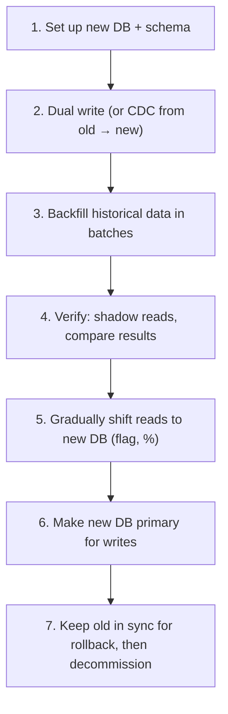

# Scenario-Based Questions (FAANG-Style)

[⬅ Back to index](../README.md)

Covers: the "what would you do if…" questions asked as follow-ups or as whole rounds: performance incidents, traffic spikes, database and cache failures, hot keys, data inconsistencies, migrations, duplicate payments, region outages, breaking changes, and scaling decisions.

> How to answer: **(1) stop the bleeding / mitigate, (2) find the root cause with data, (3) fix it properly, (4) prevent it from happening again.** Mention the metrics you'd look at, and the trade-offs of each fix.

---

## Performance & Load

### 1. Your API's p99 latency suddenly jumped from 200 ms to 2 s. How do you investigate?

Answer

1. **Scope it** – all endpoints or one? All instances or some? All regions? Since when? Correlate with **deploys, config changes, traffic changes** (most incidents follow a change) → roll back if one lines up.
2. **Traces** – find which span grew: DB, cache, a downstream service, or the app itself (GC pauses, thread pool saturation).
3. **Saturation metrics** – CPU, memory/GC, connection pools (DB pool exhausted → requests queue), thread pools, queue lengths, disk I/O.
4. **Dependencies** – slow queries (new query plan, missing index, lock contention), cache hit rate drop (cache flush or new key format), a slow third-party API.
5. **Traffic pattern** – a bot, a new client version making extra calls, a hot key.

Mitigate (roll back, scale out, shed load, enable cached fallback), then fix (index, query, timeouts), then add alerts on the cause.

### 2. Your database is at 95% CPU during peak. What do you do?

Answer

- **Short term**: find the top queries (`pg_stat_statements`, slow query log). One bad query often dominates → add an index, fix the query, or kill/throttle the offending job (e.g. an analytics report on the primary). Scale vertically if possible. Shed or rate-limit non-critical traffic.
- **Medium term**: move reads to **replicas**; add **caching** for hot reads; batch writes; move analytics to a warehouse; connection pooling.
- **Long term**: partition/shard by a good key, archive cold data, CQRS read models, or a database better suited to the access pattern.

Explain how you'd verify each change with metrics.

### 3. Traffic will be 10× next week for a big sale/launch. How do you prepare?

Answer

- **Load test** at 10–15× with realistic traffic to find the first bottleneck; fix it and repeat.
- **Pre-scale** (autoscaling is too slow for a sudden spike); raise quotas with cloud and third-party providers.
- **Caching**: warm caches, push static content to the CDN.
- **Queue** non-urgent work (emails, analytics) and protect the critical path (checkout).
- **Rate limiting, waiting rooms and load shedding** for overflow.
- **Feature flags / kill switches** for expensive non-essential features (recommendations, personalisation).
- **Code freeze** before the event; on-call staffed; dashboards and runbooks ready; DB failover tested.

### 4. A celebrity with 100M followers posts. Your feed system falls over. Why, and how do you fix it?

Answer

Fan-out on write tries to insert the post into 100M feed caches → a huge burst of writes, queue backlogs and delayed feeds for everyone. Plus, every follower then reads the same post and its counters → **hot keys**.

Fix: **hybrid fan-out** – don't push posts from high-follower accounts; merge them into followers' feeds **at read time** (followers fetch a small list of followed celebrities' recent posts, cached heavily). Cache the celebrity post itself with local/edge caching, and use sharded or buffered counters for likes.

### 5. One key in your Redis cluster is getting 500K requests per second. What do you do?

Answer

That shard is saturated (hot key). Options:
- **Local in-process cache** with a short TTL (1–5 s) on each app server → most reads never reach Redis.
- **Replicate the key** under several names (`key#0…key#9`) on different shards; read a random copy; write to all.
- **Read replicas** for that shard.
- If it's a counter being incremented: buffer increments locally and flush periodically, or shard the counter.
- Detect hot keys proactively (sampling, Redis `--hotkeys`, client-side metrics).

### 6. A message queue's consumer lag keeps growing. What do you do?

Answer

1. Is the **producer rate** higher than normal (spike, bug causing duplicates), or did **consumer throughput** drop (slow DB, errors causing retries, a poison message blocking a partition, a rebalance loop)?
2. Mitigate: scale consumers (up to the partition count), batch processing, skip/DLQ poison messages, pause non-critical producers.
3. If one partition lags: a **hot key** sends most messages to it → better partition key or salting.
4. Long term: more partitions, faster downstream (bulk writes), separate queues by priority, alert on lag (time behind, not just message count).

### 7. Your service works fine at 1K QPS but falls over at 5K QPS. How do you find the bottleneck?

Answer

Load test incrementally while watching saturation of every resource: CPU, memory/GC, thread pools, connection pools (DB, HTTP clients), file descriptors, network bandwidth, locks (lock contention shows as low CPU but high latency), and downstream dependencies' latency. The first resource to saturate is the bottleneck. Typical culprits: an undersized DB connection pool, synchronous calls holding threads, a single hot lock or row, logging to disk synchronously, N+1 queries, or a downstream rate limit. Fix, re-test, find the next one.

---

## Failures & Outages

### 8. Your cache cluster goes down completely. What happens and how do you design for it?

Answer

Every request falls through to the database, which likely can't handle the full load → cascading failure (the **cache avalanche**). Design for it:
- A cache cluster with **replicas and automatic failover** across AZs.
- **Circuit breakers and rate limits** in front of the DB so it isn't overwhelmed; shed load or serve degraded responses.
- **Request coalescing** so identical misses hit the DB once.
- A small **local cache** layer that keeps serving hot data.
- Warm the cache gradually when it comes back (don't let all traffic miss at once).
- Capacity-plan the DB for a realistic partial cache loss.

### 9. An entire AWS region goes down. What happens to your system?

Answer

Depends on the DR strategy (state your RPO/RTO):
- **Single region** – you're down until it recovers; restore from cross-region backups if it's prolonged.
- **Active-passive** – fail over DNS/global load balancer to the standby region; promote the replica database (possible loss of async-replicated recent writes); scale up the standby.
- **Active-active** – traffic shifts to healthy regions automatically; they need headroom to absorb it.

Also discuss: hidden single-region dependencies (auth, config, CI/CD, a third party), data written only in the failed region, testing failover regularly, and failback.

### 10. A downstream service is slow (not down). How do you prevent it from taking your service down?

Answer

Slowness is worse than failure: threads and connections pile up waiting. Use **tight timeouts**, a **circuit breaker** that opens on slow calls too, a **bulkhead** (dedicated, bounded pool for that dependency), a **fallback** (cached/default data), limited retries with backoff, and **deadline propagation** so you don't keep working on requests the client gave up on. Load shed early if your own queues grow.

### 11. A bad deploy is corrupting data in production. What do you do?

Answer

1. **Stop it**: roll back the deploy or turn off the feature flag immediately; if needed, pause writes for the affected path.
2. **Assess**: which records, since when (deploy time), which users.
3. **Repair**: restore affected data from backups/point-in-time recovery or recompute from the event log/audit trail; write a careful, tested repair script; prefer correcting forward over bulk restores that lose newer valid writes.
4. **Communicate** with affected users if needed.
5. **Prevent**: canary releases with data-validation checks, schema constraints, better tests, backups verified by restores.

### 12. Users report that they sometimes see stale data after updating their profile. Why?

Answer

Likely causes:
- **Replica lag** – the write goes to the primary, the next read hits a lagging replica.
- **Cache not invalidated** (or a race that re-populated the old value).
- A CDN or client cache serving an old response.
- Eventual consistency in a multi-region setup.

Fixes: **read-your-writes** (read from the primary for that user for a few seconds after a write, or use a version/LSN token), invalidate caches after commit (and use versioned values), `Cache-Control: no-store/private` on personalised responses, and show the client its own update optimistically.

---

## Data & Correctness

### 13. Some customers were charged twice. How did it happen and how do you prevent it?

Answer

Typical cause: a **retry after a timeout** – the first charge actually succeeded, but the client or service didn't get the response and retried; or a double-click; or a queue redelivered a message to a non-idempotent consumer.

Prevention:
- **Idempotency keys** on the payment API, stored with the result atomically; the same key returns the original result.
- Pass a unique reference to the payment provider so it dedupes too.
- Unique constraints (one successful charge per order ID).
- State machine with explicit `pending` state; on unknown outcome, **query status** instead of re-charging.
- Disable the button after click (UX), but never rely on the client.
- Reconciliation jobs that detect and auto-refund duplicates.

### 14. Two microservices have inconsistent data (orders show paid, payments show failed). How do you handle it?

Answer

Root causes: dual writes without atomicity, lost events, out-of-order processing, or a failed saga step without compensation.
- **Fix the pattern**: transactional outbox / CDC for publishing events; idempotent consumers; sagas with compensations and timeouts; version numbers to ignore out-of-order events.
- **Detect**: reconciliation jobs comparing both sides regularly, alerting on mismatches.
- **Repair**: a clear source of truth per fact (the payment service owns payment status), and replay events or re-sync from it.

### 15. How would you migrate a large database to a new database with zero downtime?

Answer

Key points: use **CDC** rather than application dual-writes when possible (no consistency gaps), make every step reversible, verify with data comparison and shadow traffic, migrate by tenant/shard in waves, and keep idempotent backfills that can be restarted.

### 16. You need to add a column with a default to a table with 2 billion rows. How?

Answer

Avoid a blocking table rewrite:
- Many modern databases add a nullable column or a constant default as a metadata-only change (Postgres 11+, MySQL 8 instant ADD COLUMN) – check first.
- Otherwise use **online schema change tools** (gh-ost, pt-online-schema-change) that copy to a shadow table and swap.
- Backfill values in **small throttled batches**, watching replication lag.
- Use **expand and contract**: deploy code that handles both states; only enforce NOT NULL after the backfill.
- Build new indexes concurrently (`CREATE INDEX CONCURRENTLY`).

### 17. A user asks to delete all their data (GDPR). How does your system ensure it?

Answer

- A **data inventory**: which services/stores hold personal data, keyed by user ID.
- A **deletion orchestrator** that publishes a `UserDeletionRequested` event; each service deletes or anonymises its data and acknowledges; the orchestrator tracks completion within the legal deadline and retries.
- Caches expire/invalidated; search indexes updated; analytics pseudonymised.
- Backups: either expire within the retention window or use **crypto-shredding** (delete the user's encryption key).
- Audit log of the deletion (without the personal data).

---

## Design Decisions & Evolution

### 18. Your monolith is slowing down development for 200 engineers. How do you approach splitting it?

Answer

Don't big-bang rewrite. First modularise inside the monolith (clear domain boundaries, owned modules, enforced dependencies). Then extract services with the **strangler fig** pattern, starting with domains that change often, have clear boundaries, or have different scaling needs. Each extracted service owns its data (migrate with CDC). Invest in platform first: CI/CD, observability, service templates, contract testing. Measure success by deploy frequency and lead time, not service count.

### 19. You need to make a breaking change to a public API used by thousands of clients. How?

Answer

- Avoid it if possible (additive changes, new fields, new endpoints).
- Otherwise release **v2** alongside v1; document migration; SDK updates.
- Track v1 usage per client; contact heavy users; announce a deprecation timeline (`Deprecation`/`Sunset` headers).
- Brownouts (planned short v1 outages) to flush out stragglers before final removal.
- For mobile apps, keep old versions working until the forced-upgrade threshold.

### 20. How would you design a system to handle data for a celebrity tenant 1,000× larger than others?

Answer

Treat outliers explicitly: route them to **dedicated shards/cells** via a directory-based shard map; sub-partition their data (by sub-key or time); apply per-tenant rate limits and resource quotas so they can't starve others; give them separate queues/worker pools; and special-case caching. Keep the default path optimised for normal tenants.

### 21. Your product needs strong consistency and is going global. What are your options?

Answer

- **Single-writer region per data item** (home region by user/tenant): strong consistency within the region; cross-region reads are replicated (stale) or proxied to the home region. Most practical.
- **Globally distributed consensus database** (Spanner, CockroachDB): strong consistency everywhere, at the cost of cross-region write latency (~100+ ms).
- **Relax where possible**: keep strong consistency only for critical data (balances, inventory), eventual elsewhere.

Explain the latency cost of each: physics (speed of light) makes cross-continent consensus slow.

### 22. Search results are slow and expensive. The DB does `LIKE '%term%'` queries. What do you do?

Answer

`LIKE '%…%'` can't use B-tree indexes → full scans. Move search to a **dedicated search engine** (Elasticsearch/OpenSearch, or Postgres full-text search with GIN indexes for smaller scale) fed by CDC. Add relevance ranking, typo tolerance, filters as facets, caching for popular queries and pagination limits. Keep the DB as the source of truth.

### 23. Your notification system sent the same push to users 5 times. Why, and how do you fix it?

Answer

Likely at-least-once processing without dedupe: consumer crashes or times out after sending but before committing its offset, causing redelivery; retries at several layers; or duplicate events from the producer. Fix: a unique notification ID per (event, user, channel); **check-and-record** in a dedupe store (Redis `SET NX` with TTL, or a DB unique key) before sending; commit offsets after recording; a single retry layer with backoff; and alerts on send-rate anomalies.

### 24. How would you reduce your cloud bill by 30% without hurting reliability?

Answer

Measure first (cost per service/team, tagging). Then: right-size over-provisioned instances; autoscale on real metrics and scale down at night; reserved/savings plans for steady load and spot for batch; storage lifecycle policies (tier logs/backups to cold storage, delete what's unused); reduce cross-AZ/region and internet egress (CDN, co-location, compression); cache to cut DB size; reduce log volume and metrics cardinality; delete idle resources. Track cost as a metric alongside SLOs.

### 25. An interviewer asks: "What would break first in your design if traffic grew 100×?"

Answer

Walk your own diagram systematically: stateless services scale out → fine. Then the **stateful parts**: the primary database's write throughput (→ sharding), cache memory and hot keys, fan-out work (celebrity problem), queue partition counts, single-leader components (ID generator, schedulers), third-party rate limits, and cross-region bandwidth. Pick the most likely one, give the number where it breaks ("one Postgres primary at ~10K writes/s"), and propose the next evolution. This question tests whether you understand your own design's limits.

---

[⬅ Previous: Mobile System Design](19-mobile-system-design.md) · [⬅ Back to index](../README.md) · [Next: Low-Level Design ➡](21-low-level-design.md)
