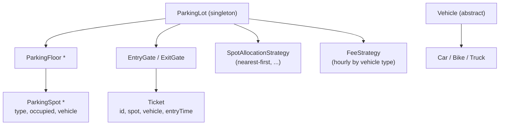

# Low-Level Design (Object-Oriented Design)

[⬅ Back to index](../README.md)

Covers: how to approach an LLD / machine-coding round, SOLID and the patterns that come up most, concurrency in LLD, and worked designs: parking lot, elevator system, LRU cache, rate limiter, vending machine, movie ticket booking, Splitwise, in-memory key-value store with TTL, logger, pub/sub system, chess and snake & ladder.

Code samples are in Java (the most common LLD language); the same ideas apply in Kotlin, Swift, C++ or Python.

---

## Approach

### 1. How do you approach a low-level design round?

<details>
<summary>Answer</summary>

1. **Clarify requirements and scope** (5 min) – list the use cases; ask about scale, concurrency, extensibility ("multiple floors? EV spots? payment types?").
2. **Identify entities** – nouns become classes (ParkingLot, Floor, Spot, Vehicle, Ticket); verbs become methods.
3. **Define relationships** – has-a vs is-a; prefer composition; interfaces for things that vary.
4. **Draw a class diagram** with key fields and methods.
5. **Apply patterns where they fit** – Strategy for variable algorithms, State for lifecycles, Factory for creation, Observer for notifications, Singleton (sparingly) for shared managers.
6. **Write the core code** – clean, runnable, with the main flows; handle edge cases and **thread safety**.
7. **Discuss extensions** – how a new requirement fits without modifying existing classes (Open/Closed).

Interviewers look for clean abstractions, SOLID, sensible patterns, readable code and handling concurrency – not for every feature.

</details>

### 2. Which SOLID principles matter most in LLD answers?

<details>
<summary>Answer</summary>

- **S – Single responsibility** – `ParkingLot` doesn't calculate fees; a `FeeCalculator` does.
- **O – Open/closed** – add a new vehicle type or pricing rule by adding a class, not editing a switch statement.
- **L – Liskov substitution** – subclasses must work wherever the parent is expected (no throwing `UnsupportedOperationException` for half the methods).
- **I – Interface segregation** – small focused interfaces (`Payable`, `Refundable`).
- **D – Dependency inversion** – depend on interfaces (`PaymentProcessor`), inject implementations.

</details>

### 3. Which design patterns come up most in LLD interviews?

<details>
<summary>Answer</summary>

| Pattern | Typical use in LLD problems |
|---|---|
| **Strategy** | Pricing/fee rules, spot allocation, elevator scheduling, split types in Splitwise, eviction policies |
| **State** | Vending machine, elevator, order/booking lifecycle |
| **Factory** | Creating vehicles, spots, payment methods, pieces in chess |
| **Observer** | Notifications, display boards, pub/sub, stock price updates |
| **Singleton** | A single ParkingLot/Logger manager (be ready to discuss testability) |
| **Builder** | Complex objects (requests, reports) |
| **Decorator** | Adding toppings/features, logging/caching wrappers |
| **Command** | Undo/redo, queued requests (elevator requests, text editor) |
| **Chain of responsibility** | Logger levels, request handling/validation pipelines, ATM cash dispensing |
| **Composite** | File systems, menus, org charts |

</details>

### 4. How do you handle concurrency in an LLD answer?

<details>
<summary>Answer</summary>

Identify **shared mutable state** (available spots, seat status, cache map) and protect it:
- Fine-grained locks (per floor/per show) rather than one global lock.
- Atomic operations / concurrent collections (`ConcurrentHashMap`, `AtomicInteger`, compare-and-set).
- `synchronized` / `ReentrantLock` around check-then-act sequences ("is the seat free? then book it").
- Optimistic locking with versions for booking systems.
- Immutable value objects to reduce what needs locking.

Always mention the race ("two cars take the same spot", "two users book the same seat") and how your design prevents it.

</details>

---

## Worked Designs

### 5. Design a parking lot.

<details>
<summary>Answer</summary>

**Requirements** – multiple floors; spot types (motorcycle, compact, large, EV); vehicles of different sizes; entry issues a ticket; exit calculates the fee by duration and vehicle type; display free spots per floor; concurrent entry gates.

**Classes**


```java
enum SpotType { BIKE, COMPACT, LARGE, EV }

abstract class Vehicle { final String plate; abstract SpotType requiredSpot(); }

class ParkingSpot {
    final String id; final SpotType type; private Vehicle vehicle;
    synchronized boolean tryOccupy(Vehicle v) { if (vehicle != null) return false; vehicle = v; return true; }
    synchronized void free() { vehicle = null; }
    boolean isFree() { return vehicle == null; }
}

interface SpotAllocationStrategy { Optional<ParkingSpot> find(List<ParkingFloor> floors, SpotType type); }
interface FeeStrategy { long fee(Ticket t, Instant exit); }

class ParkingLot {
    private final List<ParkingFloor> floors;
    private final SpotAllocationStrategy allocator; private final FeeStrategy fees;

    Ticket park(Vehicle v) {
        while (true) {
            ParkingSpot spot = allocator.find(floors, v.requiredSpot())
                .orElseThrow(() -> new IllegalStateException("Lot full"));
            if (spot.tryOccupy(v)) return new Ticket(UUID.randomUUID().toString(), v, spot, Instant.now());
            // another gate took it first → retry
        }
    }
    long unpark(Ticket t) { t.spot().free(); return fees.fee(t, Instant.now()); }
}
```

**Discussion** – `tryOccupy` makes the check-and-take atomic so two gates can't take one spot. New spot types, pricing or allocation rules are new classes (Strategy). Display boards can observe spot changes (Observer).

</details>

### 6. Design an elevator system.

<details>
<summary>Answer</summary>

**Requirements** – N elevators, M floors; hall calls (up/down buttons) and car calls (floor buttons inside); efficient scheduling; door/state handling; capacity limits; emergency stop.

**Classes** – `ElevatorController` (receives requests, assigns elevators via a `SchedulingStrategy`), `Elevator` (current floor, direction, state, sorted sets of pending stops), `Request` (floor, direction), `ElevatorState` (IDLE, MOVING_UP, MOVING_DOWN, DOORS_OPEN, MAINTENANCE).

```java
class Elevator {
    int floor; Direction dir = Direction.IDLE;
    final TreeSet<Integer> upStops = new TreeSet<>(), downStops = new TreeSet<>();

    void addStop(int f) { if (f > floor) upStops.add(f); else if (f < floor) downStops.add(f); }

    void step() {                       // called on each tick
        if (dir != Direction.DOWN && !upStops.isEmpty()) { dir = Direction.UP; floor++; if (upStops.remove(floor)) openDoors(); }
        else if (!downStops.isEmpty())  { dir = Direction.DOWN; floor--; if (downStops.remove(floor)) openDoors(); }
        else dir = Direction.IDLE;
    }
}
```

**Scheduling (Strategy)** – the classic **SCAN/LOOK** algorithm: keep moving in one direction serving stops, then reverse. For assigning hall calls: pick the elevator that will reach the floor soonest (already moving towards it in the same direction, else nearest idle). Discuss alternatives (zoning for skyscrapers, destination dispatch) and thread safety of the request queues.

</details>

### 7. Implement an LRU cache.

<details>
<summary>Answer</summary>

`get` and `put` in **O(1)**: a **hash map** from key → node in a **doubly linked list** ordered by recency (most recent at the head). On access, move the node to the head; on insert beyond capacity, remove the tail.

```java
class LRUCache<K, V> {
    private final int capacity;
    private final Map<K, Node<K, V>> map = new HashMap<>();
    private final Node<K, V> head = new Node<>(null, null), tail = new Node<>(null, null);

    LRUCache(int capacity) { this.capacity = capacity; head.next = tail; tail.prev = head; }

    public synchronized V get(K key) {
        Node<K, V> n = map.get(key);
        if (n == null) return null;
        remove(n); addFirst(n);
        return n.value;
    }

    public synchronized void put(K key, V value) {
        Node<K, V> n = map.get(key);
        if (n != null) { n.value = value; remove(n); addFirst(n); return; }
        if (map.size() == capacity) { Node<K, V> lru = tail.prev; remove(lru); map.remove(lru.key); }
        n = new Node<>(key, value); addFirst(n); map.put(key, n);
    }

    private void remove(Node<K, V> n) { n.prev.next = n.next; n.next.prev = n.prev; }
    private void addFirst(Node<K, V> n) { n.next = head.next; n.prev = head; head.next.prev = n; head.next = n; }

    private static class Node<K, V> { K key; V value; Node<K, V> prev, next; Node(K k, V v) { key = k; value = v; } }
}
```

Follow-ups: thread safety (synchronized here; striped locks or a concurrent library like Caffeine for high contention), TTL support, LFU variant (map of frequency → linked list), Java's `LinkedHashMap(accessOrder=true)` with `removeEldestEntry` as a shortcut.

</details>

### 8. Implement a rate limiter class (token bucket).

<details>
<summary>Answer</summary>

```java
class TokenBucket {
    private final long capacity; private final double refillPerNano;
    private double tokens; private long lastRefill;

    TokenBucket(long capacity, double refillPerSecond) {
        this.capacity = capacity; this.refillPerNano = refillPerSecond / 1e9;
        this.tokens = capacity; this.lastRefill = System.nanoTime();
    }

    synchronized boolean tryAcquire() {
        long now = System.nanoTime();
        tokens = Math.min(capacity, tokens + (now - lastRefill) * refillPerNano);
        lastRefill = now;
        if (tokens >= 1) { tokens -= 1; return true; }
        return false;
    }
}

class RateLimiter {
    private final ConcurrentHashMap<String, TokenBucket> buckets = new ConcurrentHashMap<>();
    boolean allow(String clientId) {
        return buckets.computeIfAbsent(clientId, id -> new TokenBucket(100, 100 / 60.0)).tryAcquire();
    }
}
```

Discuss: refilling lazily on access (no background thread), per-client buckets in a concurrent map, evicting idle buckets, a `RateLimitStrategy` interface for sliding window variants, and distributing it via Redis ([distributed version](16-designs-core-infrastructure.md)).

</details>

### 9. Design a vending machine.

<details>
<summary>Answer</summary>

A textbook **State pattern** problem. States: `Idle`, `HasMoney`, `Dispensing`, `OutOfService`. Each state implements the same interface and decides what each action means in that state.

```java
interface VendingState {
    void insertCoin(VendingMachine m, Coin c);
    void selectProduct(VendingMachine m, String code);
    void cancel(VendingMachine m);
}

class HasMoneyState implements VendingState {
    public void insertCoin(VendingMachine m, Coin c) { m.addBalance(c.value); }
    public void selectProduct(VendingMachine m, String code) {
        Product p = m.inventory().get(code);
        if (p == null || m.inventory().count(code) == 0) { m.display("Sold out"); return; }
        if (m.balance() < p.price()) { m.display("Insert more"); return; }
        m.setState(new DispensingState());
        m.dispense(p); m.returnChange(m.balance() - p.price());
        m.setState(new IdleState());
    }
    public void cancel(VendingMachine m) { m.returnChange(m.balance()); m.setState(new IdleState()); }
}
```

Other classes: `Inventory` (code → product + count), `CoinDispenser` (change-making – greedy works for canonical coin systems), `Product`. Extensions: card payments (Strategy for payment), admin restocking mode.

</details>

### 10. Design a movie ticket booking system (like BookMyShow).

<details>
<summary>Answer</summary>

**Entities** – `City`, `Cinema`, `Screen`, `Seat` (row, number, type), `Movie`, `Show` (movie, screen, start time, price per seat type), `ShowSeat` (show, seat, status AVAILABLE/LOCKED/BOOKED, lockedBy, lockExpiry), `Booking` (user, show, seats, status, payment), `Payment`.

**Key flow** – search shows → view seat map → **lock** selected seats for ~10 minutes → pay → confirm booking (seats BOOKED) or release locks on failure/timeout.

```java
class SeatLockService {
    private final Map<String, SeatLock> locks = new ConcurrentHashMap<>(); // key = showId:seatId

    boolean lockSeats(String showId, List<String> seatIds, String userId, Duration ttl) {
        List<String> acquired = new ArrayList<>();
        for (String seat : seatIds) {
            String key = showId + ":" + seat;
            SeatLock fresh = new SeatLock(userId, Instant.now().plus(ttl));
            SeatLock existing = locks.compute(key, (k, cur) ->
                (cur == null || cur.expired()) ? fresh : cur);
            if (existing != fresh) { acquired.forEach(locks::remove); return false; } // all-or-nothing
            acquired.add(key);
        }
        return true;
    }
}
```

Discuss: all-or-nothing seat locking, lock expiry, the DB-level version for distributed deployments (conditional updates – see [Ticketmaster](18-designs-location-commerce.md)), payment via a `PaymentStrategy`, notifications via Observer, and pricing rules via Strategy.

</details>

### 11. Design Splitwise (expense sharing).

<details>
<summary>Answer</summary>

**Entities** – `User`, `Group`, `Expense` (paidBy, amount, splits, description), `Split` (abstract: `EqualSplit`, `ExactSplit`, `PercentSplit`), `BalanceSheet` (net amount between pairs of users).

```java
abstract class Split { final User user; long amount; }   // amounts in cents

interface SplitStrategy { List<Split> compute(long total, List<User> users, List<Double> params); }

class ExpenseService {
    private final Map<String, Map<String, Long>> balances = new HashMap<>(); // a owes b → amount

    void addExpense(User paidBy, long total, List<Split> splits) {
        validate(total, splits);              // splits must sum to total; percents to 100
        for (Split s : splits) {
            if (s.user.equals(paidBy)) continue;
            adjust(s.user.id, paidBy.id, s.amount);   // s.user owes paidBy
        }
    }
    private void adjust(String from, String to, long amt) {
        balances.computeIfAbsent(from, k -> new HashMap<>()).merge(to, amt, Long::sum);
        balances.computeIfAbsent(to, k -> new HashMap<>()).merge(from, -amt, Long::sum);
    }
}
```

Follow-ups: rounding leftovers (assign remaining cents to one person), **simplify debts** (compute each person's net balance, then greedily match the largest creditor with the largest debtor using two heaps – minimises transactions in practice), money as integers, and splits as a Strategy/Factory.

</details>

### 12. Design an in-memory key-value store with TTL.

<details>
<summary>Answer</summary>

```java
class KVStore<K, V> {
    private record Entry<V>(V value, long expiresAt) { boolean expired(long now) { return expiresAt > 0 && now >= expiresAt; } }
    private final ConcurrentHashMap<K, Entry<V>> map = new ConcurrentHashMap<>();
    private final ScheduledExecutorService cleaner = Executors.newSingleThreadScheduledExecutor();

    KVStore() { cleaner.scheduleAtFixedRate(this::evictExpired, 1, 1, TimeUnit.SECONDS); }

    void put(K k, V v, Duration ttl) { map.put(k, new Entry<>(v, ttl == null ? 0 : System.currentTimeMillis() + ttl.toMillis())); }

    V get(K k) {
        Entry<V> e = map.get(k);
        if (e == null) return null;
        if (e.expired(System.currentTimeMillis())) { map.remove(k, e); return null; }   // lazy expiry
        return e.value();
    }

    private void evictExpired() { long now = System.currentTimeMillis(); map.entrySet().removeIf(en -> en.getValue().expired(now)); }
}
```

Discussion: lazy expiry on read + periodic active cleanup (Redis does the same with sampling); a min-heap or timing wheel by expiry time for efficient cleanup; memory limits with LRU eviction; transactions/snapshots; persistence via an append-only log.

</details>

### 13. Design a logging framework.

<details>
<summary>Answer</summary>

**Requirements** – log levels (DEBUG < INFO < WARN < ERROR), multiple destinations (console, file, remote), configurable format, thread safe, minimal impact on the app.

**Design**
- `Logger` (per class/name, has a level and a list of `Appender`s) – created via a `LoggerFactory` (Singleton registry).
- `Appender` interface: `ConsoleAppender`, `FileAppender` (with rotation), `RemoteAppender`.
- `Formatter` interface (Strategy): plain text, JSON.
- **Chain of responsibility** for levels (each handler handles its level or passes on) is a common interview variant.
- **Async logging** – log calls put events on a bounded queue; a background thread writes to appenders (choose: block, drop, or drop-low-priority when the queue is full).
- Avoid string building cost for disabled levels (`if (log.isDebugEnabled())` or lambdas/suppliers).

</details>

### 14. Design an in-memory pub/sub (message broker) system.

<details>
<summary>Answer</summary>

```java
interface Subscriber { void onMessage(String topic, Message m); }

class Broker {
    private final Map<String, Set<Subscriber>> topics = new ConcurrentHashMap<>();
    private final ExecutorService delivery = Executors.newFixedThreadPool(8);

    void subscribe(String topic, Subscriber s) { topics.computeIfAbsent(topic, t -> ConcurrentHashMap.newKeySet()).add(s); }
    void unsubscribe(String topic, Subscriber s) { topics.getOrDefault(topic, Set.of()).remove(s); }

    void publish(String topic, Message m) {
        for (Subscriber s : topics.getOrDefault(topic, Set.of()))
            delivery.submit(() -> s.onMessage(topic, m));   // async, one slow subscriber can't block others
    }
}
```

Extensions: per-subscriber queues with offsets (Kafka-like replay), ordering guarantees per topic (a single-threaded executor per subscriber), acknowledgements and retries, backpressure with bounded queues, wildcard topics.

</details>

### 15. Design a chess game.

<details>
<summary>Answer</summary>

- `Game` (board, players, current turn, status, move history), `Board` (8×8 `Cell`s), `Piece` (abstract: color, `canMove(board, from, to)`), subclasses `King`, `Queen`, `Rook`, `Bishop`, `Knight`, `Pawn` – each implements its movement rule (polymorphism instead of a giant switch).
- `Move` (from, to, piece, captured piece, special flags: castling, en passant, promotion) – stored for history and **undo** (Command pattern).
- `Game.makeMove` validates turn, piece rule, path not blocked, and that the move doesn't leave your own king in check; then updates status (check, checkmate, stalemate).
- Extensions: timers (chess clock), online play (moves as events), AI player via a `Player` interface (HumanPlayer, ComputerPlayer – Strategy).

</details>

### 16. Design Snake and Ladder.

<details>
<summary>Answer</summary>

- `Board` (size, map of snake heads → tails and ladder bottoms → tops), `Player` (name, position), `Dice` (interface; `StandardDice`, `LoadedDice` for tests – Strategy), `Game` (queue of players, board, dice, winner).
- Loop: take the next player from the queue → roll → new position (ignore if > board size, per rules) → apply snake/ladder jumps (possibly chained) → check win → re-queue.
- Validation when building the board: no snake and ladder starting on the same cell, no cycles.
- Shows clean modelling and testability (inject the dice).

</details>

### 17. Design an ATM system.

<details>
<summary>Answer</summary>

**Classes** – `ATM` (state, cash dispenser, card reader, bank client), `Card`, `Account`, `Transaction` (abstract: `Withdrawal`, `Deposit`, `BalanceInquiry`, `Transfer`), `CashDispenser`, `BankService` (interface to the bank's backend).

- **State pattern** for the session: `Idle → CardInserted → PinVerified → TransactionSelected → Dispensing → Idle` (and `OutOfService`). Wrong PIN three times → retain card.
- **Cash dispensing** – **chain of responsibility** over note denominations (2,000 → 500 → 100 handlers), each dispensing as many as possible and passing the remainder on; check the ATM's stock before committing.
- **Withdrawal correctness** – authorise/debit the account with the bank first (with a transaction ID for idempotency), then dispense; if dispensing fails, reverse the debit. Log every step for reconciliation.
- **Concurrency** – one session per ATM, but the bank side must handle simultaneous withdrawals from the same account (atomic balance check and debit).

</details>

### 18. Design Tic-tac-toe (N × N, two players).

<details>
<summary>Answer</summary>

```java
class TicTacToe {
    private final int n; private final int[] rows, cols; private int diag, antiDiag;
    private final char[][] board;

    TicTacToe(int n) { this.n = n; rows = new int[n]; cols = new int[n]; board = new char[n][n]; }

    /** player 1 adds +1, player 2 adds -1; returns the winner (1 or 2) or 0. O(1) per move. */
    int move(int r, int c, int player) {
        if (board[r][c] != 0) throw new IllegalArgumentException("Cell taken");
        board[r][c] = player == 1 ? 'X' : 'O';
        int v = player == 1 ? 1 : -1;
        rows[r] += v; cols[c] += v;
        if (r == c) diag += v;
        if (r + c == n - 1) antiDiag += v;
        if (Math.abs(rows[r]) == n || Math.abs(cols[c]) == n || Math.abs(diag) == n || Math.abs(antiDiag) == n) return player;
        return 0;
    }
}
```

Discuss: O(1) win checking with counters instead of scanning the board; a `Game` class managing turns, `Player` interface (human/computer – Strategy), draw detection (move count = n²), and minimax for an unbeatable AI on 3×3.

</details>

### 19. Design a library management system.

<details>
<summary>Answer</summary>

**Entities** – `Book` (ISBN, title, authors), `BookCopy` (barcode, status: AVAILABLE/BORROWED/RESERVED/LOST), `Member` (limits, fines), `Loan` (copy, member, issue date, due date, return date), `Reservation` (queue per book), `Librarian`, `Catalog` (search by title/author/subject).

**Key flows**
- **Checkout** – check member status (no unpaid fines over a limit, under the max-loans limit), pick an available copy, create a loan, mark the copy BORROWED – atomically, so two librarians can't lend the same copy.
- **Return** – close the loan, compute fines (a `FineStrategy` per member type), and if reservations exist, mark the copy RESERVED and notify the next member (Observer).
- **Renew** – only if no one has reserved the book.
- **Search** – index by title, author, subject (a `SearchStrategy` or simple indexes).

Patterns: Strategy (fines, search), Observer (notifications), Repository (persistence), State for copy status.

</details>

### 20. Design an in-memory file system.

<details>
<summary>Answer</summary>

Support `mkdir(path)`, `ls(path)`, `addContentToFile(path, content)`, `readContentFromFile(path)`, plus delete and move.

```java
abstract class Node { final String name; Node(String n) { name = n; } }
class File extends Node { final StringBuilder content = new StringBuilder(); File(String n) { super(n); } }
class Directory extends Node {
    final TreeMap<String, Node> children = new TreeMap<>();   // sorted for ls
    Directory(String n) { super(n); }
}

class FileSystem {
    private final Directory root = new Directory("");

    private Directory walk(String[] parts, int upto, boolean create) {
        Directory cur = root;
        for (int i = 0; i < upto; i++) {
            Node next = cur.children.get(parts[i]);
            if (next == null) {
                if (!create) throw new NoSuchElementException(parts[i]);
                next = new Directory(parts[i]); cur.children.put(parts[i], next);
            }
            if (!(next instanceof Directory d)) throw new IllegalStateException(parts[i] + " is a file");
            cur = d;
        }
        return cur;
    }
    private static String[] split(String path) { return Arrays.stream(path.split("/")).filter(s -> !s.isEmpty()).toArray(String[]::new); }

    void mkdir(String path) { String[] p = split(path); walk(p, p.length, true); }

    List<String> ls(String path) {
        String[] p = split(path);
        if (p.length == 0) return new ArrayList<>(root.children.keySet());
        Node n = walk(p, p.length - 1, false).children.get(p[p.length - 1]);
        if (n instanceof File) return List.of(n.name);
        return new ArrayList<>(((Directory) n).children.keySet());
    }

    void addContentToFile(String path, String content) {
        String[] p = split(path);
        Directory dir = walk(p, p.length - 1, true);
        File f = (File) dir.children.computeIfAbsent(p[p.length - 1], File::new);
        f.content.append(content);
    }

    String readContentFromFile(String path) {
        String[] p = split(path);
        return ((File) walk(p, p.length - 1, false).children.get(p[p.length - 1])).content.toString();
    }
}
```

This is the **Composite pattern** (files and directories share a `Node` type). Follow-ups: permissions, sizes (aggregate up the tree), search by name/extension (Specification/Strategy filters), and thread safety (read-write locks per directory).

</details>

### 21. Design a meeting room booking system.

<details>
<summary>Answer</summary>

**Requirements** – rooms with capacity and equipment; book a room for a time interval; no overlapping bookings; find free rooms for a time and size; cancel; recurring meetings (follow-up).

**Design**
- `Room(id, capacity, features)`, `Booking(id, roomId, start, end, organiser)`, `RoomScheduler`.
- Store bookings per room in a **sorted structure by start time** (`TreeMap<start, Booking>`). An interval `[s, e)` overlaps if the booking just before `s` ends after `s`, or the booking at/after `s` starts before `e` – an O(log n) check.

```java
synchronized boolean book(Room room, long s, long e, Booking b) {
    TreeMap<Long, Booking> cal = calendars.get(room.id());
    Map.Entry<Long, Booking> prev = cal.floorEntry(s), next = cal.ceilingEntry(s);
    if (prev != null && prev.getValue().end() > s) return false;
    if (next != null && next.getKey() < e) return false;
    cal.put(s, b); return true;
}
```

- **Finding a room** – filter rooms by capacity/features, then check availability; choose the smallest suitable room (Strategy).
- **Concurrency** – lock per room (not global) so different rooms can be booked in parallel; in a distributed version, use a DB constraint/conditional insert.
- Related classic question: "minimum number of rooms needed for a list of meetings" → sort start and end times and sweep, or use a min-heap of end times.

</details>

### 22. Design a text editor with undo and redo.

<details>
<summary>Answer</summary>

Use the **Command pattern**: every edit is an object that knows how to apply and reverse itself.

```java
interface Command { void execute(); void undo(); }

class InsertCommand implements Command {
    private final StringBuilder doc; private final int pos; private final String text;
    InsertCommand(StringBuilder doc, int pos, String text) { this.doc = doc; this.pos = pos; this.text = text; }
    public void execute() { doc.insert(pos, text); }
    public void undo() { doc.delete(pos, pos + text.length()); }
}

class Editor {
    private final StringBuilder doc = new StringBuilder();
    private final Deque<Command> undo = new ArrayDeque<>(), redo = new ArrayDeque<>();

    void run(Command c) { c.execute(); undo.push(c); redo.clear(); }   // a new edit clears redo history
    void undo() { if (!undo.isEmpty()) { Command c = undo.pop(); c.undo(); redo.push(c); } }
    void redo() { if (!redo.isEmpty()) { Command c = redo.pop(); c.execute(); undo.push(c); } }
}
```

Discuss: `DeleteCommand` must remember the deleted text; merging consecutive keystrokes into one undo step; limiting history size; the **Memento** alternative (snapshots – simpler but memory-heavy); and real editors' data structures (gap buffer, rope, piece table) for efficient inserts in large documents.

</details>

### 23. Implement a thread-safe bounded blocking queue (producer–consumer).

<details>
<summary>Answer</summary>

```java
class BoundedBlockingQueue<T> {
    private final Object[] items; private int head, tail, count;
    private final ReentrantLock lock = new ReentrantLock();
    private final Condition notFull = lock.newCondition(), notEmpty = lock.newCondition();

    BoundedBlockingQueue(int capacity) { items = new Object[capacity]; }

    void put(T item) throws InterruptedException {
        lock.lock();
        try {
            while (count == items.length) notFull.await();   // while, not if: spurious wake-ups
            items[tail] = item; tail = (tail + 1) % items.length; count++;
            notEmpty.signal();
        } finally { lock.unlock(); }
    }

    @SuppressWarnings("unchecked")
    T take() throws InterruptedException {
        lock.lock();
        try {
            while (count == 0) notEmpty.await();
            T item = (T) items[head]; items[head] = null; head = (head + 1) % items.length; count--;
            notFull.signal();
            return item;
        } finally { lock.unlock(); }
    }
}
```

Key points: a circular buffer, one lock with two conditions, **`while` loops** around waits (spurious wake-ups and competing threads), `finally` to always unlock, and signalling the opposite condition. In production use `ArrayBlockingQueue`/`LinkedBlockingQueue`. Follow-ups: timeouts (`offer`/`poll` with time), shutdown signalling, and why bounded queues provide backpressure.

</details>

---

[⬅ Previous: Scenario-Based Questions](20-scenario-based.md) · [⬅ Back to index](../README.md) · [Next: AI/ML Systems & What's New ➡](22-ai-ml-whats-new.md)
