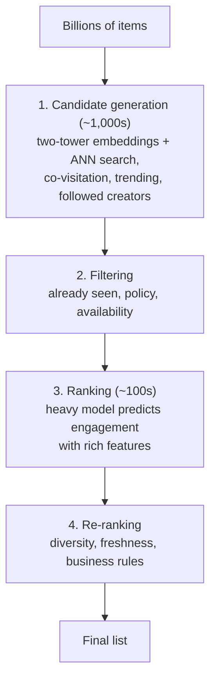
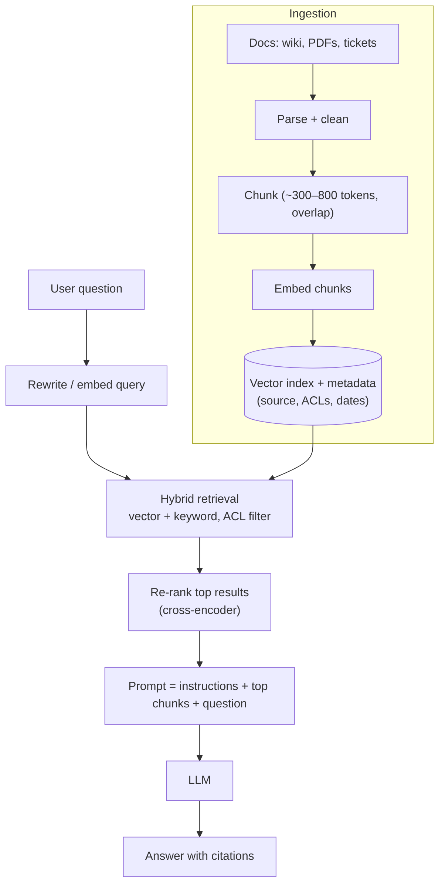
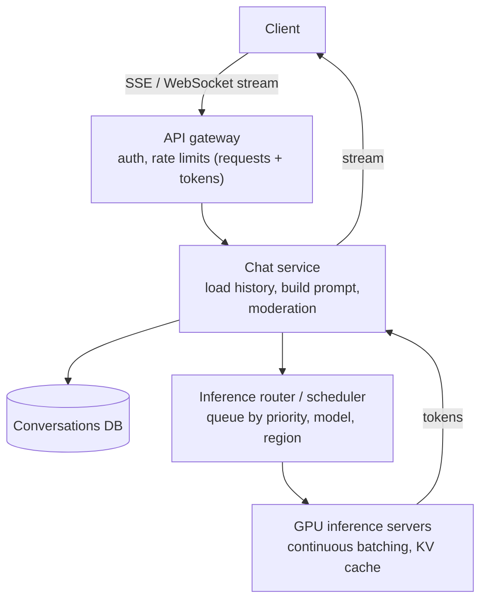
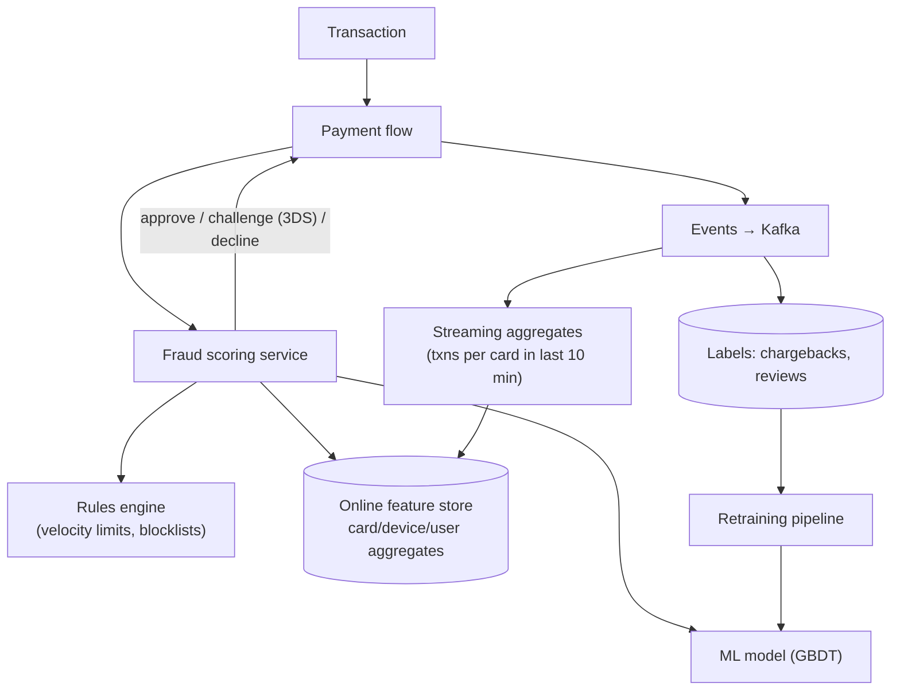

# AI/ML Systems & What's New

[⬅ Back to index](../README.md)

Covers: ML system design basics, recommendation systems, embeddings and vector search, RAG, designing a ChatGPT-like service, LLM serving and cost, LLM gateways, AI agents, evaluation and guardrails, fraud detection and content moderation, plus trending infrastructure topics (Kubernetes, edge computing, platform engineering, local-first, data mesh).

---

## ML System Design

### 1. How does an ML system design interview differ from a regular one?

Answer

Besides the usual serving architecture, you're expected to cover the **ML lifecycle**:
1. **Problem framing** – what's being predicted (click probability, fraud score), the business metric, and offline metrics (AUC, precision@k, NDCG).
2. **Data** – sources, labels (explicit/implicit), sampling, freshness, privacy.
3. **Features** – user, item, context, cross features; a feature store for online/offline consistency.
4. **Model** – start simple (logistic regression/GBDT), then deep models; trade-offs in latency and interpretability.
5. **Serving** – batch vs real-time inference, latency budget, caching, multi-stage ranking.
6. **Evaluation** – offline metrics, then **A/B tests** online.
7. **Monitoring** – data/prediction drift, feedback loops, retraining cadence.

### 2. Design a recommendation system (e.g. YouTube/Netflix home page, Amazon "you may also like").

Answer

Multi-stage funnel to rank from billions of items in ~100 ms:

Details:
- **Candidate generation** – user and item embeddings from a **two-tower model**; nearest-neighbour search in a vector index; plus heuristic sources. Cheap and broad.
- **Ranking** – a model (GBDT or deep network) scoring each candidate with features from a **feature store** (user history, item stats, context like time and device). Predicts multiple objectives (click, watch time, like) combined into one score.
- **Training data** – logged impressions and interactions; beware **feedback loops** and position bias.
- **Freshness** – real-time features from streaming (what you just watched); periodic retraining.
- **Cold start** – new users: popular/regional items, onboarding preferences; new items: content-based embeddings and exploration.
- **Evaluation** – offline (recall@k, NDCG), online A/B tests on engagement and long-term retention.

### 3. What are embeddings and vector databases?

Answer

An **embedding** is a vector (e.g. 768 floats) representing text, images, users or items so that **similar things are close** in vector space. **Vector search** finds the nearest vectors to a query vector.

Exact search over millions of vectors is too slow, so vector databases use **approximate nearest neighbour (ANN)** indexes:
- **HNSW** (graph-based) – high recall, fast, memory-heavy.
- **IVF** (cluster-based) + **product quantisation** – compresses vectors for billions-scale.

Options: pgvector (Postgres), Elasticsearch/OpenSearch kNN, Pinecone, Milvus, Weaviate, Qdrant, FAISS (library). Design concerns: metadata filtering with vector search, index rebuilds as data changes, memory cost, and **hybrid search** (BM25 + vectors) for best relevance.

---

## LLM Systems

### 4. Design a RAG (retrieval-augmented generation) system, e.g. "chat with company docs".

Answer

**Goal** – answer questions using private, up-to-date documents, with citations, without retraining the model.

**Deep dives**
- **Chunking** – by document structure (headings), with overlap; store metadata for filtering and citations.
- **Retrieval quality** – hybrid search, query rewriting, re-ranking; this matters more than model choice.
- **Permissions** – filter retrieved chunks by the user's access rights (never let the LLM see documents the user can't).
- **Freshness** – incremental re-indexing via change events.
- **Grounding** – instruct the model to answer only from context and say "I don't know"; show sources.
- **Evaluation** – a test set of questions with expected answers; measure retrieval recall and answer faithfulness (LLM-as-judge + human review).
- **Cost/latency** – cache embeddings and frequent answers; stream tokens to the UI.

### 5. Design a ChatGPT-like conversational service.

Answer

**Requirements** – users chat with an LLM, responses stream token by token, conversation history persists, millions of users, GPU capacity is scarce and expensive, abuse prevention.

**Deep dives**
- **Streaming** – SSE from the inference server through the chat service to the client; first-token latency is the key UX metric.
- **Context management** – conversation history grows; truncate or summarise older turns to fit the context window; cache the shared prefix (system prompt) – **prompt caching**.
- **Inference efficiency** – continuous batching (vLLM, TensorRT-LLM), KV cache management (paged attention), quantisation, speculative decoding; route simple requests to smaller models.
- **Capacity** – GPUs are the bottleneck: admission control, per-user/plan **token-based rate limits**, priority queues (paid users first), graceful "at capacity" responses.
- **Safety** – input and output moderation classifiers, abuse detection.
- **Storage** – conversations sharded by user ID; titles/summaries generated asynchronously.

### 6. How do you serve LLMs efficiently and control cost?

Answer

- **Pick the smallest model that meets quality**; route by task difficulty (model cascades/routers).
- **Batching** – continuous batching to keep GPUs busy.
- **Caching** – prompt prefix caching, exact-match response caching, semantic caching (similar questions) where safe.
- **Quantisation** (8-bit/4-bit) and distillation to smaller models.
- **Limit tokens** – concise prompts, max output tokens, retrieve fewer but better chunks.
- **Async/batch APIs** for non-interactive work at lower cost.
- Measure: cost per request, tokens per request, GPU utilisation, time-to-first-token, tokens/s.

### 7. What is an LLM gateway and why use one?

Answer

A central proxy between applications and model providers (hosted APIs and self-hosted models) that handles:
- unified API across providers, **routing and fallback** when a provider is down or rate-limited,
- authentication, per-team **quotas and token budgets**, cost tracking,
- caching, retries with backoff,
- logging and tracing of prompts/responses (with PII redaction), evaluation hooks,
- guardrails (prompt-injection detection, output filters).

It's the API-gateway pattern applied to LLM traffic.

### 8. How would you design an AI agent system that uses tools?

Answer

An agent loop: the LLM receives a goal and a list of **tools** (search, database query, code execution, APIs); it decides which tool to call with what arguments; the system executes the tool, returns the result, and the loop continues until the task is done.

Design concerns:
- **Orchestration** – a durable workflow engine (state persisted per step so long tasks survive restarts), step limits and timeouts.
- **Tool interface** – well-described schemas (e.g. via a standard like the Model Context Protocol), input validation.
- **Security** – least-privilege tool permissions, sandboxed execution, human approval for risky actions (payments, deletions, sending emails), defence against **prompt injection** from tool outputs.
- **Observability** – trace every step, token cost per task, evaluation of task success.
- **Cost/latency** – parallel tool calls, caching, smaller models for simple steps.

### 9. How do you evaluate and add guardrails to LLM features?

Answer

- **Offline evaluation** – curated test sets per use case; automatic metrics (exact match, faithfulness, relevance) with **LLM-as-judge** calibrated against human ratings; regression tests on every prompt/model change.
- **Online** – A/B tests, user feedback (thumbs), task completion rates.
- **Guardrails** – input filters (abuse, prompt injection, PII), output filters (toxicity, leaking secrets, schema validation for structured output), grounding checks for RAG, refusing out-of-scope requests.
- **Monitoring** – drift in inputs, cost, latency, refusal rates, flagged outputs.

### 10. Design a real-time fraud detection system.

Answer

**Requirements** – score each transaction in < 100 ms, block or challenge risky ones, minimise false positives, adapt to new fraud patterns.

Key points: rules for known patterns + ML for subtle ones; real-time aggregate features from streaming; graph features (shared devices/cards between accounts); a review queue for borderline cases; labels arrive late (chargebacks weeks later) so training must handle delay; fail-open vs fail-closed decision if scoring is down.

### 11. Design a content moderation system.

Answer

- **Layers**: hash matching against known bad content (perceptual hashes like PhotoDNA), ML classifiers per policy (nudity, violence, hate, spam), LLM-based classifiers for nuanced text, rules for spam signals, then **human review** for uncertain cases.
- **Timing**: pre-publication checks for high-risk surfaces (fast models), post-publication async checks for deeper analysis; user reports feed the queue.
- **Prioritisation**: review queues ranked by severity × reach (viral content first).
- **Feedback loop**: reviewer decisions become training labels; appeals process.
- **Scale & latency**: GPUs for image/video models, sampling frames for video, regional/legal policy differences.

---

## What's New & Trending in System Design

### 12. What role does Kubernetes play in modern system design?

Answer

Kubernetes is the standard platform for running containers: it schedules pods onto nodes, restarts failed containers, scales replicas (HPA on CPU or custom metrics), performs rolling updates, provides service discovery (Services/DNS), config and secrets, and manages stateful workloads (StatefulSets) with persistent volumes. In interviews you rarely need its internals; mention it as the runtime that gives self-healing, autoscaling and rolling deploys, and note its operational complexity (managed offerings like EKS/GKE reduce it).

### 13. What is edge computing and when would you use it?

Answer

Running code at CDN edge locations close to users (Cloudflare Workers, Lambda@Edge, Fastly Compute) and storing data at the edge (KV stores, Durable Objects, edge databases). Uses: personalisation of cached pages, A/B routing, auth checks, geolocation logic, bot protection, low-latency APIs, image resizing. Limits: constrained runtimes, data consistency (global writes are hard), debugging. Pattern: keep reads and light logic at the edge, writes in a central region.

### 14. What is platform engineering and the "internal developer platform"?

Answer

A platform team builds paved roads for product teams: self-service templates for new services, CI/CD pipelines, observability by default, infrastructure as code (Terraform), secrets, and a developer portal (Backstage). It reduces cognitive load and makes good practices (security, reliability) the default. In design interviews at scale, mentioning how teams ship and operate many services shows staff-level thinking.

### 15. What is local-first software?

Answer

Apps where the **primary copy of data lives on the device**, work fully offline, and sync between devices and collaborators in the background, usually with **CRDTs** for conflict-free merging (Automerge, Yjs) and sync engines (Linear's sync engine, Replicache/Zero, PowerSync, ElectricSQL). Benefits: instant UI, offline use, user ownership of data. Challenges: schema migrations on many devices, authorisation on synced data, storage limits. Increasingly relevant for collaborative and mobile apps.

### 16. What is data mesh?

Answer

An organisational approach to analytics data: instead of one central data team owning a monolithic warehouse, **domain teams own and publish their data as products** (with schemas, quality guarantees, documentation and SLAs) on a shared self-serve platform, under federated governance. It addresses central-team bottlenecks at large companies, at the cost of requiring mature domain teams and strong standards.

### 17. How are cloud-native databases changing system design?

Answer

- **Serverless and separated storage/compute** (Aurora Serverless, Neon, PlanetScale, DynamoDB on-demand, Snowflake) – scale compute independently, branch databases for testing, pay per use.
- **Distributed SQL** (Spanner, CockroachDB, YugabyteDB, Aurora DSQL) – relational semantics with horizontal scale and multi-region consistency, reducing the need for manual sharding.
- **Postgres as a platform** – extensions for vectors (pgvector), time-series (Timescale), queues and analytics mean one database often covers more needs.
- **Object storage as the foundation** – lakehouse tables (Iceberg) and even streaming systems storing data directly in S3 for cheaper retention.

The interview takeaway: "manual sharding" is now one option among several; justify the choice by scale, consistency and operational cost.

---

[⬅ Previous: Low-Level Design](21-low-level-design.md) · [⬅ Back to index](../README.md) · [Next: Company-Wise Questions ➡](23-company-wise-questions.md)
