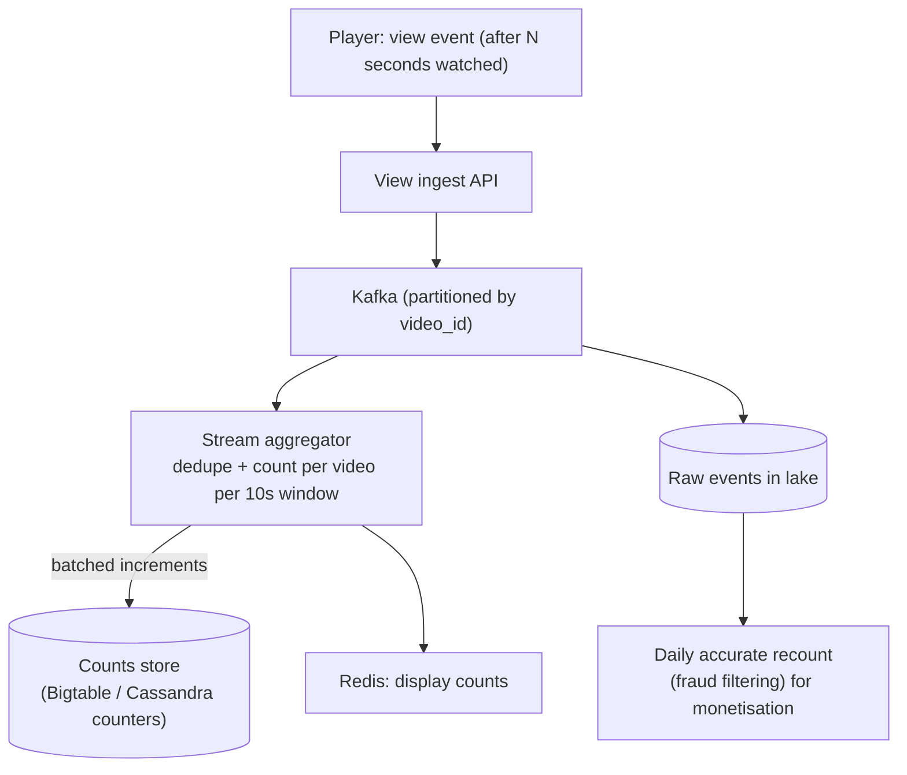
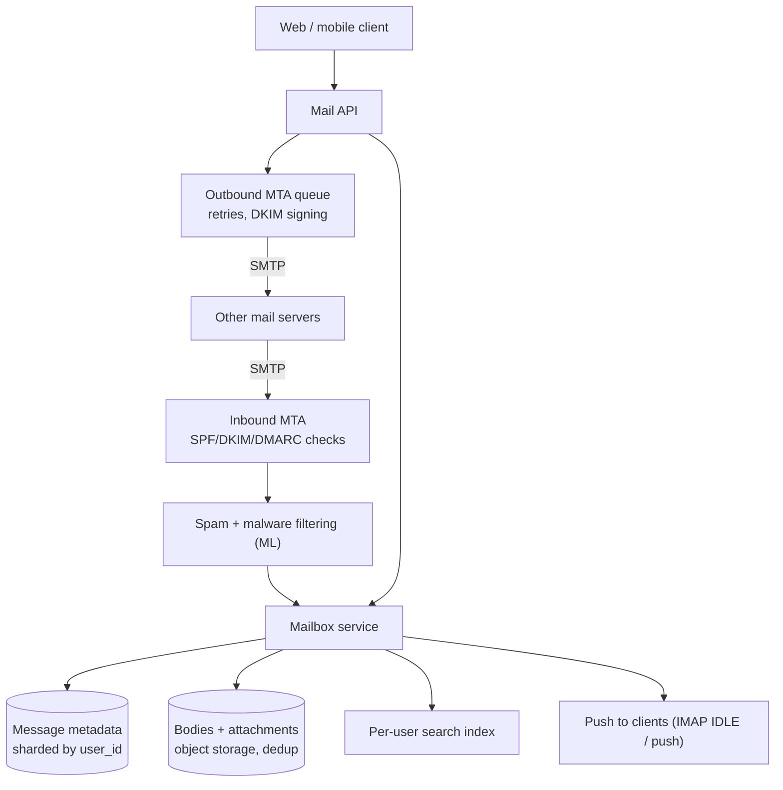
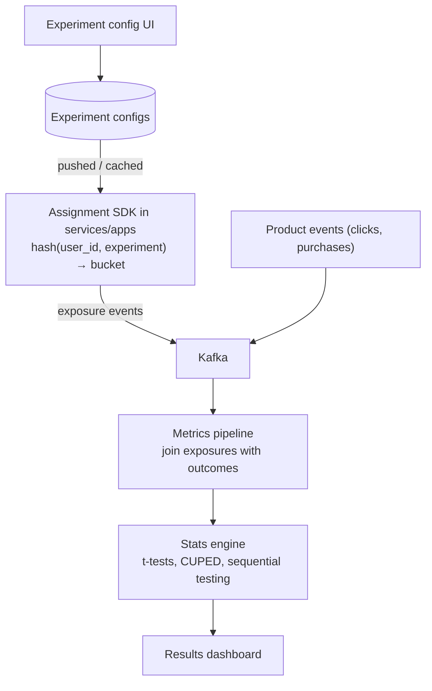
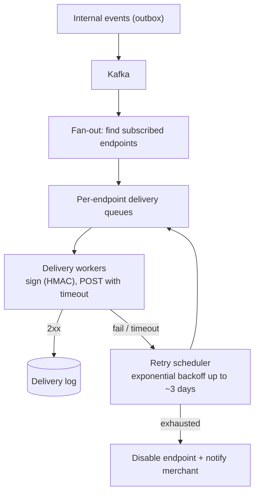

# Company-Wise Questions (Product Companies)

[⬅ Back to index](../README.md)

Covers: how system design rounds differ at Google, Meta, Amazon, Microsoft, Apple, Netflix, Uber, Airbnb, Stripe, LinkedIn and Indian product companies (Flipkart, Swiggy/Zomato, PhonePe/Paytm/Razorpay, Zerodha, Hotstar), the prompts each is commonly reported to ask, and full designs for the frequently asked prompts not covered elsewhere.

> These lists come from commonly reported interview experiences. Companies change their questions often, so use them to practise the **style** each company expects, not as a guaranteed list. Links point to the full answer in this repo.

---

## What Each Company Asks

### 1. What is Google's system design round like, and what does it commonly ask?

Answer

**Style** – open-ended and scale-heavy (billions of users, global distribution). Expect deep follow-ups on **data partitioning, consistency, and back-of-the-envelope numbers**, and questions about why your design wouldn't break. Interviewers often care about first-principles reasoning more than naming products; Google-internal ideas (Bigtable, Spanner, MapReduce, Chubby) are fair game to discuss.

**Commonly reported prompts**
- Design YouTube / YouTube view counts → [YouTube](17-designs-social-media.md), [counting at scale](15-big-data-streaming.md), [view counter](#14-design-a-youtube-view-counter--a-distributed-counter)
- Design Google Search / web crawler → [search engine](17-designs-social-media.md), [crawler](16-designs-core-infrastructure.md)
- Design search autocomplete → [typeahead](16-designs-core-infrastructure.md)
- Design Google Docs → [collaborative editing](17-designs-social-media.md)
- Design Google Drive → [Dropbox/Drive](17-designs-social-media.md)
- Design Google Maps / ETA → [Maps](18-designs-location-commerce.md)
- Design Gmail → [email service](#16-design-an-email-service-like-gmail)
- Design Google Calendar → [calendar](#15-design-google-calendar)
- Design a distributed key-value store / rate limiter / ID generator → [core infrastructure](16-designs-core-infrastructure.md)

### 2. What is Meta's system design round like?

Answer

**Style** – Meta has two variants: **System Design** (backend, distributed systems) and **Product Architecture** (APIs, data models, client–server interaction for a product feature). Both are product-focused: think about what the user sees, then the scale (billions of users, celebrity accounts, real-time). Common deep dives: **fan-out, caching, hot keys, real-time delivery, consistency of counts**.

**Commonly reported prompts**
- Design the Facebook News Feed / Instagram feed → [news feed](17-designs-social-media.md)
- Design Facebook Messenger / WhatsApp → [chat](17-designs-social-media.md)
- Design Instagram / Instagram Stories → [Instagram](17-designs-social-media.md)
- Design live comments on Facebook Live → [live streaming + comments](17-designs-social-media.md)
- Design a post search system (search posts by keyword) → [post search](#17-design-facebook-post-search)
- Design top-K / trending (hashtags, most shared articles) → [top-K](15-big-data-streaming.md)
- Design an ad click aggregator → [ad clicks](18-designs-location-commerce.md)
- Design a privacy/visibility system for posts (friends only, public) → [post search](#17-design-facebook-post-search) covers visibility filtering
- Design proximity / nearby friends → [Yelp](18-designs-location-commerce.md), [Uber](18-designs-location-commerce.md)
- Design LeetCode / an online judge → [online judge](18-designs-location-commerce.md)

### 3. What is Amazon's system design round like?

Answer

**Style** – practical and customer-focused, often mixed with **Leadership Principles** questions in the same round ("Customer Obsession", "Dive Deep", "Bias for Action"). Expect questions about **availability, operational excellence, failure handling, cost**, and AWS building blocks (DynamoDB, SQS, S3, Lambda). Be ready to explain trade-offs you made in real projects.

**Commonly reported prompts**
- Design Amazon's e-commerce checkout / shopping cart → [e-commerce](18-designs-location-commerce.md)
- Design a flash sale / Prime Day traffic → [flash sale](18-designs-location-commerce.md)
- Design a top-K best-sellers list per category → [best-sellers](#18-design-amazon-best-sellers-top-k-per-category)
- Design order tracking / notifications → [notification system](16-designs-core-infrastructure.md)
- Design Amazon Locker / package pickup → [Amazon Locker](#19-design-amazon-locker)
- Design a recommendation system ("customers also bought") → [recommendations](22-ai-ml-whats-new.md)
- Design a distributed cache / message queue / job scheduler → [core infrastructure](16-designs-core-infrastructure.md)
- LLD: parking lot, vending machine, locker → [LLD](21-low-level-design.md)

### 4. What do Microsoft and Apple typically ask?

Answer

**Microsoft** – usually a mix of HLD and LLD, team-dependent. Common: design **Microsoft Teams / Outlook / OneDrive**, a URL shortener, a rate limiter, a distributed cache, an LRU cache, a notification system, and collaborative editing (Office). → [chat](17-designs-social-media.md) (Teams), [email](#16-design-an-email-service-like-gmail) (Outlook), [Dropbox](17-designs-social-media.md) (OneDrive), [Google Docs](17-designs-social-media.md) (Office online).

**Apple** – team-specific and often more practical; strong emphasis on **privacy, on-device processing, and client–server design** for iOS teams. Common: design iMessage (with end-to-end encryption), iCloud Photos sync, Find My, App Store, a push notification service. → [chat](17-designs-social-media.md), [photo backup](#20-design-a-photo-backup-service-like-icloud-photos--google-photos), [notifications](16-designs-core-infrastructure.md), [mobile design](19-mobile-system-design.md).

### 5. What do Netflix, Uber, Airbnb and LinkedIn ask?

Answer

- **Netflix** – video streaming at scale, CDN (Open Connect), **resilience** (chaos engineering, fallbacks), **A/B testing**, recommendations, personalised artwork. → [YouTube/streaming](17-designs-social-media.md), [A/B testing platform](#21-design-an-ab-testing--experimentation-platform), [recommendations](22-ai-ml-whats-new.md), [reliability](13-reliability-observability.md).
- **Uber** – ride matching, **surge pricing**, ETA, driver location tracking, payments, trip state machines; heavy on geospatial and real-time. → [Uber](18-designs-location-commerce.md), [Maps](18-designs-location-commerce.md), [payments](18-designs-location-commerce.md).
- **Airbnb** – search with availability and pricing, **booking without double booking**, reviews, payments to hosts, messaging between guest and host. → [hotel booking](18-designs-location-commerce.md), [chat](17-designs-social-media.md).
- **LinkedIn** – feed, "**People You May Know**", connection degree (1st/2nd/3rd), job recommendations, profile views. → [news feed](17-designs-social-media.md), [PYMK](#22-design-linkedin-people-you-may-know-and-connection-degree).

### 6. What do Stripe and fintech companies ask?

Answer

**Style** – correctness first: **idempotency, exactly-once effects, ledgers, reconciliation, auditability**, API design quality and backward compatibility. Stripe rounds are often practical (an API design or integration-style problem) and value clear, well-designed APIs.

**Commonly reported prompts**
- Design a payment system / Stripe's charge API → [payments](18-designs-location-commerce.md)
- Design a **webhook delivery system** → [webhooks](#23-design-a-webhook-delivery-system-like-stripe-webhooks)
- Design a rate limiter for an API platform → [rate limiter](16-designs-core-infrastructure.md)
- Design a ledger / wallet / money transfer → [wallet](18-designs-location-commerce.md)
- Design idempotency for an API → [idempotency](09-consistency-transactions-consensus.md)

### 7. What do Indian product companies (Flipkart, Swiggy, Zomato, PhonePe, Paytm, Razorpay, Zerodha, Hotstar, CRED, Meesho) ask?

Answer

Most run an **HLD round + an LLD/machine-coding round** (working code in 60–90 minutes). Prompts often come from their own domain:

| Company | Commonly reported prompts |
|---|---|
| **Flipkart / Meesho / Myntra** | Big Billion Days flash sale, inventory without overselling, product catalog and search, cart and checkout, order tracking → [e-commerce](18-designs-location-commerce.md), [flash sale](18-designs-location-commerce.md) |
| **Swiggy / Zomato / Zepto / Blinkit** | Food or grocery delivery, delivery partner assignment, live order tracking, ETA, quick-commerce inventory per dark store → [food delivery](18-designs-location-commerce.md) |
| **PhonePe / Paytm / Google Pay / Razorpay** | UPI payments, wallet, payment gateway, reconciliation, notification/SMS systems, rate limiter → [UPI](#24-design-a-upi-payment-system-phonepe--google-pay--paytm), [payments](18-designs-location-commerce.md) |
| **Zerodha / Groww** | Stock trading platform, order matching, real-time price ticks to millions, portfolio → [stock exchange](18-designs-location-commerce.md), [price ticker](#25-design-a-real-time-stock-price-ticker-for-millions-of-users) |
| **Hotstar (JioHotstar)** | Live cricket streaming to tens of millions of concurrent viewers, traffic spikes when a wicket falls → [live streaming at massive concurrency](#26-design-live-cricket-streaming-for-25m-concurrent-viewers-hotstar) |
| **CRED / Ola / Rapido / MakeMyTrip / BookMyShow** | Rewards and credit-card bill payment, ride-hailing, flight/hotel search and booking, movie ticket booking → [Uber](18-designs-location-commerce.md), [booking](18-designs-location-commerce.md), [BookMyShow LLD](21-low-level-design.md) |

LLD rounds commonly ask: parking lot, Splitwise, BookMyShow, snake and ladder, elevator, rate limiter, cache, logger, food-ordering system → [Low-Level Design](21-low-level-design.md).

### 8. How should you adapt your answer to the company you're interviewing at?

Answer

- **Use their domain in examples** – at Uber talk about geo-sharding; at Stripe about idempotency; at Netflix about resilience and CDNs.
- **Match the scale** – Google/Meta expect billions of users; a startup or mid-size company expects pragmatic, cost-aware designs.
- **Match the style** – Meta Product Architecture: APIs and data models in detail. Amazon: tie decisions to customers and operations, and expect Leadership Principle questions. Indian product companies: be ready to write working LLD code.
- **Read their engineering blog** before the interview (Netflix Tech Blog, Uber Engineering, Meta Engineering, Stripe, Flipkart Tech, Swiggy Bytes, Hotstar). Mentioning a real system they built (thoughtfully) shows genuine interest.

### 9. What do FAANG interviewers expect at senior vs staff level in these rounds?

Answer

- **Senior (L5/E5/SDE3)** – drives the round end to end, correct core design, sensible numbers, 2–3 strong deep dives, proactively covers failures and bottlenecks.
- **Staff (L6/E6/Principal)** – all of the above plus: multiple viable architectures compared, migration and rollout plans, multi-region and disaster recovery, cost, observability, team/ownership boundaries, and spotting subtle issues (hot partitions, consistency anomalies, abuse vectors) before being asked.

At Meta and Google, the round can decide your level (down-levelling is common if depth is missing), so go deep rather than wide.

### 10. Which prompts are asked most across all product companies?

Answer

If you only have time for a few, practise these until you can do each in 45 minutes:
1. [URL shortener](16-designs-core-infrastructure.md)
2. [Rate limiter](16-designs-core-infrastructure.md)
3. [News feed / Twitter](17-designs-social-media.md)
4. [Chat / WhatsApp](17-designs-social-media.md)
5. [Uber / proximity](18-designs-location-commerce.md)
6. [YouTube / Netflix](17-designs-social-media.md)
7. [Notification system](16-designs-core-infrastructure.md)
8. [Typeahead](16-designs-core-infrastructure.md)
9. [Ticket booking / Ticketmaster](18-designs-location-commerce.md)
10. [Payment system](18-designs-location-commerce.md)
11. [Distributed key-value store / cache](16-designs-core-infrastructure.md)
12. [Dropbox / Google Drive](17-designs-social-media.md)
13. [Web crawler](16-designs-core-infrastructure.md)
14. [Top-K / ad click aggregator](18-designs-location-commerce.md)

Then the [scenario questions](20-scenario-based.md), which are the follow-ups to all of them.

### 11. How should you prepare in the last week before a product-company system design round?

Answer

- Days 1–2: re-read the [framework](01-interview-framework.md) and [estimation numbers](02-estimation.md); revise the one-liners in the README.
- Days 3–5: do one timed mock per day on that company's common prompts (above), out loud, with a drawing tool.
- Day 6: drill [scenarios](20-scenario-based.md) and the deep-dive topics your mocks exposed as weak.
- Day 7: rest; skim your notes and prepare 2–3 stories about systems you built (design decisions, failures, trade-offs), since many interviewers ask about your past work first.

### 12. How do you answer "Tell me about a system you designed" (the project deep dive)?

Answer

Common at Amazon, Meta, Uber and most senior loops. Structure:
1. **Context** – the problem, users, scale and constraints (one minute).
2. **Architecture** – draw it; explain the key components and data flow.
3. **Key decisions and trade-offs** – what alternatives you considered and why you chose this one.
4. **Hard problems** – a scaling bottleneck, an outage, a data-consistency bug, and how you solved it.
5. **Results** – metrics (latency, cost, reliability, business impact).
6. **Hindsight** – what you'd do differently now.

Be precise about **your** contribution versus the team's, and expect deep follow-ups on any component you mention.

### 13. What red flags make interviewers at product companies reject a design?

Answer

- No requirements gathering, or ignoring the stated requirements.
- Single points of failure left unaddressed; no answer to "what if this goes down?"
- Strong consistency claimed where the design can't deliver it (or vice versa: eventual consistency for money).
- No idempotency for retried writes in payments/orders.
- Unbounded fan-out or hot keys ignored at stated scale.
- Buzzword architecture with no justification, or refusing to adjust when the interviewer hints at a problem.
- Running out of time without a complete end-to-end design.

---

## Additional Frequently Asked Designs

### 14. Design a YouTube view counter / a distributed counter.

Answer

**Requirements** – count views for billions of videos; viral videos get 100K+ views/s; show approximately real-time counts; counts used for monetisation must be accurate (deduplicated, bots filtered).

**Design**

**Deep dives**
- **Never increment one DB row per view** – aggregate in the stream processor and write one increment per video per window; this turns 100K writes/s for a viral video into a handful.
- **Hot videos** – pre-aggregate on the ingest servers too, or salt the partition key for the hottest videos.
- **Dedupe** – view ID per playback session; ignore repeat views from the same user within a window; bot detection.
- **Two counts** – a fast approximate display count and an accurate audited count from batch (YouTube famously froze counts at ~300 while verifying views).
- **Reads** – counts are cached; slightly stale is fine.

### 15. Design Google Calendar.

Answer

**Requirements** – create events (one-off and recurring), invite attendees, accept/decline, reminders, view day/week/month, free/busy lookup for scheduling, time zones, sharing calendars.

**Data model**
- `events(event_id, calendar_id, organiser, title, start_utc, end_utc, timezone, rrule, …)` – recurring events stored **once with a recurrence rule** (RFC 5545 RRULE), not expanded forever.
- `event_exceptions(event_id, original_start, modified fields | cancelled)` – edits to single occurrences.
- `attendees(event_id, user_id, response_status)`.
- Per-user calendar view index: `(user_id, start_utc) → event_id` for non-recurring events, plus a list of the user's recurring series.

**Key flows**
- **Reading a week** – query the user's events in the time range + expand recurring series for that range on the fly (apply exceptions); cache rendered ranges.
- **Invites** – write the event once; fan out attendee entries; send notifications/emails asynchronously.
- **Free/busy** – merge busy intervals of all attendees for a range (interval merging); suggest slots.
- **Reminders** – a scheduler with time-bucketed due reminders (see [job scheduler](16-designs-core-infrastructure.md)); for recurring events, schedule only the next occurrence.
- **Time zones** – store UTC + the event's IANA time zone; recurring events follow the zone's local time across daylight-saving changes.
- **Sync** – CalDAV/mobile apps sync via change tokens (delta sync).

### 16. Design an email service (like Gmail).

Answer

**Requirements** – send and receive email (SMTP interoperability), store mailboxes (GBs per user, billions of users), fast search, labels/threads, spam filtering, attachments, push to clients.

**Deep dives**
- **Sharding by user** – a mailbox is only accessed by its owner, so everything (metadata, index) is partitioned by `user_id`.
- **Storage** – metadata (headers, labels, thread ID, flags) in a wide-column store; bodies and attachments in object storage; dedupe identical attachments sent to many users.
- **Search** – a per-user inverted index (small, local to the shard) rather than one global index.
- **Threads** – group by `Message-ID`/`In-Reply-To` headers and subject.
- **Outbound** – a queue with retries and backoff (remote servers may be down for days), sender reputation, rate limits.
- **Spam** – reputation, authentication results, content ML, user feedback ("report spam").

### 17. Design Facebook post search.

Answer

**Requirements** – search posts by keywords; results only include posts the searcher is **allowed to see** (privacy: public, friends, friends-of-friends, custom); ranked by relevance and recency; new posts searchable within seconds; billions of posts.

**Design**
- **Indexing** – post created → event → indexer tokenises and writes to an inverted index sharded by post ID (or by time); recent posts in a fresh in-memory tier.
- **Query** – scatter-gather across shards; each shard returns top candidates with author and visibility metadata.
- **Privacy filtering** – the hard part. Options: (a) filter candidates after retrieval by checking visibility against the searcher's social graph (cheap for public posts; graph lookups for friends-only), (b) index posts per audience segment, or (c) search the searcher's friends' posts directly by including `author_id IN (friends)` in the query for friends-only content. Usually a combination: public posts from the global index + friends' posts from an author-partitioned index.
- **Ranking** – text relevance + recency + social closeness + engagement, then ML re-ranking.
- **Deletes and privacy changes** must propagate to the index quickly (also filter at query time as a safety net).

### 18. Design Amazon best-sellers (top-K per category).

Answer

**Requirements** – show the top 100 products per category (tens of thousands of categories) by sales over a recent window (e.g. last 24 hours), updated every few minutes to hourly.

**Design**
- Order events → Kafka → a stream processor (Flink) keeps **windowed sales counts** per (category, product), partitioned by category.
- Each partition maintains a **top-K min-heap per category** and periodically emits the top 100 to a fast store (Redis sorted sets or a KV table keyed by category).
- Products belong to several categories (and parent categories): emit counts to each ancestor category.
- For huge categories, compute local top-K per partition and merge.
- Approximate alternative at extreme scale: Count-Min Sketch + heap.
- Reads are served from cache/CDN; the list is the same for everyone, so it's very cacheable.
- Guard against manipulation (fake orders, returns) by using confirmed, non-cancelled orders and a daily batch correction.

### 19. Design Amazon Locker.

Answer

**Requirements** – customers choose a locker location at checkout; the system assigns a compartment of the right size; the courier deposits the package; the customer gets a code; pickup within N days or return.

**Design**
- **Entities** – `Location(locker_id, geo, hours)`, `Compartment(id, locker_id, size, status)`, `Reservation(order_id, compartment_id, code, expires_at, status)`.
- **Checkout** – show nearby lockers with availability for the package size on the expected delivery date (geo query + capacity forecast).
- **Assignment** – reserve a compartment of the smallest fitting size when the package is near delivery (atomic conditional update `status AVAILABLE → RESERVED`); handle overbooking with fallback lockers.
- **Delivery** – courier scans the package; the locker kiosk (an edge device that must work offline) opens the assigned door and confirms deposit; the customer gets a one-time code (hashed, expiring).
- **Pickup** – code entered at the kiosk → validated (locally cached or online) → door opens → status updated; sync events when connectivity returns.
- **Expiry** – a scheduler triggers return-to-sender after N days and frees the compartment.

Often asked as LLD at Amazon: model `Locker`, `Compartment`, `Package`, a `CompartmentAssignmentStrategy`, and a `CodeGenerator`.

### 20. Design a photo backup service (like iCloud Photos / Google Photos).

Answer

**Requirements** – back up all photos/videos from phones automatically, sync across devices, browse a timeline, search ("dog on a beach"), share albums; storage of exabytes; minimal battery and data use on the phone.

**Design**
- **Client** – detects new media, uploads in the background (background URLSession/WorkManager, Wi-Fi/charging constraints), resumable chunked uploads, **content hash** to skip duplicates.
- **Server** – upload service writes originals to object storage (erasure-coded, cold tiering for old originals); metadata DB sharded by user (timestamp, location, hash, album membership).
- **Processing pipeline** – thumbnails and multiple resolutions, video transcoding, ML labels/faces/embeddings for search (on-device for privacy-focused designs like Apple's), EXIF extraction.
- **Sync** – change log per user with sync tokens; other devices pull metadata and thumbnails first, originals on demand ("optimise storage").
- **Timeline** – metadata indexed by (user_id, taken_at); thumbnails via CDN with signed URLs.
- **Sharing** – shared albums with ACLs and link tokens.
- **Privacy** – encryption at rest; optional end-to-end encryption (Apple Advanced Data Protection) which moves ML features on-device.

### 21. Design an A/B testing / experimentation platform.

Answer

**Requirements** – define experiments with variants and target audiences; assign users consistently; ramp traffic gradually; collect metrics; compute statistically sound results; run thousands of concurrent experiments.

**Design**

**Deep dives**
- **Deterministic assignment** – `hash(user_id + experiment_salt) mod 1000` → bucket; no lookup needed, consistent across sessions and services; evaluated locally in the SDK.
- **Layers / mutual exclusion** – experiments on the same surface go in one layer (users in one experiment per layer); different layers are independent.
- **Exposure logging** – log when a user actually experiences the variant, not just when assigned (avoids diluting results).
- **Metrics** – define metrics once in a semantic layer; compute daily with batch jobs, near real time for guardrail metrics (crash rate, latency) with automatic shutdown if harmed.
- **Statistics** – sample ratio mismatch checks, variance reduction (CUPED), correcting for peeking (sequential tests), multiple-comparison awareness.

### 22. Design LinkedIn "People You May Know" and connection degree.

Answer

**Connection degree (1st/2nd/3rd)** – the graph is huge (billions of edges). For a given viewer and profile:
- 1st: edge lookup in the adjacency list (sharded by member ID).
- 2nd: intersect the viewer's connections with the target's connections (both lists fetched; the smaller one checked against the other via hash set or a Bloom filter).
- 3rd: too expensive per request; precompute/cache a **second-degree network** for active users, or answer approximately.
LinkedIn built a dedicated distributed graph service with cached second-degree networks for this.

**People You May Know**
- **Candidate generation (offline, batch)** – friends-of-friends (triangle closing) weighted by number of mutual connections, same company/school/time overlap, contact imports, profile views.
- **Ranking** – an ML model predicting the probability of sending and accepting an invite.
- **Serving** – precomputed candidate lists per member stored in a KV store, re-ranked online with fresh signals, filtered (already connected, dismissed, blocked).
- **Freshness** – new connections trigger incremental updates via streaming.

### 23. Design a webhook delivery system (like Stripe webhooks).

Answer

**Requirements** – when events happen (payment succeeded), deliver HTTP POSTs to each merchant's registered endpoints; at-least-once delivery with retries for up to days; per-endpoint ordering not guaranteed but events have IDs and timestamps; signatures; slow or failing endpoints must not affect others; delivery logs and manual replay.

**Deep dives**
- **Isolation** – per-endpoint queues and concurrency limits so one slow merchant doesn't block others (bulkheads); circuit-break endpoints that keep failing.
- **Security** – HMAC signature with a per-endpoint secret over timestamp + payload; receivers verify and reject old timestamps (replay protection); egress from fixed IPs; block requests to internal/private IPs (SSRF).
- **Reliability** – events persisted before delivery (outbox); at-least-once delivery, so receivers dedupe by event ID; retries with exponential backoff and jitter.
- **Observability** – delivery attempts visible to merchants in a dashboard, manual resend, and an API to list events (so merchants can reconcile missed webhooks).

### 24. Design a UPI payment system (PhonePe / Google Pay / Paytm).

Answer

**Context** – UPI is run by NPCI: payer app (PSP) → payer's PSP bank → NPCI switch → payee's bank. The app doesn't hold money; it initiates and tracks transactions. Volumes are very high (hundreds of millions of transactions per day in India, with festival and month-start peaks).

**App-side design (PSP)**
- **Onboarding** – device binding (SIM verification via SMS), linking bank accounts, UPI PIN set through the bank (PIN is encrypted on the device with NPCI's keys; the PSP never sees it).
- **Payment flow** – create a transaction with a unique ID (idempotency) → send a collect/pay request via the PSP bank to NPCI → the bank debits and credits → status callback → update the transaction state machine (`INITIATED → PENDING → SUCCESS/FAILED/DEEMED`).
- **Unknown status** – timeouts are common; mark `PENDING`, poll the status API and rely on callbacks; never re-initiate with a new ID; reconcile with bank/NPCI settlement files daily.
- **Scale** – stateless transaction services partitioned by transaction ID; transaction DB sharded; per-bank circuit breakers and routing (banks' uptime varies); queues for notifications.
- **Risk** – velocity limits, device fingerprinting, fraud ML, transaction limits per NPCI rules.
- **UX** – show clear pending status; payee notifications (sound boxes for merchants via push).

### 25. Design a real-time stock price ticker for millions of users.

Answer

**Requirements** – stream live prices for thousands of instruments to millions of app users (Zerodha/Groww style) with < 1 s latency; each user watches ~10–50 symbols; market open causes huge connection spikes.

**Design**
- **Ingest** – exchange market-data feeds (multicast) → feed handlers normalise ticks → an internal pub/sub (Kafka or an in-memory bus) partitioned by symbol.
- **Fan-out tier** – WebSocket gateway servers; each holds ~100K+ connections and subscribes upstream only to the symbols its connected users watch; one upstream tick is fanned out locally to all interested sockets.
- **Conflation** – users don't need every tick: send the latest price per symbol every 100–500 ms (drop intermediate ticks) to save bandwidth and client CPU.
- **Binary protocol** – compact binary messages instead of JSON (Zerodha's Kite ticker is a well-known example).
- **Scale and spikes** – pre-scale gateways before market open, connection rate limiting, reconnect with jitter, sticky routing not required (state is just subscriptions).
- **Snapshots** – on (re)connect, send the latest snapshot for subscribed symbols, then deltas.

### 26. Design live cricket streaming for 25M+ concurrent viewers (Hotstar).

Answer

What's special is the **extreme, sudden concurrency** (tens of millions, with surges when a big player comes to bat or after a break) – the video path is the [live streaming design](17-designs-social-media.md) plus:
- **Multi-CDN** with traffic steering; pre-provisioned edge capacity; very high cache hit ratio for segments (everyone watches the same few seconds of video).
- **Pre-scaling** – autoscaling is too slow for spikes of millions in a minute, so infrastructure is scaled ahead of the match using traffic forecasts and load tests ("game day" simulations with tens of millions of synthetic users).
- **Protect the backend** – most API calls (home page, scorecards, ads config) are made cacheable or static; non-essential features (personalisation, recommendations) are degraded during peaks via feature flags (**panic mode**).
- **Login/entitlement surges** – cache entitlement checks, token-based playback authorisation at the edge.
- **Client behaviour** – jittered retries and reconnects so clients don't stampede the backend after a blip; adaptive bitrate to keep playback going on poor networks.
- **Ads** – server-side ad insertion keyed by audience segment, synchronised to ad breaks.
- **Observability** – real-time dashboards of concurrency, buffering ratio and errors per CDN/region with fast switching.

---

[⬅ Previous: AI/ML Systems & What's New](22-ai-ml-whats-new.md) · [⬅ Back to index](../README.md)
